# Kavach (Netrika-Trace)

## Autonomous Agentic Shadow-AI Gateway

**Project Documentation, Implementation Guide and Viva Preparation**

Prepared 29 October 2026.

> Status tags used in this document: **[Implemented]**, **[Partial]**, **[Mocked]**, **[Defined, not wired]**, **[Unverified]**. See section 1.1.
> Companion files: `IMPLEMENTATION_MAP.md`, `VERIFICATION_NOTES.md`.

---

# Table of Contents

- [Part 1: Project Overview](#part-1-project-overview)
    - [1.1 How to read this document](#11-how-to-read-this-document)
    - [1.2 Project title and abstract](#12-project-title-and-abstract)
    - [1.3 The problem, in simple words](#13-the-problem-in-simple-words)
    - [1.4 Existing approach versus the proposed solution](#14-existing-approach-versus-the-proposed-solution)
    - [1.5 Objectives and scope](#15-objectives-and-scope)
    - [1.5.1 Target users and use cases](#151-target-users-and-use-cases)
    - [1.6 Major features and their current status](#16-major-features-and-their-current-status)
    - [1.7 Technologies and their roles](#17-technologies-and-their-roles)
    - [1.8 My contribution](#18-my-contribution)
- [Part 2: System Architecture](#part-2-system-architecture)
    - [2.1 The big picture](#21-the-big-picture)
    - [2.2 Folder map](#22-folder-map)
    - [2.3 Request and response flows](#23-request-and-response-flows)
    - [2.4 End-to-end data flow](#24-end-to-end-data-flow)
    - [2.5 Authentication and authorization flow](#25-authentication-and-authorization-flow)
    - [2.6 Background processing and events](#26-background-processing-and-events)
    - [2.7 Deployment architecture and configuration](#27-deployment-architecture-and-configuration)
- [Part 3: Feature-by-Feature Implementation](#part-3-feature-by-feature-implementation)
    - [3.1 Network proxy gateway](#31-network-proxy-gateway)
    - [3.2 Chrome extension (browser interception)](#32-chrome-extension-browser-interception)
    - [3.3 The LangGraph pipeline (orchestration)](#33-the-langgraph-pipeline-orchestration)
    - [3.4 Sniffer node](#34-sniffer-node)
    - [3.5 Forensic node: detectors run in parallel](#35-forensic-node-detectors-run-in-parallel)
    - [3.6 Layered scanner inside the forensic node](#36-layered-scanner-inside-the-forensic-node)
    - [3.7 Risk calculator and decision node](#37-risk-calculator-and-decision-node)
    - [3.8 Intervention node: the breach story](#38-intervention-node-the-breach-story)
    - [3.9 The layered scanner (scanner/)](#39-the-layered-scanner-scanner)
    - [3.10 Server enforcement gate and the chat sandbox](#310-server-enforcement-gate-and-the-chat-sandbox)
    - [3.11 Incident logging and the privacy design](#311-incident-logging-and-the-privacy-design)
    - [3.12 Authentication, RBAC and device registration](#312-authentication-rbac-and-device-registration)
    - [3.13 SOC dashboard (React)](#313-soc-dashboard-react)
    - [3.14 Reports and analytics](#314-reports-and-analytics)
    - [3.15 Policy management](#315-policy-management)
    - [3.16 Alerts and background jobs](#316-alerts-and-background-jobs)
    - [3.17 Model evaluation endpoint](#317-model-evaluation-endpoint)
- [Part 4: Technical Deep Dive](#part-4-technical-deep-dive)
    - [4.1 Python and aiohttp (backend)](#41-python-and-aiohttp-backend)
    - [4.2 LangGraph (agent orchestration)](#42-langgraph-agent-orchestration)
    - [4.3 PII detection: Presidio and regular expressions](#43-pii-detection-presidio-and-regular-expressions)
    - [4.4 spaCy NER](#44-spacy-ner)
    - [4.5 Sentence-transformers (semantic scoring)](#45-sentence-transformers-semantic-scoring)
    - [4.6 Layered scanner: the statistics](#46-layered-scanner-the-statistics)
    - [4.7 Code and secret detection (regex and Pygments)](#47-code-and-secret-detection-regex-and-pygments)
    - [4.8 mitmproxy (network interception)](#48-mitmproxy-network-interception)
    - [4.9 Chrome Manifest V3 extension](#49-chrome-manifest-v3-extension)
    - [4.10 Database: SQLAlchemy, SQLite and PostgreSQL](#410-database-sqlalchemy-sqlite-and-postgresql)
    - [4.11 Redis, pub/sub and WebSockets](#411-redis-pubsub-and-websockets)
    - [4.12 Authentication and security design](#412-authentication-and-security-design)
    - [4.13 React frontend stack](#413-react-frontend-stack)
    - [4.14 Docker and configuration](#414-docker-and-configuration)
    - [4.15 Testing, logging and reliability](#415-testing-logging-and-reliability)
    - [4.16 Concepts implemented versus future improvements](#416-concepts-implemented-versus-future-improvements)
- [Part 5: Database and API Documentation](#part-5-database-and-api-documentation)
    - [5.1 Database schema](#51-database-schema)
    - [5.2 API reference](#52-api-reference)
- [Part 6: Important Workflows and Diagrams](#part-6-important-workflows-and-diagrams)
    - [6.1 Overall application workflow](#61-overall-application-workflow)
    - [6.2 Browser file upload (a major feature, step by step)](#62-browser-file-upload-a-major-feature-step-by-step)
    - [6.3 Chat message through the server gate](#63-chat-message-through-the-server-gate)
    - [6.4 Scanner reasoning on a bare token](#64-scanner-reasoning-on-a-bare-token)
    - [6.5 Database interaction when an incident is logged](#65-database-interaction-when-an-incident-is-logged)
    - [6.6 Error handling and recovery](#66-error-handling-and-recovery)
    - [6.7 Live updates to the dashboard](#67-live-updates-to-the-dashboard)
    - [6.8 Policy change reaching the extension](#68-policy-change-reaching-the-extension)
- [Part 7: Testing, Reliability, and Limitations](#part-7-testing-reliability-and-limitations)
    - [7.1 Tests that exist and what they establish](#71-tests-that-exist-and-what-they-establish)
    - [7.2 Known bugs and incomplete functionality (found by reading the code)](#72-known-bugs-and-incomplete-functionality-found-by-reading-the-code)
    - [7.3 Packaging problem: reports/ is git-ignored](#73-packaging-problem-reports-is-git-ignored)
    - [7.4 Security considerations](#74-security-considerations)
    - [7.5 Compliance claims to double-check](#75-compliance-claims-to-double-check)
    - [7.6 Failure scenarios and how they are handled](#76-failure-scenarios-and-how-they-are-handled)
    - [7.7 Limitations](#77-limitations)
    - [7.8 Realistic future improvements](#78-realistic-future-improvements)
- [Part 8: Viva and Interview Preparation](#part-8-viva-and-interview-preparation)
    - [8.1 Project overview and problem statement](#81-project-overview-and-problem-statement)
    - [8.2 Architecture and complete data flow](#82-architecture-and-complete-data-flow)
    - [8.3 The pipeline and detectors](#83-the-pipeline-and-detectors)
    - [8.4 Interceptors](#84-interceptors)
    - [8.5 The layered scanner](#85-the-layered-scanner)
    - [8.6 Programming language and framework choices](#86-programming-language-and-framework-choices)
    - [8.7 Database design and SQL](#87-database-design-and-sql)
    - [8.8 APIs and integrations](#88-apis-and-integrations)
    - [8.9 Algorithms and business logic](#89-algorithms-and-business-logic)
    - [8.10 AI and machine learning](#810-ai-and-machine-learning)
    - [8.11 Security and authentication](#811-security-and-authentication)
    - [8.12 Testing and debugging](#812-testing-and-debugging)
    - [8.13 Performance and scalability](#813-performance-and-scalability)
    - [8.14 Limitations and future scope](#814-limitations-and-future-scope)
    - [8.15 My specific contribution (answer from your own experience)](#815-my-specific-contribution-answer-from-your-own-experience)
    - [8.16 Quick rapid-fire list (one-line answers)](#816-quick-rapid-fire-list-one-line-answers)
- [Part 9: Presentation Preparation](#part-9-presentation-preparation)
    - [9.1 The 30-second introduction](#91-the-30-second-introduction)
    - [9.2 The 2-minute explanation](#92-the-2-minute-explanation)
    - [9.3 The 5-minute technical walkthrough](#93-the-5-minute-technical-walkthrough)
    - [9.4 Explaining the architecture diagram (script)](#94-explaining-the-architecture-diagram-script)
    - [9.5 Suggested live-demo sequence](#95-suggested-live-demo-sequence)
    - [9.6 Likely faculty questions during the demo](#96-likely-faculty-questions-during-the-demo)
    - [9.7 Honest explanation of limitations and future work (30 seconds)](#97-honest-explanation-of-limitations-and-future-work-30-seconds)
- [Glossary](#glossary)
- [Appendix A: Implementation references](#appendix-a-implementation-references)
- [Appendix B: Additional questions for self-practice](#appendix-b-additional-questions-for-self-practice)

---

# Part 1: Project Overview

## 1.1 How to read this document

This document explains the project in the same spirit as the Sentinel reference: first in plain language, then in technical depth, then as questions and answers you can speak in a viva.

Every section is built from the actual source code in the project folder, not from the README alone. Where the README or the older design notes disagree with the code, this document follows the code and says so (see Part 7 and `VERIFICATION_NOTES.md`).

Status tags used throughout:

| Tag | Meaning |
|---|---|
| **[Implemented]** | The code exists and its logic was traced end to end. |
| **[Partial]** | Some of the behaviour exists; the gap is stated. |
| **[Mocked]** | The code path exists but returns canned or simulated output. |
| **[Defined, not wired]** | The function exists but nothing in the application calls it. |
| **[Unverified]** | It could not be checked in this review (for example, it needs a real browser, a real AI site or a running Ollama). |

## 1.2 Project title and abstract

**Title:** Kavach (code name *Netrika-Trace*): an Autonomous Agentic Shadow-AI Gateway.

The product name shown in the web interface is now **Kavach** ("shield" in Hindi and Sanskrit). The repository, the Python code, the logs, the database file and the older documents still use the name **Netrika-Trace**. They are the same system. This document uses *Kavach* for the product and *Netrika-Trace* when it quotes file names or code.

**Abstract.** Employees increasingly paste confidential material into public AI tools such as ChatGPT, Gemini and Claude: source code, customer records, database passwords and Aadhaar numbers. Once sent, that data leaves the company's control. Kavach sits between the employee and the AI service and checks what is about to leave. It works in two places: a **network proxy** (mitmproxy) that inspects traffic to a list of AI domains, and a **Chrome extension** that inspects text, pasted content and file uploads inside the browser. Both send the text to a Python backend that runs a **five-node LangGraph pipeline**. The pipeline detects personal data (Microsoft Presidio with Indian-specific patterns), named entities (spaCy), source code and secrets (regular expressions and Pygments), and meaning-level risk (sentence-transformer similarity). On top of that, a **layered scanner** written for this project catches unlabelled random tokens, encoded or disguised secrets and fingerprints of the company's real secrets. The result is an **ALLOW, WARN or BLOCK** decision. Every decision is logged as metadata only (never the raw secret) and shown in a React security dashboard with live updates, reports and role-based access.

## 1.3 The problem, in simple words

Imagine a bank clerk who wants to fix a bug. They copy 200 lines of code, including a database password, into ChatGPT and press Enter. The password is now on a server the bank does not control. Nobody notices until much later, if ever.

Three things make this hard to stop:

1. **Firewalls are blunt.** A firewall can only block ChatGPT completely, which hurts productivity. It cannot read the *content* of a request.
2. **Old DLP tools are keyword based.** They miss a password typed as `xyzwudguwd` with no label, and they miss data hidden in a PDF or encoded in base64.
3. **Training is passive.** Annual slides do not stop someone at the exact moment they make the mistake.

Kavach's answer: look at the content at the moment of sending, decide automatically, explain the decision, and keep a privacy-safe audit trail that supports India's Digital Personal Data Protection (DPDP) Act 2023.

## 1.4 Existing approach versus the proposed solution

| Aspect | Typical existing approach | Kavach |
|---|---|---|
| Where it checks | Network edge only, by domain | Network proxy **and** browser extension (typed text, paste, drag-and-drop, file picker) |
| What it understands | Keywords and a few regular expressions | Presidio PII, Indian IDs (Aadhaar, PAN, UPI, IFSC), NER, code and secret patterns, semantic similarity, **and** a layered scanner for unlabelled tokens and encodings |
| Response | Allow or block | ALLOW, WARN, BLOCK; the scanner can also REDACT or TOKENIZE (swap a secret for a reversible placeholder) |
| Privacy of the audit log | Often stores the leaked text | Stores types, counts, a SHA-256 hash and a size; the 200-character preview field exists but the sniffer node deliberately leaves it empty |
| User learning | None | A local-LLM "breach story" (Ollama, phi3:mini) built from sanitized type names only |
| Compliance | Manual | DPDP-oriented PDF and CSV reports from the audit tables |

## 1.5 Objectives and scope

**Objectives**

1. Detect sensitive data in AI-bound requests before it leaves the organisation.
2. Decide ALLOW, WARN or BLOCK from a transparent risk score and explicit policy rules.
3. Work both at network level and in the browser.
4. Keep raw secrets out of logs, the database, the dashboard and the local LLM prompt.
5. Give security staff a multi-tenant dashboard with roles, incident review and exportable reports.
6. Give employees an in-browser experience that explains what was found and how to fix it.

**In scope:** text prompts, JSON API bodies, pasted text, `.txt`, `.csv`, `.pdf`, `.docx` uploads (and `.json`, `.zip` in the scanner file reader), images through in-browser OCR in the chat sandbox, the model's reply in the sandbox and in the proxy.

**Out of scope or not done:** blocking at the operating-system level, mobile devices, non-Chrome browsers, streamed (SSE) AI replies in the proxy, and a real LLM behind the chat sandbox (it is mocked, see 3.10).

## 1.5.1 Target users and use cases

| User | What they do with the system |
|---|---|
| **Employee** | Uses AI tools as normal; sees overlays when something is blocked, warned or redacted. |
| **SOC analyst** | Watches the live feed, filters incidents, reviews them, exports CSV or PDF. |
| **Organisation admin** | Edits policy, manages devices and users, views analytics. |
| **Super admin** | Sees every organisation. |
| **Compliance officer** | Downloads the DPDP compliance report. |

Typical use cases: stop an Aadhaar number from going into a chatbot; stop an AWS key pasted into a prompt; stop a `.env` file from being uploaded; teach the employee why with a short breach story; give auditors a record that the attempt was caught.

## 1.6 Major features and their current status

| # | Feature | Where | Status |
|---|---|---|---|
| 1 | Network proxy for AI domains | `proxy/addon.py`, `proxy/run_proxy.py` | **[Implemented]** code traced; live HTTPS interception **[Unverified]** |
| 2 | Chrome extension (fetch/XHR hook, paste guard, file uploads) | `extension/` | **[Implemented]**; behaviour on real AI sites **[Unverified]** |
| 3 | LangGraph 5-node pipeline | `agents/` | **[Implemented]** |
| 4 | PII detection with Indian patterns | `pii/presidio_analyzer.py` | **[Implemented]** |
| 5 | NER with spaCy | `pii/spacy_ner.py` | **[Implemented]**, audit only |
| 6 | Code and secrets detection | `agents/code_detector.py` | **[Implemented]**; one unit test fails (see 7.1) |
| 7 | Semantic similarity scoring | `pii/semantic_scorer.py` | **[Partial]**: computed, but its weight in the score is 0 in `config.json` |
| 8 | Risk score and decision policy | `pii/risk_calculator.py`, `agents/decision_node.py` | **[Implemented]** |
| 9 | Layered scanner (bare tokens, decoding, fingerprints) | `scanner/`, `frontend/src/scanner/` | **[Implemented]**, measured on a synthetic corpus |
| 10 | Server-side enforcement gate for chat | `backend/scanner_gate.py` | **[Implemented]** |
| 11 | Chat sandbox with document upload | `server/intervention_server.py`, `frontend/src/pages/Chat.tsx` | **[Implemented]** UI and DLP; the AI reply is **[Mocked]** |
| 12 | Breach simulation with local LLM | `agents/intervention_node.py` | **[Implemented]** with static fallback; Ollama itself **[Unverified]** |
| 13 | Audit logging (metadata only) | `agents/logger_node.py`, `database/` | **[Implemented]** |
| 14 | Authentication, RBAC, multi-tenancy | `backend/auth/`, `backend/api/auth_routes.py` | **[Implemented]** with security caveats (7.4) |
| 15 | React SOC dashboard with live feed | `frontend/` | **[Implemented]** |
| 16 | Reports: incident PDF, DPDP PDF, CSV | `reports/`, `backend/api/` | **[Partial]**: `reports/` is git-ignored (7.3) |
| 17 | Policy management and extension sync | `backend/api/policy_routes.py`, `extension/background.js` | **[Partial]**: stored and pushed, but not applied by the pipeline (3.15) |
| 18 | Email, Slack and Teams alerts | `utils/mailer.py`, `backend/services/notifier.py` | Email **[Implemented]** (needs SMTP); Slack/Teams **[Defined, not wired]** |
| 19 | Background workers (Celery) | `workers/` | **[Defined, not wired]** |
| 20 | Model evaluation endpoint | `backend/api/eval_routes.py` | **[Implemented]** (computes metrics from submitted labels) |
| 21 | Streamlit admin panel | `dashboard/app.py` | **[Implemented]** as legacy; not exercised in this review |
| 22 | Docker Compose deployment | `docker-compose.yml`, `Dockerfile` | **[Implemented]** as configuration; not run in this review |

## 1.7 Technologies and their roles

| Layer | Technology (version from the project files) | Role |
|---|---|---|
| Language | Python 3.11 (Dockerfile; local run used 3.11.9), TypeScript 5, JavaScript | Backend, frontend, extension |
| Web server | aiohttp ≥ 3.9 | Async HTTP API, static files, WebSockets |
| Orchestration | LangGraph ≥ 0.2, langchain-core ≥ 0.3 | Five-node state machine |
| PII | presidio-analyzer / anonymizer ≥ 2.2 | Detects credit cards, SSN, IBAN and custom Indian IDs |
| NLP | spaCy ≥ 3.7 (`en_core_web_sm`) | Named entity recognition |
| Embeddings | sentence-transformers ≥ 2.2, `all-MiniLM-L6-v2`, torch ≥ 2.1 | Semantic similarity |
| Code detection | Pygments ≥ 2.17 plus regex | Source code and secret detection |
| Proxy | mitmproxy ≥ 10 | Intercepts HTTPS to AI hosts |
| Local LLM | Ollama ≥ 0.3, `phi3:mini` | Breach stories |
| Database | SQLAlchemy ≥ 2.0; SQLite (default) or PostgreSQL 15 (Docker) | Audit and tenancy tables |
| Cache and events | Redis 7, redis-py ≥ 5 | Publish/subscribe of incidents |
| Background jobs | Celery ≥ 5.3 | Defined PDF and webhook tasks |
| Auth | Hand-written HS256 JWT, PBKDF2-HMAC-SHA256 | Login and tokens |
| Frontend | React 18, Vite 5, TypeScript, Tailwind 3, Framer Motion 11, Recharts 2, TanStack Query 5, Zustand 4, React Router 6 | SOC dashboard, chat sandbox, landing page |
| Browser OCR | tesseract.js 5 | Reads text from images in the browser |
| Extension | Chrome Manifest V3 | Hooks and overlays |
| Reports | ReportLab ≥ 4 | PDF reports |
| Admin UI | Streamlit ≥ 1.35, Plotly | Legacy panel |
| Tests | pytest ≥ 7.4, pytest-asyncio, vitest 2 | Python and TypeScript tests |

## 1.8 My contribution

The repository history (15 commits, all under one GitHub identity, `pmrazeen7`) does not by itself show who wrote which module, and this review has no other evidence about a team split. **Fill the table below with what you can truthfully explain**, because an examiner will probe it.

| Area | Evidence in the repository | What you should be able to explain |
|---|---|---|
| Core pipeline (LangGraph nodes, Presidio, NER, risk score) | Present from the first commits | Every step in Part 3, sections 3.3 to 3.8 |
| Enterprise upgrade (auth, RBAC, multi-tenant DB, extension, Docker) | Present in the models and routes | Sections 3.13 and 3.16 |
| Frontend redesign | Commits from 2026-10-23 and 2026-10-24 | Part 3.14 |
| Layered scanner, server gate, evaluation harness | Latest commits on the `scanner-engine` branch | Section 3.9; read `scanner/README.md` |

**Honest note for the viva:** the layered scanner, the browser scanner, the evaluation harness and the 2026 frontend redesign were produced in recent working sessions with an AI coding assistant. Be ready to explain how they work in your own words, to say which parts you reviewed and tested, and to give the exact limitations in Part 7. Examiners respect a clear, accurate account far more than a claim of full ownership.

# Part 2: System Architecture

## 2.1 The big picture

Kavach has four cooperating parts: **interceptors** (proxy and browser extension), a **backend** (aiohttp API plus the LangGraph pipeline), **storage** (SQLAlchemy database, Redis), and **user interfaces** (React dashboard, chat sandbox, legacy Streamlit panel).

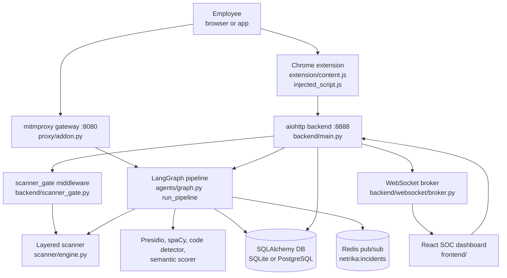

**How to read it.** The employee's request goes through one of two doors. At the browser door the extension asks the backend `POST /api/v1/analyze`. At the network door the proxy calls the same pipeline function in-process. Chat messages from the built-in sandbox additionally pass through a middleware (the *gate*) that scans on the server so nobody can skip the browser-side scanner by calling the API directly. The pipeline writes the incident, and the backend pushes a live event to the dashboard over a WebSocket.

### Component responsibilities

| Component | Responsibility | Key files |
|---|---|---|
| Browser extension | Hooks `fetch`, `XMLHttpRequest`, file inputs, drag and drop, paste; shows overlays; relays text to the backend through its service worker | `extension/injected_script.js`, `content.js`, `background.js`, `paste_guard.js` |
| Proxy gateway | Intercepts POSTs to the configured AI hostnames, extracts prompt text, runs the pipeline, redirects on BLOCK, injects a banner on WARN, masks sensitive data in the model's reply | `proxy/addon.py`, `ai_endpoints.py`, `run_proxy.py` |
| Backend API | Authentication, incidents, analytics, policy, scanner settings, analyze gateway, chat sandbox, WebSockets, static frontend | `backend/main.py`, `backend/api/*.py` |
| Pipeline | Sniff, analyse, decide, (explain), log | `agents/graph.py` and the five node files |
| Detectors | PII, NER, semantic, code and secrets | `pii/`, `agents/code_detector.py` |
| Layered scanner | Normalise, decode, validate formats, statistics for bare tokens, context, fingerprints, business rules, decision | `scanner/` |
| Persistence | Organisations, users, devices, incidents, entity detections, policies, audit log, evaluations | `database/models.py`, `crud.py`, `session.py` |
| Live events | Redis publish from the logger node; WebSocket push to dashboards and extensions | `agents/logger_node.py`, `backend/websocket/broker.py` |
| Dashboard | Overview, incidents, devices, detection settings, reports, chat sandbox | `frontend/src/` |

## 2.2 Folder map

```
netrika-trace/
  agents/        LangGraph nodes, graph, state, code detector, mock chat service
  backend/       aiohttp app (main.py), api/ routes, auth/ (JWT, RBAC), websocket/, services/, scanner_gate.py
  server/        legacy intervention server (still supplies the chat and upload handlers)
  proxy/         mitmproxy addon, AI endpoint registry, launcher
  pii/           Presidio wrapper, spaCy NER, semantic scorer, risk calculator
  scanner/       layered scanner (Python), rule pack, trained model, evaluation harness
  database/      SQLAlchemy models, CRUD, session factory   (db/ re-exports it for old imports)
  simulation/    Jinja2 page builder and breach simulator, HTML templates
  reports/       ReportLab PDF builders (git-ignored, see 7.3)
  workers/       Celery app and two tasks (not called by the app)
  utils/         SMTP mailer
  dashboard/     legacy Streamlit admin panel
  extension/     Chrome MV3 extension
  frontend/      React + Vite + TypeScript app (src/, public/, scripts/)
  tests/         pytest suites and sample payloads
  docs/          openapi.yaml, brand docs
  config.json    thresholds and weights read by the pipeline
  docker-compose.yml, Dockerfile, setup.sh, demo.sh
```

**Two servers, one product.** `backend/main.py` is the primary server (it is what `docker-compose.yml` runs as `backend`). `server/intervention_server.py` is the older server. It has its own `create_app()` and routes (including `/api/analyze/file`, `/api/analyze/file/fast` and `/incident/{id}`), but `backend/main.py` imports its chat and upload handlers and registers them itself. The routes that exist only in the legacy server are not served by `backend/main.py` (see 5.2).

## 2.3 Request and response flows

### Flow A: browser extension (typed text, paste, files)

1. `injected_script.js` runs in the page's own JavaScript world (`"world": "MAIN"` in the manifest) at `document_start`, so it can wrap `window.fetch` and `XMLHttpRequest` before the page uses them. It also watches file inputs, drag and drop and paste.
2. It asks `content.js` (isolated world) to analyse the text or file by `postMessage`. `pdf_extract.js` extracts text from PDFs with pdf.js.
3. `content.js` sends the text to `background.js` (the service worker), which calls `POST http://localhost:8888/api/v1/analyze` with the device and organisation headers.
4. The backend runs `run_pipeline`, applies a block policy for extension traffic, broadcasts a live event, and returns `{decision, risk_score, entities_found, block_reason, ...}`.
5. The extension shows a scanning overlay, then a block or warn dialog, or lets the request continue.
6. `paste_guard.js` and `kavach-scanner.js` additionally scan pasted text locally with the TypeScript engine and replace or block it before it enters the page.

### Flow B: network proxy

1. The browser or system is configured to use `127.0.0.1:8080`; mitmproxy terminates TLS with its own certificate authority (stored in the `mitmproxy-ca` Docker volume).
2. `NetrikaTraceAddon.request()` checks the host against `AIEndpointRegistry`, which loads the `ai_endpoints` list from `config.json` and falls back to built-in defaults (its docstring mentions the database, but `_load_endpoints` never reads the `ai_endpoints` table). Only POST requests with at least 10 characters of text are analysed.
3. `_extract_payload` pulls prompt text out of JSON (keys such as `content`, `text`, `prompt`, `messages`, to depth 10), form data or raw text.
4. `run_pipeline` runs in a thread executor so the event loop is not blocked.
5. **BLOCK:** the addon answers `302` with `Location: http://netrika-trace.internal/incident/<id>`. **WARN:** metadata is stored and the response handler injects a banner after `<body>` in HTML responses. **ALLOW:** the request passes through.
6. `response()` also scans the AI service's complete (non-streamed) JSON or text reply and masks flagged items.

### Flow C: chat sandbox with the server gate

1. The React chat page scans as you type in a Web Worker (TypeScript engine) and shows findings.
2. On send, `POST /api/chat` reaches the middleware `scanner_gate` first. It requires a valid sign-in, reads up to the last 6 user messages of the session, and scans the message on the server.
3. **BLOCK:** it writes an incident (hash and metadata only), broadcasts it, and answers HTTP 422 `blocked_by_policy`. The handler is never called.
4. **REDACT or TOKENIZE:** the message is rewritten and stored in `request["scan_message"]`.
5. `api_chat` runs the full pipeline, then calls `chat_with_llm` (a mock, 3.10), and scans the reply before returning it.

## 2.4 End-to-end data flow

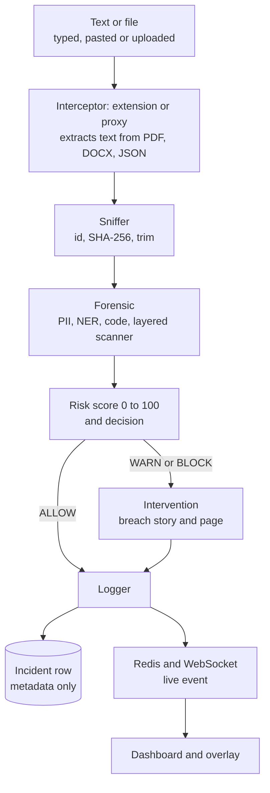

What changes along the way: the raw text exists only in memory inside the pipeline. After the forensic node it is reduced to entity *types and counts*; the logger writes a hash, a size and counts. The dashboard never receives the text.

## 2.5 Authentication and authorization flow

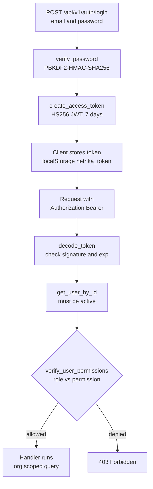

| Role | Permissions (from `ROLE_PERMISSIONS`) |
|---|---|
| SUPER_ADMIN | everything; sees all organisations |
| ORG_ADMIN | view_incidents, edit_policies, manage_users, manage_devices, view_analytics, export_reports |
| ANALYST | view_incidents, review_incidents, view_analytics, export_reports |
| EMPLOYEE | use_extension, register_device |

Multi-tenancy is by `org_id`: list and detail handlers pass the caller's `org_id` to the query unless the role is SUPER_ADMIN.

## 2.6 Background processing and events

* **Redis publish.** `logger_node._broadcast_event` publishes a small JSON event to the channel `netrika:incidents` with a 0.2 second timeout. If Redis is down it logs a warning and continues.
* **Redis subscribe.** `server/intervention_server.py` has `redis_listener`, which subscribes and forwards events to WebSocket clients. It is started by the legacy server's startup hook. `backend/main.py` does not start it, so in the primary server the live feed comes from direct calls to `broadcast_incident_event` made inside the request handlers.
* **WebSockets.** `/ws/alerts` and `/ws/live-feed` (dashboard) and `/ws/policy-sync` (extensions). Clients are kept in in-memory sets; there is no replay of missed events.
* **Celery.** `workers/celery_app.py` configures Celery with Redis as broker and result backend, and `workers/tasks.py` defines `generate_incident_pdf_task` and `dispatch_webhook_alert_task`. No code calls them, so background jobs are **[Defined, not wired]**.
* **Thread pools.** The forensic node runs PII, NER and code detection in a `ThreadPoolExecutor(max_workers=3)`; the API runs the whole pipeline with `loop.run_in_executor`.

## 2.7 Deployment architecture and configuration

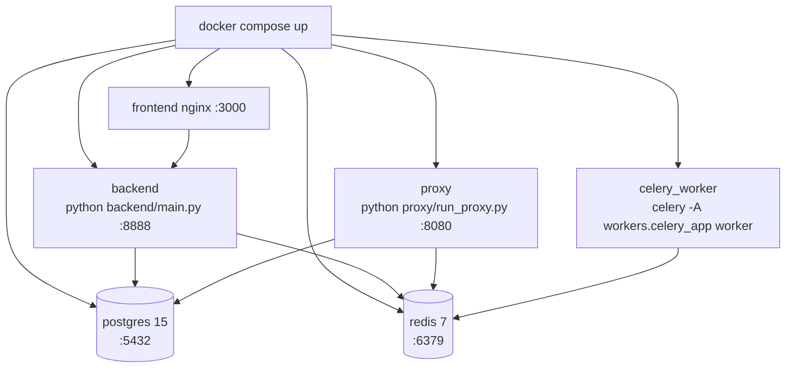

| Service | Image or build | Port | Notes |
|---|---|---|---|
| postgres | `postgres:15-alpine` | 5432 | Health-checked; volume `postgres-data` |
| redis | `redis:7-alpine` | 6379 | Health-checked |
| backend | `Dockerfile` (python:3.11-slim) | 8888 | Depends on healthy postgres and redis; reaches Ollama on the host via `host.docker.internal:11434` |
| proxy | same image | 8080 | Volume `mitmproxy-ca` keeps the generated CA |
| celery_worker | same image | none | Runs the (unused) tasks |
| frontend | `frontend/Dockerfile` (nginx) | 3000 to 80 | Serves the built React app |

Configuration inputs (names only): `DATABASE_URL`, `REDIS_URL`, `JWT_SECRET`, `OLLAMA_HOST`, `OLLAMA_MODEL`, `SBERT_MODEL`, `SPACY_MODEL`, `INTERVENTION_PORT`, `PROXY_PORT`, `PROXY_FAIL_CLOSED`, `LOG_LEVEL`, SMTP settings (`SMTP_HOST`, `SMTP_PORT`, `SMTP_USER`, `SMTP_PASS`, `SMTP_STARTTLS`, `ADMIN_EMAIL`), `SLACK_WEBHOOK_URL`, `TEAMS_WEBHOOK_URL`, `SCANNER_HMAC_KEY`, `SCANNER_KEY_PATH`. `config.json` holds thresholds, weights and the AI host list. Without `DATABASE_URL` the app uses SQLite at `data/netrika.db`.

**Important:** the sample compose file contains a database password and a JWT secret written in plain text. They are not repeated here. Treat them as development defaults and replace them before any real deployment (7.4).

# Part 3: Feature-by-Feature Implementation

Each section answers the same questions: what it does, why it exists, how a user meets it, which files implement it, the internal steps, the data and database involved, rules, error handling, an example, and the limits.

## 3.1 Network proxy gateway

**What and why.** A transparent HTTPS proxy that sees every request an organisation's machines send to AI services, even from apps that are not browsers. It exists because a browser extension cannot see desktop apps or scripts.

**User interaction.** None for the employee beyond a proxy setting; they see a redirect page on BLOCK or a banner on WARN.

**Implementation.** `proxy/run_proxy.py` starts `mitmdump` with `--listen-port` (default 8080) and loads `proxy/addon.py`. `NetrikaTraceAddon` has `request()` and `response()` hooks. `proxy/ai_endpoints.py` holds `AIEndpointRegistry`.

**Internal flow.**
1. `request()`: if the host is not in the registry, return. Mark `flow.metadata["netrika_ai_request"]`.
2. Skip non-POST requests and payloads under 10 characters.
3. `_extract_payload` decodes the body (UTF-8, replacement on errors). For JSON it calls `_extract_text_from_json`, which walks dictionaries and lists up to depth 10 and collects values under keys such as `content`, `text`, `prompt`, `query`, `input`, `message`, `system`, `user`, `assistant`.
4. `run_pipeline(...)` is awaited in an executor.
5. BLOCK builds a `302` response with `X-Netrika-Decision`, `X-Netrika-Incident` and `X-Netrika-Score` headers. WARN stores the incident id, score and entities in `flow.metadata`.
6. `response()`: `_mask_model_output` scans complete, non-streamed JSON, plain-text or Markdown replies up to 2,000,000 bytes and masks flagged items when the scanner setting `scan_output` is on. For WARN, `render_warning_banner` output is inserted after `<body ...>` in HTML responses.

**Data and database.** The pipeline writes the incident. The proxy itself stores nothing.

**Error handling.** If the pipeline raises, the request is allowed through by default (the layered scanner inside the pipeline fails closed on its own). Setting `PROXY_FAIL_CLOSED=1` makes the proxy answer `503` instead.

**Example.** A script POSTs `{"messages":[{"role":"user","content":"my aws key AKIA..."}]}` to `api.openai.com`. The addon extracts the string, the pipeline returns BLOCK, the script receives a 302.

**Limitations.** Streamed (Server-Sent Events) replies are not masked. The redirect target `netrika-trace.internal` must resolve inside the organisation (**[Unverified]**), and the page it points to (`/incident/{id}`) is served by the legacy server only. Real HTTPS interception needs the mitmproxy CA installed on clients (**[Unverified]** here).

## 3.2 Chrome extension (browser interception)

**What and why.** Catches text and files inside the browser before they leave, with instant, friendly overlays. It also sees traffic that is end-to-end inside one web page.

**User interaction.** The employee types, pastes, picks a file or drags one in. A scanning overlay appears ("Netrika is checking your upload"), then either nothing (allowed), a warning with *Proceed anyway* or *Cancel upload*, or a blocked screen.

**Implementation.**

| File | Role |
|---|---|
| `manifest.json` | MV3; three content-script groups; host permission for `http://localhost:8888/*`; service worker `background.js` |
| `injected_script.js` | Runs in the **page's JavaScript world** at `document_start`; wraps `fetch`/`XMLHttpRequest`; hooks paste, drop and file-input `change`; keeps upload "pass" caches |
| `pdf_extract.js` | Extracts text from PDFs with pdf.js (`lib/pdf.min.mjs`) |
| `content.js` | Isolated world; owns the overlays (`showScanning`, `showInterventionDialog`) and talks to `background.js` |
| `background.js` | Registers the device, fetches the policy, keeps a policy WebSocket, relays analysis requests (`ANALYZE_API`) to the backend |
| `kavach-scanner.js`, `paste_guard.js` | Local scan of pasted text using the TypeScript engine bundle (`npm run build:extension`) |
| `popup.html`, `popup.js` | Checks `/health` and shows status |

**Internal flow (file upload).**
1. `injected_script.js` sees a file chosen or dropped, and calls `showScanningUI` (a `postMessage` of type `NETRIKA_SHOW_SCANNING`).
2. `content.js` receives `NETRIKA_SCAN_BUFFER` or the file-scan request, extracts text (PDF through `pdf_extract.js`), and sends `ANALYZE_API` to the service worker.
3. `background.js` posts to `/api/v1/analyze` with `X-Device-ID`, `X-Organization-ID` and the JWT if one is stored.
4. The verdict returns as `NETRIKA_VERDICT`; `injected_script.js` then lets the original request proceed or cancels it.

**Data.** The service worker stores `device_uuid`, `org_id`, `jwt_token`, `active_policy` and an offline queue in `chrome.storage.local`.

**Error handling.** If the backend cannot be reached (`sendResponse(null)`), `content.js` handles the fallback; the file-scan path logs "No files received for scan — blocking (fail-closed)". Offline requests can be queued (`QUEUE_OFFLINE_ANALYZE`).

**Limitations.** The extension targets a configured list of AI sites in `manifest.json`. Verified only through a simulated paste on localhost; behaviour on real AI sites is **[Unverified]**. The extension fetches the policy but the content scripts do not read the threshold or keyword fields (a search for them in `content.js` and `injected_script.js` finds nothing), so policy edits do not change what the extension blocks (3.15).

## 3.3 The LangGraph pipeline (orchestration)

**What and why.** One reusable analysis path for every door (proxy, extension, chat, uploads). LangGraph is used so that the steps are explicit nodes sharing one typed state, with a conditional edge after the decision.

**Implementation.** `agents/state.py` defines `AgentState` (a `TypedDict`). `agents/graph.py::build_graph()` registers five nodes, sets `sniffer_node` as the entry point, adds edges `sniffer → forensic → decision`, then a conditional edge from `decision_node` using `should_intervene`: `intervention_node` for WARN or BLOCK, `logger_node` for ALLOW (and for "fast-path" sources), then `intervention → logger → END`. `run_pipeline(...)` builds the initial state and calls `.invoke`. The compiled graph is a lazy singleton.

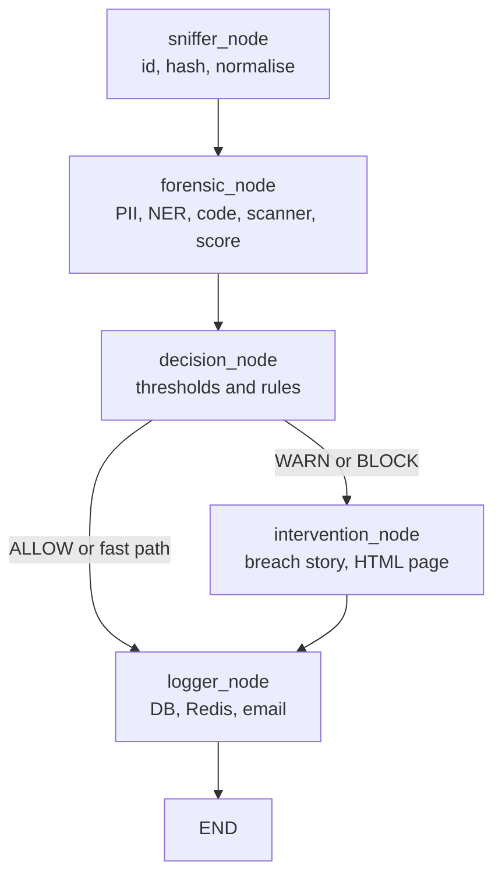

**State fields.** `payload`, `user_ip`, `target_host`, `target_url`, `http_method`, `payload_size_bytes`, `risk_score`, `pii_score`, `entity_score`, `semantic_score`, `entities_found`, `intent_label`, `decision`, `code_detected`, `secrets_detected`, `scan_history`, `scanner_action`, `scanner_summary`, `simulation_html`, `incident_id`, `payload_hash`, `payload_preview`.

**Fast path.** When `user_ip` is `chat-upload`, or starts with `extension` or `browser-extension`, the forensic node skips the semantic scorer, the decision node blocks as soon as any policy entity is present, and the router skips the intervention node. This is a latency optimisation, because the Ollama call is slow.

## 3.4 Sniffer node

`agents/sniffer_node.py`. It (1) creates a UUID incident id, (2) computes `SHA-256` of the payload (for de-duplication, not stored as text), (3) strips whitespace and truncates to 50,000 characters, (4) records the byte size, (5) sets `payload_preview` to an **empty string** on purpose (so no sensitive text is retained), and (6) resets the score and result fields. Its logger line contains sizes and addresses, never content.

## 3.5 Forensic node: detectors run in parallel

`agents/forensic_node.py` loads each detector lazily (so import-time model loading does not slow start-up) and runs three of them in a `ThreadPoolExecutor(max_workers=3)`.

### 3.5.1 PII detection (Presidio plus Indian patterns)

`pii/presidio_analyzer.py::PresidioAnalyzerWrapper`.
* Standard entities: `CREDIT_CARD`, `EMAIL_ADDRESS`, `US_SSN`, `CRYPTO`, `IBAN_CODE`, `IP_ADDRESS`.
* Custom Indian recognizers built with `PatternRecognizer`: `AADHAAR` (`[2-9]\d{3}\s?\d{4}\s?\d{4}`), `PAN` (`[A-Z]{5}[0-9]{4}[A-Z]`), `UPI_ID` (name plus a known handle such as `@upi`, `@ybl`, `@paytm`), `IFSC` (`[A-Z]{4}0[A-Z0-9]{6}`), `INDIAN_PHONE`, `INDIAN_PASSPORT`.
* A keyword layer (`SENSITIVE_KEYWORDS`) catches `password=`, `api_key=`, database URLs, private-key headers, AWS keys and `.env`-style lines, and reports them as `SENSITIVE_*` types.
* If Presidio cannot load, `_regex_analyze` runs the same patterns directly (a fallback so the system degrades instead of stopping).
* `compute_pii_score` ignores harmless labels (PERSON, DATE, ORG and so on) and adds, per detected item of a blocking type, `0.85 × 1.25` for high-confidence types (Aadhaar, PAN, UPI, IFSC, credit card, SSN, passport, private key, AWS key, database credential, secret key, password) or 0.5, 0.3 or 0.1 by confidence for others, capped at 1.0.

### 3.5.2 Named entity recognition (spaCy)

`pii/spacy_ner.py` extracts `ORG`, `PERSON`, `GPE`, `NORP`, `FAC`, `PRODUCT`, `MONEY`, `DATE` from the first 10,000 characters using `en_core_web_sm`, with a keyword fallback. Its score function **always returns 0.0** by design: names and places appear in ordinary text, so they are recorded for the dashboard's audit view (`audit_ner_entities`) but never drive a block.

### 3.5.3 Source code and secrets

`agents/code_detector.py::CodeDetector.analyze`.
* **Secrets:** compiled regular expressions for `PRIVATE_KEY`, `AWS_ACCESS_KEY` (`AKIA[0-9A-Z]{16}`), `JWT_TOKEN`, `DATABASE_URL`, `GITHUB_TOKEN`, `SLACK_TOKEN`, `GENERIC_API_KEY`, `BEARER_TOKEN`, `AZURE_CONNECTION`, and more.
* **Code:** patterns such as Python `def`/`class`/`import`, JS functions and arrows, Java classes, SQL statements, `<script>`, Dockerfile commands, YAML and shebangs. Code is "detected" when at least 2 pattern types match or 3 matches in total. If regex says no, Pygments' language guesser gets a second opinion.
* Output: `code_detected`, `secrets_detected`, a list of detections.

### 3.5.4 Semantic similarity

`pii/semantic_scorer.py` embeds the first 2,048 characters with `all-MiniLM-L6-v2` (normalised vectors) and compares them with two template sets, `DANGEROUS_TEMPLATES` and `SAFE_TEMPLATES`, using the maximum cosine similarity: `raw = dangerous / (dangerous + safe)`, then it is rescaled to 0 to 1. `classify_intent` maps the score to `PII_LEAK`, `IP_LEAK`, `SAFE` or `AMBIGUOUS` (≥ 0.7 is risky, ≤ 0.3 is safe). It returns 0.5 if the model is unavailable. In the current configuration its weight is 0 (see 3.7), so it only sets the **intent label** shown to analysts.

### 3.5.5 Entity policy and merging

After the parallel step the node keeps only entity types in `BLOCK_POLICY_TYPES` (Aadhaar, PAN, UPI, IFSC, AWS, private key, database credential, secret key and related), maps duplicates to canonical names (for example `AWS_ACCESS_KEY` to `SENSITIVE_AWS_KEY`, `JWT_TOKEN` to `SENSITIVE_SECRET_KEY`), and de-duplicates by type. NER output is kept separately for audit.

## 3.6 Layered scanner inside the forensic node

After the older detectors, `_run_scanner` calls `scanner.service.scan_text(payload, history=..., deep=False)`. The result adds entities, can set `secrets_detected`, and raises `risk_score` to at least the scanner's score. **If the scanner itself raises, the node returns BLOCK** (`scanner_unavailable`): it fails closed. The scanner is described fully in 3.9.

## 3.7 Risk calculator and decision node

**Risk score** (`pii/risk_calculator.py::RiskCalculator.calculate`):

```python
base  = pii*pii_weight + entity*entity_weight + semantic*semantic_weight
score = int(base * 100)
if code_detected:    score += code_boost      # config: 20
if secrets_detected: score += 30
if pii_score >= 0.9: score += 30
score = min(score, 100)
```

With the shipped `config.json` the weights are `pii_weight = 1.0`, `entity_weight = 0.0`, `semantic_weight = 0.0`, so the score is effectively the PII score plus boosters. The docstrings and the older design notes mention 0.5, 0.2 and 0.3; the code reads `config.json` and the file says otherwise.

**Decision** (`agents/decision_node.py`), in order:
1. **Extension or chat-upload source with any policy entity:** BLOCK, score raised to at least 85.
2. **Scanner action BLOCK:** BLOCK, score at least 85. The scanner has the last word.
3. Otherwise compare the score with thresholds from `config.json`: `score >= block_threshold` (70) is BLOCK; `>= warn_threshold` is WARN; else ALLOW. `config.json` currently has `warn_threshold = 40`; the in-code default is 30.
4. If the result is ALLOW but the scanner said WARN, TOKENIZE or REDACT, upgrade to WARN.

**Worked example (computed from the code).** Text: `My Aadhaar is 2345 6789 0123`. Presidio's Aadhaar pattern matches. Aadhaar is high-confidence, so the pii score is `min(0.85 × 1.25, 1.0) = 1.0`. Risk = `int(1.0 × 100) = 100`, plus 30 for high PII, capped at 100. For an extension source, rule 1 already blocks. For a proxy source, 100 ≥ 70 so it is BLOCK.

## 3.8 Intervention node: the breach story

**What and why.** Instead of a bare "blocked" message, it shows a short, realistic story of how an attacker could abuse *that kind* of data, to teach the employee at the moment of risk.

**Flow** (`agents/intervention_node.py`): build `entity_summary` (for example `2x AADHAAR, 1x SENSITIVE_AWS_KEY`) and a payload summary (for example "A payload containing source code, API keys or credentials"). Build a fixed prompt asking a "cybersecurity educator" for a 3-paragraph story under 200 words. Call `ollama.Client(host=OLLAMA_HOST).chat(model=OLLAMA_MODEL (default phi3:mini), temperature 0.7, num_predict 300)`. On any error use `_fallback_simulation`, a fixed text. Then render the red-screen HTML with `simulation/page_builder.py` (Jinja2 templates `blocked.html` and `warning_banner.html`) and save it as `data/incidents/<incident_id>.html`.

**Privacy rule enforced in code.** The prompt contains only type names and counts, never the payload. `enable_breach_simulation` in `config.json` can turn it off.

**Limitation.** Whether Ollama and `phi3:mini` are installed was not tested here (**[Unverified]**); without them the static fallback is used.

## 3.9 The layered scanner (`scanner/`)

**What and why.** Regular expressions only find *labelled* or *formatted* secrets. A password typed as `xyzwudguwd` has no label and no format. The scanner combines several weak signals into a decision, runs fully offline, and exists twice (Python on the server, TypeScript in the browser) so the user gets instant feedback while the server stays authoritative.

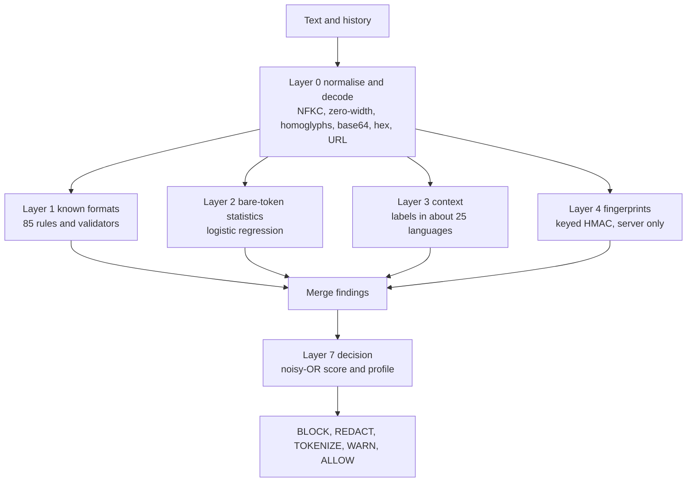

| Layer | File | What it does |
|---|---|---|
| 0 | `normalize.py` | NFKC normalisation; removes zero-width and bidi characters; folds Cyrillic and Greek look-alikes; collapses spaced-out secrets; joins wrapped lines; decodes base64, base64url, hex, URL-encoding, HTML entities and reversed text to depth 3; every decoded view is scanned and mapped back to the original span |
| 1 | `rules/formats_src.py` → `formats.json` (85 rules), `validators.py` | Provider token formats plus checksum validators: Luhn (cards), Verhoeff (Aadhaar), PAN shape, GSTIN, IFSC, IBAN mod-97, SSN and passport shape |
| 2 | `statistical.py`, `rules/model.json`, `lexicon.json` | Per token features: length, Shannon entropy, character mix, vowel and consonant runs, a trigram language model over about 52,000 words, dictionary coverage, "looks like a UUID/hash/CSS class/path/identifier/SVG path"; a small logistic regression returns a probability that the token is an opaque secret |
| 3 | `context.py` | Label words (`password`, `token`, ... in about 25 languages, leetspeak folded), `.env`, YAML, JSON, `export`, curl headers, CLI flags |
| 4 | `fingerprints.py` | Keyed HMAC-SHA256 fingerprints of the organisation's real secrets and canary tripwires; stores hashes only; server only |
| 5 | engine `_business`, `_deep` | Configured internal hostnames, codenames, custom regexes; optional Presidio and spaCy when `deep=true` |
| 7 | `decision.py` | `risk_score` by noisy-OR: `keep *= (1 - w × confidence)`, score `= 100 × (1 − keep)`; per finding action by profile (`strict`, `balanced`, `relaxed`) |

**Actions.** BLOCK, REDACT (mask), TOKENIZE (reversible placeholder, restored on the user's device), WARN, ALLOW. Known-format secrets and fingerprints cannot be "confirmed safe" by the user.

**Settings and operations.** `scanner/settings.py` stores settings, the allow-list and fingerprints in the existing `policy_config` key-value table. `scanner/service.py` is the facade (`scan_text`, `summarize`, `to_entities`, `sanitize`). `scanner/files.py` reads `.txt/.csv/.json/.docx/.pdf/.zip`.

**Measured on the project's own synthetic corpus** (`scanner/eval/REPORT.md`, balanced profile, 4,045 samples): overall recall 98.64 percent, precision 99.02 percent, false-alarm rate on hard negatives 1.00 percent (3.04 percent on real code chunks), latency p50 0.45 ms, p95 20.61 ms. Known formats, PII, evasions, labelled context, fingerprints and adversarial instructions all reached 100 percent; bare random strings 98.17 percent; human-style passwords such as `Summer2024!` only 84.15 percent. **These numbers describe a corpus written by the same authors as the detectors, so they flatter the result** (the report says so too).

**Parity.** `scanner/eval/parity.py` writes expected answers; `frontend/src/scanner/parity.test.ts` checks the TypeScript engine agrees with Python (at least 99 percent action agreement, and never a BLOCK versus non-BLOCK disagreement on known formats, evasions and context).

## 3.10 Server enforcement gate and the chat sandbox

**What and why.** A browser-side scanner can be bypassed by calling the API directly. `backend/scanner_gate.py` is an aiohttp middleware that scans on the server for every `/api/chat*` request.

**Flow.** Described in 2.3 (Flow C). Key checks: sign-in required for all `/api/chat*` paths (401 otherwise); only `POST /api/chat` is scanned; the confirmed-safe list is capped at 100 items; HTTP 422 with `blocked_by_policy` on BLOCK; the rewritten text is passed to the handler.

**Chat handlers** (`server/intervention_server.py`):
* `api_chat` runs the pipeline with the last 6 user messages as history, broadcasts a WebSocket event, replies with a fixed "BLOCKED" text on BLOCK, otherwise calls `chat_with_llm`, then scans and masks the reply.
* `api_chat_upload_scan` (multipart): extracts text (`.txt .csv .pdf .docx` through PyPDF2 and python-docx), runs the pipeline as `chat-upload`, stores the text in an in-memory pending map if not blocked, and returns the verdict before any model is called. `api_chat_upload_respond` then asks for the answer. This split makes the verdict appear fast.
* `api_chat_memory_test` runs a "digital Alzheimer's" demonstration: a fresh session cannot recall earlier data.

**Important: the AI reply is mocked.** `agents/llm_service.py::chat_with_llm` calls `_get_mock_response`, which returns canned text ("This is a mock AI response ... (Gemini API quota exceeded)"). No Gemini call is made even though `google-generativeai` is listed in `requirements.txt` and the UI says "Powered by Gemini". The DLP checking around it is real; the model behind it is not. Say this plainly in a demo.

## 3.11 Incident logging and the privacy design

**Logger node** (`agents/logger_node.py`):
1. `ensure_data_dir()` and `init_database()`.
2. Build an entity summary `{type: count}` only.
3. `create_incident(...)`: hash, size, score, decision, intent, `entities_json`, `code_detected`, `simulation_html`.
4. `create_entity_detection(...)` per policy entity and per NER entity (detector source `NER`).
5. Publish `netrika:incidents` to Redis.
6. If the policy value `enable_email_alerts` is true and the decision is BLOCK or WARN, send an email.

Every step is wrapped in `try/except`; a failure is logged and the response still returns. **What is never stored:** the payload text, entity values, and (because the sniffer empties it) the preview. This is checked by tests in `tests/test_scanner_safety.py`.

## 3.12 Authentication, RBAC and device registration

* `POST /api/v1/auth/login`: looks up the user by email, verifies with `verify_password`, rejects inactive users (403), issues a 7-day access token and a 30-day refresh token, writes an `audit_logs` row.
* `POST /api/v1/auth/refresh`: accepts a token whose `type` is `refresh` and returns a new access token.
* `POST /api/v1/auth/register-device`: stores or updates a device row for the extension (heartbeat via `last_seen`).
* `GET /api/v1/auth/me`, `GET /api/v1/auth/devices` (needs `manage_devices`).
* `backend/auth/security.py` implements PBKDF2-HMAC-SHA256 (100,000 iterations, random 16-byte salt) and a hand-written HS256 JWT with `hmac`. `backend/auth/rbac.py` provides `require_auth` and `require_permission(...)` decorators.
* `seed_enterprise_defaults()` creates a default organisation, a default SUPER_ADMIN account and a default policy at first start. The password is set in the source; change it (7.4).

## 3.13 SOC dashboard (React)

**Routes** (`frontend/src/App.tsx`): `/` landing, `/login`, `/dashboard`, `/incidents`, `/incidents/:id`, `/devices`, `/detection`, `/reports`, `/chat`, `/style-guide`; `/search` and `/compliance` redirect. Pages are lazy loaded.

**Data access.** `src/lib/api.ts` (`apiFetch`) adds the `Authorization` header from `localStorage["netrika_token"]` and turns HTTP errors into messages. TanStack Query hooks in `src/hooks/useIncidents.ts` fetch incidents, stats, compliance and endpoint stats. `useWebSocket.ts` connects to `/ws/alerts` and updates the Zustand `incidentStore` so new incidents appear without refresh.

**Key pages.** Dashboard (stat cards, charts, live feed), Incidents (search, filters, mark reviewed, CSV and PDF), Incident detail (entity detections, notes), Devices, Detection (rules, scanner settings, quality metrics), Reports (DPDP PDF, CSV), Chat (composer with live scanner, findings drawer).

**Design system.** Design tokens in `src/index.css`, Tailwind config reading CSS variables, light and dark themes, characters (Kavi, Sentinel, Vault, Lens), the Kavach logo component.

## 3.14 Reports and analytics

* `GET /api/v1/analytics/stats?window=1h|24h|7d|30d`: totals by decision, average latency, average risk, hourly traffic and top entities (`get_incident_stats`, `get_traffic_breakdown`).
* `GET /api/v1/analytics/search`, `/endpoints-stats`, `/compliance`, `/compliance/pdf`, `/export` (CSV).
* `GET /api/v1/incidents/{id}/pdf`: `reports/pdf_builder.py::IncidentPDFBuilder.build_incident_report`.
* The DPDP text (`reports/dpdp_template.py`, and the matching cards in `frontend/src/pages/Reports.tsx`) explains how the logs help with "Section 8", "Section 9" and "Section 15". **Check these titles against the official Act before you present them:** to the best of this review's knowledge, Section 9 of the DPDP Act 2023 concerns children's data and Significant Data Fiduciaries are in Section 10, so the project's section labels may be mislabelled (see 7.5).
* **Caveat:** `.gitignore` excludes `reports/`, so a fresh clone does not contain these modules and the PDF endpoints would fail (7.3).

## 3.15 Policy management

* `GET/PATCH /api/v1/policies` read and update the `enterprise_policies` row for the caller's organisation (thresholds, blocked keywords, allowed and blocked domains, allowed file types, maximum file size, feature switches). A patch is audited and pushed to connected extensions over `/ws/policy-sync` as a `POLICY_UPDATE` message.
* `GET /api/v1/policies/extension-sync?org_id=...` gives the extension a light copy.
* **Gap:** the pipeline reads thresholds and weights from `config.json`, not from this table, and the extension's interception code does not read the synced fields. So the policy screen stores and distributes settings but does not change what is blocked **[Partial]**. The scanner's own settings (profile, tokenize, scan output, hosts, codenames, custom patterns) are the part that does change behaviour, through `/api/v1/scanner/settings`.

## 3.16 Alerts and background jobs

* **Email:** `utils/mailer.py::EmailService.send_incident_alert` uses `smtplib` with optional STARTTLS and login from `SMTP_*` variables; skipped with a warning if `SMTP_HOST` is missing. Triggered from the logger node when `enable_email_alerts` is true.
* **Slack and Teams:** `backend/services/notifier.py` posts JSON to webhook URLs from environment variables. Nothing calls `send_all_alerts`, so it is **[Defined, not wired]**.
* **Celery tasks:** PDF generation and a Slack-style webhook alert; **[Defined, not wired]**.

## 3.17 Model evaluation endpoint

`POST /api/v1/eval/evaluate` validates `model_version`, `dataset_name` and equal-length 0/1 arrays (maximum 100,000), computes TP, FP, TN, FN, precision, recall and F1, stores a `model_evaluations` row and returns it. `GET /api/v1/eval/latest` lists the last 10 for the organisation. `backend/services/evaluator.py` also has a function with ROC points that nothing calls. This lets an analyst record the quality of any detector; it does not itself test the pipeline.

# Part 4: Technical Deep Dive

Each topic follows one pattern: **What it is**, **Why here**, **How it works in this project**, **Alternatives**. Items under "Could be added later" are *not* implemented.

## 4.1 Python and aiohttp (backend)

**What.** aiohttp is an asynchronous HTTP framework built on `asyncio`: one thread serves many connections by switching whenever a handler waits (network, disk).

**Why here.** The server holds long-lived WebSocket connections and many short API calls. Async handles both without a thread per client.

**How.** `backend/main.py::create_app()` builds `web.Application(middlewares=[cors_middleware, scanner_gate], client_max_size≈10 MB)` and registers routes. CPU-heavy work (the pipeline with spaCy and transformers) is pushed out of the event loop with `loop.run_in_executor(None, ...)`, otherwise one slow scan would freeze every other request. The models are loaded eagerly in the main thread at import time (a comment says this prevents thread deadlocks).

**Alternatives.** Flask (simple but synchronous, WebSockets are awkward), FastAPI (async plus automatic validation and OpenAPI; a good future upgrade), Django (heavy for this size).

**Could be added later.** Request-schema validation with Pydantic (the package is a dependency but handlers parse JSON by hand), rate limiting, structured logging.

## 4.2 LangGraph (agent orchestration)

**What.** A library for building a graph of steps that share one state object. Each *node* is a function `state -> state`; *edges* say which runs next; *conditional edges* choose by a function.

**Why here.** The DLP flow is a small state machine with one branch (intervene or not). Using a graph makes each stage independently testable and easy to explain.

**How.** `StateGraph(AgentState)`, `add_node`, `set_entry_point`, `add_edge`, `add_conditional_edges("decision_node", should_intervene, {...})`, `graph.compile()`, `invoke(initial_state)`.

**Honest view.** The nodes are ordinary deterministic Python; the "agents" do not plan or call tools. "Agentic" here means an orchestrated multi-stage pipeline. An examiner may ask whether this needs LangGraph; a plain function chain would work, and LangGraph's value is structure, typed state and room to add parallel or looping nodes.

**Alternatives.** A simple sequence of function calls; Celery chains; Prefect or Airflow (too heavy for per-request latency).

## 4.3 PII detection: Presidio and regular expressions

**What.** Presidio's `AnalyzerEngine` combines recognizers (patterns, checksums, spaCy NER) to find entities in text. A `PatternRecognizer` is a regular expression with a score.

**Why here.** Presidio already knows credit cards, SSNs, IBANs; Indian identifiers are added as custom recognizers.

**How.** See 3.5.1. A regex fallback (`_regex_analyze`) keeps detection working if Presidio cannot start (the code comments mention Python 3.14 compatibility problems).

**Limits.** The Aadhaar pattern is just 12 digits starting with 2 to 9, without a Verhoeff checksum, so random 12-digit numbers can match; the layered scanner's Layer 1 does validate with Verhoeff. Regex is brittle against obfuscation, which is why Layer 0 of the scanner exists.

**Alternatives.** Cloud DLP APIs (send data out, which defeats the purpose); trained NER models for PII (need labelled data).

## 4.4 spaCy NER

**What.** A statistical NLP library; `en_core_web_sm` is a small English model that tags people, organisations, places, money and dates.

**Why here.** To give analysts context ("which organisations were mentioned") without letting ordinary names block work.

**How.** Used only for the audit list; `compute_entity_score` returns 0.0 by design (3.5.2).

## 4.5 Sentence-transformers (semantic scoring)

**What.** `all-MiniLM-L6-v2` turns a sentence into a 384-number vector so that similar meanings are close (high cosine similarity).

**Why here.** To flag *intent* such as "here is our customer database, summarise it" even without a recognisable pattern.

**How.** Compare to curated dangerous and safe example prompts; take the maximum similarity to each side and normalise (3.5.4).

**Trade-offs.** It needs torch and a model download, is slow on CPU (the project skips it on the fast path), and its quality depends on the template lists. Its weight is currently 0.

## 4.6 Layered scanner: the statistics

**Entropy.** Shannon entropy `H = -Σ p(c) log2 p(c)` measures how unpredictable the characters of a token are; random keys have high entropy, English words low.

**Language model.** A trigram (3-letter) model trained on about 52,000 words gives the probability that letters follow each other naturally; `xyzwudguwd` scores as very unlike English.

**Logistic regression.** Combines about 26 features (length, entropy, character mix, trigram score, dictionary coverage, vowel runs, shape tests) into a probability using `p = 1 / (1 + e^-(w·x + b))`. The weights are in `rules/model.json`, trained by `train_model.py` on synthetic examples (`synth.py`). **No real leaked-credential dataset was used.**

**Noisy-OR.** `score = 1 - Π(1 - w_i c_i)`: independent evidence accumulates but never passes 100.

**HMAC fingerprints.** `HMAC-SHA256(key, secret)` identifies a known secret without storing it. Because a plain hash of a short secret can be brute-forced, the key is secret and server-only (`SCANNER_HMAC_KEY` or `data/scanner/hmac.key`). Losing the key silently disables Layer 4.

**Why two implementations.** The browser needs instant results while typing and must not send text to a server first; the server must not trust the browser. A shared rule pack plus a parity test keeps them aligned.

**Alternatives.** A trained neural classifier (needs real data and more compute); entropy-only rules (many false alarms on UUIDs, hashes and base64 image data).

## 4.7 Code and secret detection (regex and Pygments)

**Regex** finds known prefixes and structures (AWS `AKIA...`, `-----BEGIN ... PRIVATE KEY-----`, `eyJ...` JWTs). **Pygments** is a syntax-highlighting library whose lexers can guess a language; here it is a second opinion on whether text is code. Alternatives: tree-sitter parsers (more exact, heavier), ML code classifiers.

## 4.8 mitmproxy (network interception)

**What.** An interactive HTTPS proxy. It acts as a man-in-the-middle by presenting certificates signed by its own CA, which clients must trust.

**How.** A Python addon class with `request` and `response` hooks (3.1).

**Security note.** TLS interception is powerful and sensitive; it is appropriate only on managed company devices with consent and policy. Alternatives: a secure web gateway from a vendor, DNS or SNI-based filtering (cannot see content), endpoint agents.

## 4.9 Chrome Manifest V3 extension

**What.** MV3 replaced persistent background pages by short-lived service workers and restricts remote code and request blocking.

**Why a MAIN-world script.** Content scripts in the isolated world cannot wrap the page's own `fetch`. The manifest declares `injected_script.js` with `"world": "MAIN"` and `"run_at": "document_start"`, so it patches `window.fetch` and `XMLHttpRequest` before page scripts run. It communicates with the isolated content script by `window.postMessage`, and the content script calls `chrome.runtime.sendMessage` to the service worker, which can use the extension's host permission to call `localhost:8888`.

**Why not the old `webRequest` blocking API.** MV3 limits it; patching in the page is the practical alternative, with the trade-off that a determined page or user can evade or break hooks.

## 4.10 Database: SQLAlchemy, SQLite and PostgreSQL

**What.** SQLAlchemy is an ORM: Python classes map to tables; `Session` objects run queries.

**How.** `database/session.py` reads `DATABASE_URL` (default `sqlite:///data/netrika.db`). For SQLite it sets `check_same_thread=False`; for other URLs it creates a pooled engine (`pool_size=10`, `max_overflow=20`, `pool_pre_ping=True`). `init_database()` runs `Base.metadata.create_all`. There is **no migration tool** (no Alembic), so schema changes on an existing database are manual.

**Why both.** SQLite needs no server (good for a demo); PostgreSQL is concurrent and robust (the Docker setup).

**Indexes.** Declared with `index=True` on `users.email`, `devices.device_uuid`, and on `incidents.org_id`, `user_id`, `device_id`, `timestamp`; `audit_logs.org_id`, `user_id`, `timestamp`. Unique constraints: `organizations.domain`, `users.email`, `devices.device_uuid`, `policy_config.key`, `ai_endpoints.hostname`.

**Alternatives.** MongoDB (no need, the data is relational), raw SQL (more control, more code).

## 4.11 Redis, pub/sub and WebSockets

**Redis** is an in-memory data store. **Pub/sub** lets one process publish a message on a channel and others receive it live, without storing it. **A WebSocket** is a persistent two-way connection between browser and server.

**How here.** The logger node publishes to `netrika:incidents` (0.2 s timeout, failure tolerated). The legacy server subscribes and forwards to WebSockets; the primary server calls `broadcast_incident_event` directly. In both, WebSocket clients live in an in-memory `set`, so with several backend instances an event would reach only the clients connected to the instance that handled it. Redis pub/sub is how that could be shared, but `backend/main.py` does not subscribe.

**Pub/sub does not store messages**, so a client that was offline misses events; the dashboard refills from the REST API on load.

**Alternatives.** Server-Sent Events (one-way, simpler), polling (simple, higher latency), Kafka (durable log, overkill here).

## 4.12 Authentication and security design

* **Passwords:** PBKDF2-HMAC-SHA256, 100,000 iterations, 16-byte random salt, the two derived keys are compared by hashing both with SHA-256 and using `==` (not `hmac.compare_digest`). Current guidance recommends more iterations (hundreds of thousands) or a memory-hard function (argon2, bcrypt, scrypt). `passlib` and `bcrypt` are in `requirements.txt` but not used.
* **JWT:** hand-written HS256 using `hmac`; `PyJWT` is listed but unused. Claims: `sub`, `org_id`, `role`, `email`, `iat`, `exp`. `decode_token` checks signature and expiry. It does **not** check the `type` claim, so a refresh token is accepted as an access token (7.4).
* **Secret handling:** `JWT_SECRET` falls back to a hard-coded default string when the variable is missing.
* **RBAC:** role to permission map (2.5), enforced by decorators; data is scoped by `org_id`.
* **CORS:** the middleware answers `Access-Control-Allow-Origin: *` for every route.
* **Privacy:** metadata-only logging (3.11).

**Could be added later.** Short-lived access tokens, token type checks, token revocation, login rate limiting, secure cookies, WebSocket authentication, secrets from a vault.

## 4.13 React frontend stack

* **React 18 + Vite 5 + TypeScript 5:** component UI, fast dev server and build, static types.
* **Tailwind 3 with CSS variables:** one token file (`src/index.css`) for colours, radii and shadows; light and dark themes by `data-theme`.
* **TanStack Query:** caching, loading and error states for REST data. **Zustand:** a tiny store for the live incident list. **React Router:** routing with lazy loading. **Framer Motion:** animation (respecting reduced motion). **Recharts:** charts.
* **Web Worker:** the TypeScript scanner runs off the main thread (`src/scanner/worker.ts`, `client.ts`) so typing stays smooth.
* **tesseract.js:** OCR in the browser for images (assets in `public/ocr`).

## 4.14 Docker and configuration

A single `Dockerfile` (python:3.11-slim) installs CPU-only PyTorch, the requirements and the spaCy model; `docker-compose.yml` starts six services (2.7). The Dockerfile's default command starts the proxy; compose overrides it per service. Environment variables carry configuration. Alternatives: Kubernetes (scale and orchestration, more complexity), plain virtual environments.

## 4.15 Testing, logging and reliability

* Python logging with prefixes such as `[SNIFFER]`, `[FORENSIC]`, `[DECISION]`; level set by `LOG_LEVEL`.
* Graceful degradation: lazy detector loading, regex fallback for Presidio, keyword fallback for spaCy, static fallback for the breach story, Redis and email failures ignored, scanner failures treated as BLOCK.
* Tests: see Part 7.

## 4.16 Concepts implemented versus future improvements

| Implemented | Future (not implemented) |
|---|---|
| Layered, explainable detection with failure fallbacks | Real labelled leak dataset and measured accuracy on real traffic |
| JWT and RBAC | Argon2, refresh-token rotation, WebSocket auth, rate limiting |
| In-memory WebSocket fan-out | Redis-backed fan-out across instances |
| `create_all` schema creation | Alembic migrations |
| Celery tasks defined | Actually queue PDF and webhook work |
| Config-file thresholds | Per-organisation policy actually consumed by the pipeline |
| Mock chat model | Real LLM integration |

# Part 5: Database and API Documentation

## 5.1 Database schema

The schema is defined in `database/models.py` (SQLAlchemy 2 declarative models). There are ten tables. Primary keys are 36-character UUID strings except `entity_detections`, `policy_config` and `ai_endpoints` (auto-increment integers). Tables are created by `Base.metadata.create_all` (no migrations).

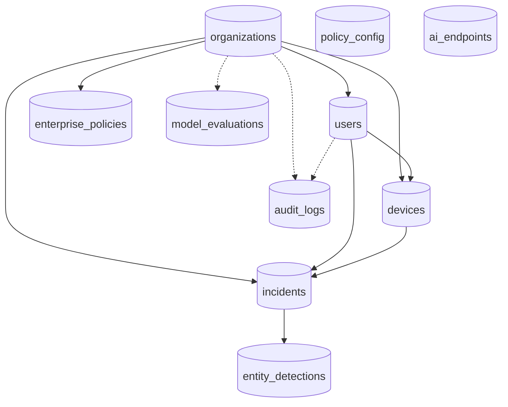

Solid arrows are foreign keys from the parent to the child table. Dotted arrows are nullable foreign keys. `policy_config` and `ai_endpoints` are standalone.

### organizations

| Column | Type | Notes |
|---|---|---|
| id | String(36) PK | UUID |
| name | String(255) | required |
| domain | String(255) | unique, required |
| license_tier | String(50) | default `ENTERPRISE` |
| created_at | DateTime(tz) | UTC |

### users

| Column | Type | Notes |
|---|---|---|
| id | String(36) PK | |
| org_id | FK `organizations.id` | required |
| email | String(255) | unique, indexed |
| password_hash | String(255) | `salt_hex$key_hex` (PBKDF2) |
| full_name | String(255) | |
| role | String(50) | `SUPER_ADMIN`, `ORG_ADMIN`, `ANALYST`, `EMPLOYEE`; default `EMPLOYEE` |
| is_active | Boolean | default true |
| created_at | DateTime(tz) | |

### devices

| Column | Type | Notes |
|---|---|---|
| id | String(36) PK | |
| device_uuid | String(100) | unique, indexed (generated by the extension) |
| user_id | FK `users.id` | required |
| org_id | FK `organizations.id` | required |
| os, browser, ext_version | String | optional |
| last_seen, created_at | DateTime(tz) | `last_seen` is the heartbeat |

### enterprise_policies

| Column | Type | Notes |
|---|---|---|
| id | String(36) PK | |
| org_id | FK `organizations.id` | |
| name | String(255) | default "Default Security Policy" |
| warn_threshold, block_threshold | Integer | defaults 30 and 67 |
| blocked_keywords_json, allowed_domains_json, blocked_domains_json, allowed_file_types_json | Text (JSON) | lists |
| max_file_size_mb | Integer | default 10 |
| enable_semantic, enable_code, enable_secrets, enable_pii, enable_local_llm, is_active | Boolean | default true |
| updated_at | DateTime(tz) | |

### incidents

| Column | Type | Notes |
|---|---|---|
| id | String(36) PK | the pipeline's `incident_id` |
| org_id, user_id, device_id | FK, nullable, indexed | tenant, user and device |
| timestamp | DateTime(tz) | indexed |
| user_ip | String(45) | also used as a **source tag**: `browser-extension`, `chat-upload`, `chat-ui` |
| target_host, target_url, http_method | String | destination |
| payload_hash | String(64) | SHA-256 hex |
| payload_preview | String(200) | always stored as `""` |
| payload_size_bytes | Integer | |
| risk_score | Integer | 0 to 100 |
| decision | String(10) | ALLOW, WARN, BLOCK |
| intent_label | String(20) | PII_LEAK, IP_LEAK, SAFE, AMBIGUOUS, SECRET_LEAK |
| entities_json | Text | JSON `{type: count}` |
| code_detected | Boolean | |
| simulation_html | Text | breach story text |
| reviewed, reviewed_by, notes | Boolean, String, Text | analyst review |
| latency_ms | Integer | default 0 |

### entity_detections

`id` (auto PK), `incident_id` (FK, required), `entity_type`, `entity_count`, `confidence_score` (nullable float), `detector_source` (`PII`, `REGEX`, `NER`, ...).

### audit_logs

`id`, `org_id`, `user_id` (nullable FKs, indexed), `action` (for example `LOGIN`, `UPDATE_POLICY`, `REVIEW_INCIDENT`), `resource`, `ip_address`, `details_json`, `timestamp` (indexed).

### model_evaluations

`id`, `org_id`, `model_version`, `dataset_name`, `precision`, `recall`, `f1_score`, `confusion_matrix_json`, `timestamp`.

### policy_config (key-value)

`id`, `key` (unique), `value` (Text), `updated_at`. Holds legacy switches such as `enable_email_alerts` and, for the scanner, settings, the allow-list and the fingerprints.

### ai_endpoints

`id`, `hostname` (unique), `display_name`, `is_active`, `added_at`. Seeded by `seed_default_endpoints()`; used by endpoint statistics. The proxy's registry reads `config.json` instead (2.3).

### Relationships (ORM)

`Organization` has many `User`, `Device`, `EnterprisePolicy`, `Incident` (cascade delete-orphan). `User` has many `Device` and `Incident`. `Device` has many `Incident`. `Incident` has many `EntityDetection` (cascade). Constraints are enforced as unique columns and foreign keys; **SQLite does not enforce foreign keys unless asked**, and nothing in `session.py` enables it.

### Significant queries and data processing (in `database/crud.py`)

| Function | What it does |
|---|---|
| `create_incident` | Inserts the incident (forces `payload_preview` to `""`) |
| `get_recent_incidents`, `search_incidents` | Filter by `org_id`, decision, minimum risk, substring over id, host, intent or IP; order by timestamp descending; limit |
| `get_incident_stats(window)` | Counts total, BLOCK, WARN, ALLOW since `now - window`; averages latency and risk |
| `get_traffic_breakdown`, `get_hourly_breakdown` | Time-bucketed counts for charts |
| `get_entity_type_breakdown` | Sums entity counts by type |
| `get_weekly_compliance_stats` | Counts used by the compliance report |
| `get_endpoint_incident_stats` | Incident counts per destination host |
| `mark_incident_reviewed` | Sets `reviewed`, `reviewed_by`, `notes` |
| `seed_enterprise_defaults`, `seed_default_endpoints` | First-run data |
| `get/set_policy_value`, `get_all_policy_config` | Key-value policy |

**Tenant-scoping gap.** The logger node does not pass `org_id`, `user_id` or `device_id` to `create_incident`, so incidents created by the pipeline have `NULL` tenant columns. List and detail queries filter `Incident.org_id == <caller's org>` for every role except SUPER_ADMIN, so ORG_ADMIN and ANALYST accounts would **not** see pipeline-created incidents; only the chat gate's blocked-message incidents carry `org_id`. This was found by reading the code and has not been reproduced in a running system (**[Unverified]**); see 7.2.

## 5.2 API reference

All paths are served by `backend/main.py` on port 8888 unless marked *legacy only*. JSON errors use `{"error": "..."}`. "Auth" says what the code enforces; "perm" is the RBAC permission.

### Public and authentication

| Method | Route | Purpose | Input | Success response | Auth |
|---|---|---|---|---|---|
| GET | `/health` | Liveness | none | `{"status":"ok"}` | none |
| POST | `/api/v1/auth/login` | Sign in | `{email, password}` | `{access_token, refresh_token, token_type, user{id,email,full_name,role,org_id,organization_name}}` | none. Errors: 400 missing fields, 401 bad credentials, 403 disabled |
| POST | `/api/v1/auth/refresh` | New access token | `{refresh_token}` | `{access_token, token_type}` | none. 401 if not a valid refresh token |
| POST | `/api/v1/auth/register-device` | Register or heartbeat a device | `{device_uuid, user_id?, org_id?, os?, browser?, ext_version?}` | `{status, device_id, device_uuid, last_seen}` | optional JWT. 400 if no `device_uuid` |
| GET | `/api/v1/auth/me` | Current user and organisation | none | `{user, organization}` | any signed-in user |
| GET | `/api/v1/auth/devices` | Devices of the organisation | none | list of devices | perm `manage_devices` |

### Analysis gateway

| Method | Route | Purpose | Input | Response | Auth |
|---|---|---|---|---|---|
| POST | `/api/v1/analyze`, `/api/analyze` | Run the pipeline on text | `{payload, user_ip?, target_host?, target_url?, http_method?, org_id?, user_id?, device_id?}` plus headers `X-Organization-ID`, `X-User-ID`, `X-Device-ID` | `{incident_id, decision, risk_score, intent_label, entities_found, code_detected, secrets_detected, block_reason, latency_ms}` | **none enforced** (the extension sends its JWT but the handler does not check it). 400 if payload under 2 characters; 500 on errors |

For `user_ip` values that start with `browser-extension` or `extension`, or equal `chat-upload`, `_apply_block_policy` runs after the pipeline: if any entity of a blocking type remains the decision is BLOCK and the score is at least 85; otherwise the decision is forced to ALLOW (so ordinary NER or intent noise cannot block extension traffic).

### Incidents

| Method | Route | Purpose | Auth |
|---|---|---|---|
| GET | `/api/v1/incidents?limit=1..100&q=&decision=` | List or search | `view_incidents`; 400 on bad `limit` or `decision` |
| GET | `/api/v1/incidents/{incident_id}` | Detail with `entity_detections` and simulation text | `view_incidents`; 404 if absent or other tenant |
| PATCH | `/api/v1/incidents/{incident_id}` | Mark reviewed; body `{notes}` (max 4000 chars) | `review_incidents`; writes an audit row |
| GET | `/api/v1/incidents/{incident_id}/pdf` | Download PDF | `view_incidents`; needs `reports/pdf_builder.py` |

### Analytics and reports

| Method | Route | Purpose | Auth |
|---|---|---|---|
| GET | `/api/v1/analytics/stats?window=1h\|24h\|7d\|30d` | `{stats, hourly, entity_breakdown, window}` | `view_analytics`; 400 on bad window |
| GET | `/api/v1/analytics/endpoints-stats` | Counts by destination | `view_analytics` |
| GET | `/api/v1/analytics/search?q&decision&risk_min&limit` | Search rows | `view_analytics` |
| GET | `/api/v1/analytics/compliance` | Compliance counters | `view_analytics` |
| GET | `/api/v1/analytics/compliance/pdf` | DPDP PDF | `export_reports` |
| GET | `/api/v1/analytics/export` | CSV (`Incident ID, Timestamp, User IP, Target Host, Risk Score, Decision, Intent, Code Detected`) | `export_reports` |

### Policy and evaluation

| Method | Route | Purpose | Auth |
|---|---|---|---|
| GET | `/api/v1/policies` | Active policy (auto-creates one) | **none enforced**; unauthenticated callers get the `default-org` policy |
| PATCH | `/api/v1/policies` | Update fields; audited; pushed to extensions by WebSocket | `edit_policies` |
| GET | `/api/v1/policies/extension-sync?org_id=` | Light policy for the extension | none |
| POST | `/api/v1/eval/evaluate` | Compute and store precision, recall, F1 from `y_true`/`y_pred` | `view_analytics`; 400 on invalid arrays |
| GET | `/api/v1/eval/latest` | Last 10 evaluations | `view_analytics` |

### Layered scanner

| Method | Route | Purpose | Auth |
|---|---|---|---|
| POST | `/api/v1/scanner/scan` | `{text, history?, policy?, confirmed?, deep?}` returns masked findings, score and action | signed in; 400 for non-string or too long text |
| GET / PATCH | `/api/v1/scanner/settings` | Read or change profile, tokenize, scan_output, hosts, codenames, custom patterns | GET signed in; PATCH `edit_policies`; 400 on an invalid regex |
| POST | `/api/v1/scanner/allow` | Allow-list one token by 32-character fingerprint | signed in |
| DELETE | `/api/v1/scanner/allow/{fp}` | Remove an allow-list entry | `edit_policies` |
| POST | `/api/v1/scanner/fingerprints/ingest` | Fingerprint secrets from `.env` or JSON files inside the project root only | `edit_policies` |
| POST | `/api/v1/scanner/canaries` | Plant a tripwire; the generated value is returned once | `edit_policies` |

### Chat sandbox (all require sign-in through the gate; 401 otherwise)

| Method | Route | Purpose |
|---|---|---|
| POST | `/api/chat` | `{message, session_id?, confirmed_safe?}`; response `{session_id, message, response, dlp{...}}`; HTTP 422 `blocked_by_policy` with `scan` details on BLOCK |
| POST | `/api/chat/upload/scan` | Multipart `file`, `session_id`; extracts text, runs DLP, returns `{filename, extracted_text_preview, dlp, blocked}` |
| POST | `/api/chat/upload/respond` | `{session_id}`; returns the model reply for the previously scanned file (400 if none pending) |
| POST | `/api/chat/upload` | One-call upload plus reply |
| POST | `/api/chat/memory-test` | Demonstrates that a new session has no memory |
| GET | `/api/chat/sessions` | Lists in-memory sessions |

### Legacy aliases and WebSockets

`/api/stats`, `/api/compliance`, `/api/compliance/pdf`, `/api/incidents` (+ `{id}`, PATCH, `/pdf`), `/api/policy` (GET, PATCH) map to the same handlers. WebSockets: `/ws/alerts`, `/ws/live-feed` (dashboard events, JSON text frames) and `/ws/policy-sync` (`{"type":"POLICY_UPDATE","org_id":...,"policy":{...}}`). **None of the WebSocket endpoints check a token.** Single-page-app routes (`/`, `/dashboard`, `/login`, ... and a catch-all) return the built `frontend/dist/index.html` when it exists.

**Legacy only (not registered by `backend/main.py`):** `/api/analyze/file`, `/api/analyze/file/fast`, `/incident/{id}` (the red page the proxy redirects to), `/api/endpoints` (list, add, toggle, delete, stats). The older design notes mention the file endpoints; the current extension uses only `/api/v1/analyze`. `docs/openapi.yaml` exists but was not compared line by line with the code.

# Part 6: Important Workflows and Diagrams

The diagrams use the real file, class and function names. Each is followed by a plain-English explanation. (Parts 2 and 3 already contain the architecture, authentication, pipeline, scanner-layer and deployment diagrams.)

## 6.1 Overall application workflow

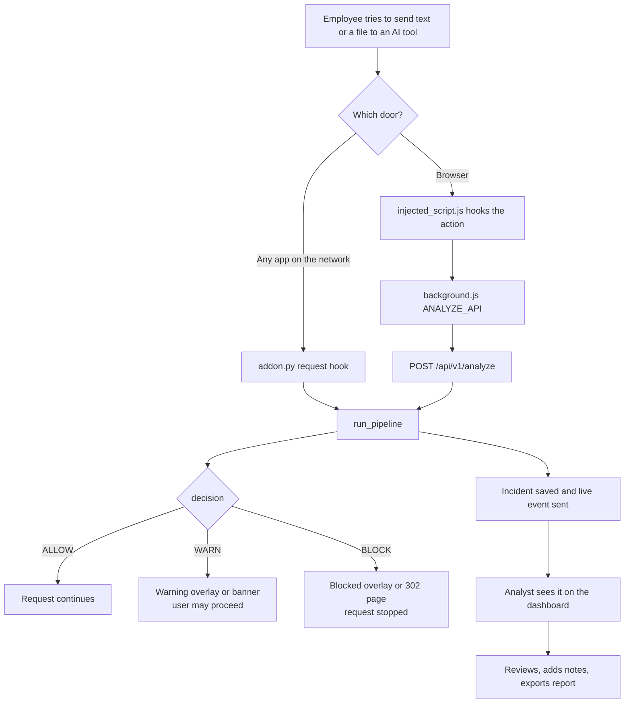

**In words.** Two doors lead to one pipeline. The pipeline decides, the interceptor enforces the decision, and the logger records it, so the analyst's dashboard reflects what employees experienced.

## 6.2 Browser file upload (a major feature, step by step)

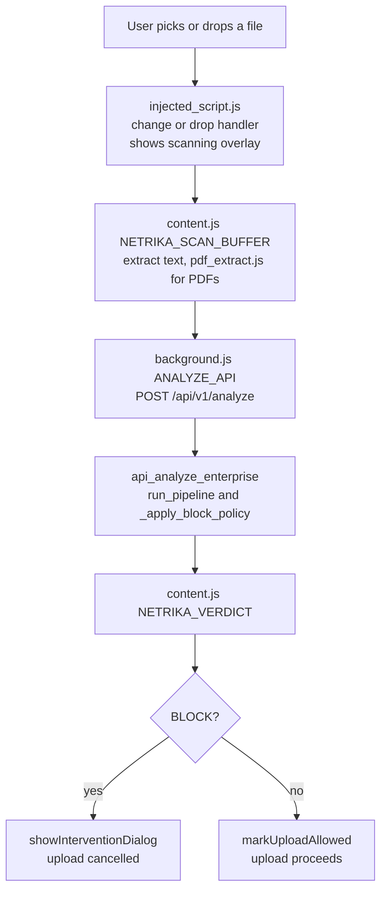

**In words.** The page script catches the file before the browser sends it, a scanning overlay appears, the text is extracted (PDF text needs pdf.js), the backend decides, and the page script either cancels the upload or marks it allowed for a short window (about 30 seconds) so the real network call is not scanned twice. If the backend is unreachable the handler's fallback applies (the file-scan path blocks, "fail-closed").

## 6.3 Chat message through the server gate

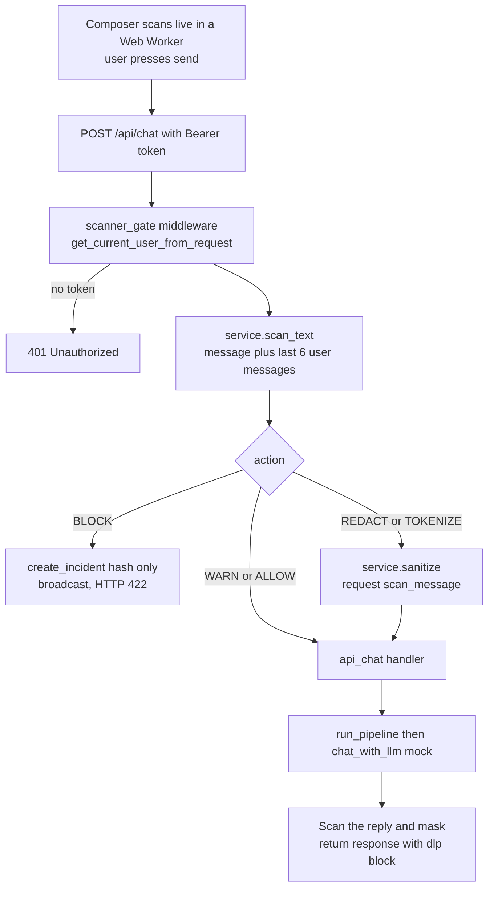

**In words.** The middleware sits in front of the handler, so no client can reach the model without being scanned. The reply is scanned too, in case the model echoes or invents data that must not leave.

## 6.4 Scanner reasoning on a bare token

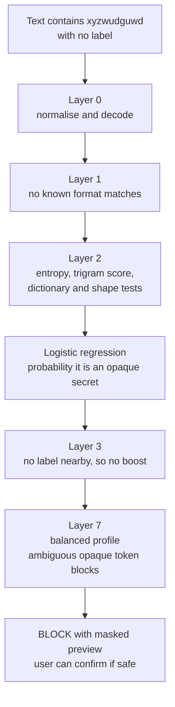

**In words.** There is no keyword and no format, so the decision rests on statistics: the token looks nothing like words, names or identifiers. The default profile prefers to interrupt and ask. In the project's synthetic evaluation this kind of case was caught 98.17 percent of the time; a person's own memorable password is caught far less often (84.15 percent).

## 6.5 Database interaction when an incident is logged

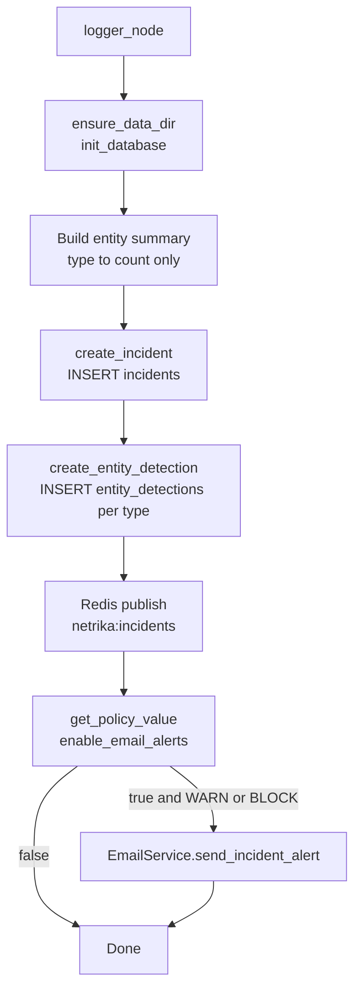

**In words.** Two inserts record the event; each step is individually guarded, so a Redis or email failure never loses the database record, and a database failure never stops the user's decision from being returned.

## 6.6 Error handling and recovery

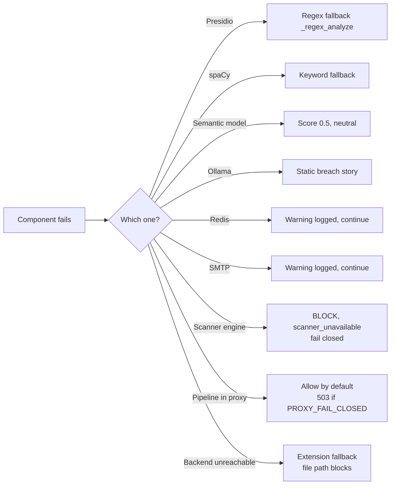

**In words.** The design principle is "degrade, do not crash" for optional features and "fail closed" for the safety-critical scanner. The proxy is the exception: by default it lets traffic through if the whole pipeline crashes, which is a deliberate availability choice that the `PROXY_FAIL_CLOSED` switch can reverse.

## 6.7 Live updates to the dashboard

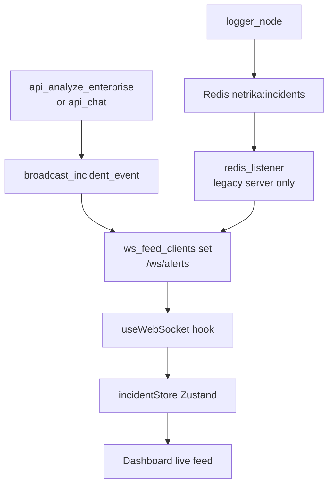

**In words.** The primary server pushes the event itself. The Redis route exists for the legacy server and for sharing events between processes, but the primary server does not subscribe to it.

## 6.8 Policy change reaching the extension

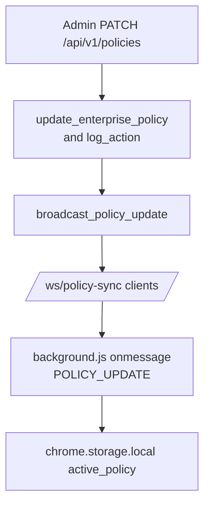

**In words.** The update is stored, audited and pushed. The extension keeps it in local storage; as noted in 3.15, the interception scripts do not currently read it.

# Part 7: Testing, Reliability, and Limitations

## 7.1 Tests that exist and what they establish

| File | Tests | What it covers | What it establishes (and does not) |
|---|---|---|---|
| `tests/test_code_detector.py` | 16 | Secrets (AWS key, private key, JWT, database URL, env variables), code patterns, safe text, a sample payload file | Regexes behave on short examples. Does not prove real-world recall |
| `tests/test_forensic.py` | 15 | Aadhaar with and without spaces, invalid Aadhaar prefixes, PAN, UPI, IFSC, safe text, empty text, no raw values in results | The Presidio wrapper's patterns and the no-values rule |
| `tests/test_risk_calculator.py` | 11 | Weighted calculation, boosters, cap at 100, thresholds, explanation | The score formula, using the shipped `config.json` |
| `tests/test_enterprise_api.py` | 11 | Login, device registration, unauthorised access, health, extension block policy, upload routes, analyze endpoint, evaluation input validation | The HTTP layer with an in-process test client |
| `tests/test_scanner_engine.py` | 26 | Validators, bare tokens, evasions, homoglyphs, cross-message, fingerprints, profiles, tokenize and redact, file reading, backtracking and latency | The scanner's behaviour on designed cases |
| `tests/test_scanner_gate.py` | 9 | Sign-in required, a secret never reaches the model through the raw API, bare token blocked, confirm once, masked results, settings, ingest confined to the project root, rewrite before the model | Server enforcement |
| `tests/test_scanner_safety.py` | 6 | Fail-closed pipeline, nothing secret logged, state has no values, proxy masks replies, output scanning switch | Privacy and safety rules |
| `tests/test_scanner_eval.py` | 2 | Evaluation thresholds hold; corpus deterministic | Recall, false-alarm and latency gate on a synthetic corpus |
| `frontend/src/scanner/parity.test.ts`, `perf.test.ts` | 9 | TypeScript and Python engines agree; speed | Cross-language parity |

### Verified results from this review (2026-10-29)

* **Python:** `pytest tests` with a temporary database and scanner key (no project data touched). The two files `test_enterprise_api.py` and `test_scanner_gate.py` could not even be imported on this machine, because Windows Application Control blocked a compiled SQLAlchemy DLL (`_util_cy`). That is an environment restriction, not a code failure, and it was not bypassed. For the other six files: **92 tests ran, 90 passed, 2 failed.**
  * `test_code_detector.py::test_detects_env_variables` fails: the test expects the type name `ENV_VARIABLE` from `detect_secrets` and gets nothing. A known, pre-existing failure.
  * `test_scanner_eval.py::test_eval_thresholds_hold` failed on p95 latency (89.7 ms against a 50 ms limit) while the machine was busy. The project's own report records p95 of about 20.6 ms; treat this as a timing-sensitive test that can fail on a loaded machine (**not investigated further**).
* **The 20 tests in the two blocked files** passed in earlier development sessions on this project, but they were **not re-run in this review**, so no pass is claimed for them here.
* **Frontend:** `vitest run` 9 of 9 passed; `tsc --noEmit` clean; `eslint src` clean; `vite build` succeeded.

### Important untested areas

* Real HTTPS interception through mitmproxy and certificate trust.
* The extension on real AI websites (only a simulated paste on localhost was tried), and its behaviour when sites change their requests.
* Ollama and `phi3:mini` generation.
* Docker Compose start-up, PostgreSQL behaviour, Redis pub/sub in a deployed setting, Celery.
* Email delivery (needs SMTP).
* PDF report generation in a clean clone (see 7.3).
* Concurrency, load and long-running behaviour.
* Detection accuracy on real company data; the numbers in 3.9 come from a synthetic corpus.

## 7.2 Known bugs and incomplete functionality (found by reading the code)

| # | Finding | Where | Effect |
|---|---|---|---|
| 1 | Pipeline-created incidents have no `org_id` | `agents/logger_node.py` calls `create_incident` without `org_id`, `user_id`, `device_id` | Non-super-admin users filtered by `org_id` would not see them (**[Unverified]** at runtime) |
| 2 | The gate looks up `user.get("sub")` or `user.get("user_id")`, but the authenticated dict uses the key `id` | `backend/scanner_gate.py::_record_block` | Blocked-chat incidents are stored without `user_id` |
| 3 | `payload_preview` is overwritten with `""` in `create_incident` | `database/crud.py` | Consistent with the privacy design, but the column and the README's "200-character preview" claim are misleading |
| 4 | `latency_ms` is never set by the logger node | `agents/logger_node.py` | Stored latency is 0 for pipeline incidents; analytics averages are therefore not meaningful |
| 5 | Policy thresholds in the database and in `config.json` disagree and only `config.json` is used | `agents/decision_node.py` | The Policy screen changes nothing about decisions |
| 6 | The extension stores the policy but its content scripts never read it | `extension/` | Same as above for the browser |
| 7 | `AIEndpointRegistry` ignores the database | `proxy/ai_endpoints.py` | Adding a host through the endpoints API (legacy server) does not affect the proxy |
| 8 | Chat model is a mock | `agents/llm_service.py` | Demo replies are canned |
| 9 | Celery tasks and Slack/Teams notifier are never called | `workers/`, `backend/services/notifier.py` | Features exist only on paper |
| 10 | The primary server does not subscribe to Redis | `backend/main.py` | The logger node's Redis event is unused in the Docker setup |
| 11 | `reports/` is ignored by git | `.gitignore` | PDF endpoints fail in a fresh clone |
| 12 | `load_weights()` is annotated as a 3-tuple but returns 4 values | `pii/risk_calculator.py` | Harmless at runtime; misleading type hint |
| 13 | The file-analysis routes in the design notes (`/api/analyze/file`, `/fast`) are not served by the primary server | `server/intervention_server.py` only | Out-of-date documentation |
| 14 | The design notes quote different weights and thresholds than the code (0.5/0.2/0.3 and 67/30 against 1.0/0.0/0.0 and 70/40 in `config.json`) | `information.txt`, `project_description.txt`, docstrings | Update the notes before you present |

## 7.3 Packaging problem: `reports/` is git-ignored

`.gitignore` line 8 is `reports/`. The directory exists locally (`pdf_builder.py`, `dpdp_template.py`), but a clone from the repository will not contain it, so the incident PDF, the DPDP PDF and the Celery PDF task raise `ModuleNotFoundError`. Fix by removing the ignore line, or move the generated output to a different folder name.

## 7.4 Security considerations

| Topic | Observation |
|---|---|
| Default secrets | `JWT_SECRET` has a hard-coded fallback; the sample compose file and the first-run seed contain default credentials in plain text. Replace all of them. |
| Token handling | Hand-written JWT; refresh tokens are accepted as access tokens; 7-day access lifetime; no revocation; tokens kept in `localStorage` (readable by any script on the page). |
| Unauthenticated surfaces | `/api/v1/analyze`, `/api/v1/policies` (GET), `/api/v1/policies/extension-sync`, `/api/v1/auth/register-device` and all WebSocket endpoints do not enforce a token. The analyze endpoint trusts `org_id`, `user_id` and `device_id` supplied by the caller. |
| CORS | `*` on every response. |
| Password hashing | PBKDF2 with 100,000 iterations; modern guidance suggests more or a memory-hard algorithm. |
| TLS interception | Powerful; requires consent and policy. |
| Data minimisation | Strong: hash and counts only, masked previews, keyed fingerprints; tests check it. |
| Fingerprint key | Losing `SCANNER_HMAC_KEY` or `hmac.key` disables Layer 4 silently. |
| Ingestion | Fingerprint ingestion is limited to files inside the project root (tested). |
| Input limits | Request size capped near 10 MB; text length caps on the scanner API; backtracking-resistant patterns (tested). |
| Evasion | Anyone can paraphrase or retype a secret; no scanner prevents all leaks. |

## 7.5 Compliance claims to double-check

The Reports page and `dpdp_template.py` label "Section 8", "Section 9" and "Section 15" of the DPDP Act 2023 with titles such as "Processing by Significant Data Fiduciary" and "Personal Data Breach Notification". To the best of this review's knowledge, the Act numbers these topics differently (for example, children's data is Section 9 and Significant Data Fiduciaries are Section 10; breach intimation is part of Section 8). The description of the penalty of up to ₹250 crore matches commonly cited figures for security-safeguard failures. **Verify every citation against the official text before presenting, and say "supports compliance" rather than "makes the organisation compliant".** The tool is a technical control, not legal advice.

## 7.6 Failure scenarios and how they are handled

| Scenario | Handling |
|---|---|
| Presidio or spaCy missing | Regex or keyword fallback (reduced accuracy) |
| Sentence-transformer model missing | Neutral score; no effect on the risk score at weight 0 |
| Ollama down or model missing | Static breach story |
| Redis down | Warning logged; the request completes |
| Database error while logging | Error logged; decision still returned (the incident is lost) |
| Scanner engine exception | BLOCK (`scanner_unavailable`) |
| Whole pipeline exception in the proxy | Allow by default; `503` with `PROXY_FAIL_CLOSED=1` |
| Backend unreachable from the extension | Fallback in `content.js`; the file path blocks |
| Huge payload | Sniffer truncates to 50,000 characters; fast path scans up to 500,000 characters of PII text |
| Streamed AI reply in the proxy | Not scanned (limitation) |

## 7.7 Limitations

1. No tool can guarantee that nothing leaks; paraphrase and memory defeat scanning.
2. Unlabelled secrets are a statistical decision. Word-like passwords are missed more often (84.15 percent recall in the synthetic test); rare words can be blocked until confirmed.
3. The bare-token model is small and trained on synthetic data; unusual real secrets may behave differently.
4. Layer 4 knows only secrets you registered from files; secrets that live only in a vault or someone's head are invisible to it.
5. Image OCR runs only in the chat sandbox and is unreliable on photos and handwriting; scanned PDFs without a text layer are not OCR'd.
6. The extension guards pasted text and uploads, not every keystroke on every site.
7. Multi-turn scanning covers the last 6 user messages of a session.
8. Not covered: ROT13 and custom ciphers, secrets inside images, deep archives, seed phrases.
9. Dictionary coverage is English plus a short list of transliterated Hindi and Indian names; other languages' words look "random".
10. Single-process in-memory state: chat sessions, the pending-upload map and WebSocket client sets are lost on restart and not shared across instances.
11. No database migrations, no rate limiting, no horizontal scaling story as shipped.

## 7.8 Realistic future improvements

* Fix the tenant gap (pass `org_id`, `user_id`, `device_id` and latency into `create_incident`), then add a regression test.
* Make the pipeline and the extension actually read the organisation's policy.
* Use a real LLM behind the chat sandbox, or label the sandbox as a simulator.
* Replace the hand-written JWT with a maintained library, add token type checks, short lifetimes, WebSocket tokens and rate limiting.
* Add Alembic migrations and a PostgreSQL integration test in CI.
* Wire Celery for PDFs and webhooks, or remove the dead code.
* Subscribe the primary server to Redis so several instances share the live feed.
* Collect real, consented examples to measure accuracy on real traffic, and calibrate the thresholds.
* Cache embeddings and models, and add queueing for the slow analysis stages if load grows.

# Part 8: Viva and Interview Preparation

**How to use this section.** Each question has a *Say it* answer you can speak in about 20 to 30 seconds, then the idea *in simple words*, a *deeper* explanation where it helps, an *example from this project*, likely *follow-ups* with answers, and the *files* to point at. Questions are grouped by topic and marked **[B]** basic, **[I]** intermediate or **[A]** advanced. Answers describe what the code does today; where something is a limitation, say so. That honesty is itself a strong viva answer.

---

## 8.1 Project overview and problem statement

**Q1 [B]. What is your project in one minute?**

*Say it:* "Kavach, internally called Netrika-Trace, is a data-loss-prevention gateway for generative-AI use. It sits between an employee and tools like ChatGPT, either as a network proxy or as a Chrome extension, checks the text or file being sent, and decides allow, warn or block. It detects Indian IDs like Aadhaar and PAN, secrets like AWS keys, source code, and even unlabelled random passwords. It logs only metadata, never the secret, and shows everything on a security dashboard."

*In simple words:* a security guard that reads what you are about to send to an AI and stops you if it contains secrets.

*Example:* pasting `AKIA...` (an AWS key) is blocked and an incident appears on the dashboard with the type and count but not the key.

*Follow-ups:* **Is it a product or a prototype?** A working prototype: the main paths are implemented, but several items (real chat model, Celery, policy consumption) are partial, and it has not been load tested. **Who are the users?** Employees, SOC analysts and admins.

*Files:* `README.md`, `agents/graph.py`, `proxy/addon.py`, `extension/`.

**Q2 [B]. What is "Shadow AI" and why is it a risk?**

*Say it:* "Shadow AI is employees using AI tools the company has not approved or cannot see. The risk is that confidential data such as code, customer details and credentials is sent to external servers, may be stored or used for training, and cannot be taken back."

*In simple words:* like emailing company documents to a stranger because it is convenient.

*Follow-up:* **Why not just ban AI tools?** Bans reduce productivity and employees use personal devices; a content-aware control allows safe use.

**Q3 [B]. Why can't a normal firewall solve this?**

*Say it:* "A firewall decides by address or domain. It can block ChatGPT entirely, but it cannot read the content of a request and say 'this message contains an Aadhaar number'. Also most traffic is encrypted, so content inspection needs a TLS-intercepting proxy or an in-browser agent, which is what we built."

*Follow-up:* **Why both a proxy and an extension?** The proxy covers every app on the network; the extension sees text and files inside the page before encryption and gives instant, friendly feedback. Each covers a blind spot of the other.

**Q4 [I]. How is this different from existing DLP products?**

*Say it:* "Classic DLP relies on keywords and patterns. We add layers: Presidio with Indian IDs, NER, code and secret detection, a semantic scorer, and a layered scanner that catches unlabelled tokens, decoded content and fingerprints of real secrets. We also keep the audit log free of raw data and teach the user with a local-LLM breach story."

*Follow-up:* **Is it better than a commercial product?** I cannot claim that; I have no comparison data. The evaluation on our synthetic corpus shows the scanner works as designed, not that it beats a vendor.

**Q5 [B]. What does the DPDP Act have to do with it?**

*Say it:* "India's Digital Personal Data Protection Act 2023 requires organisations to protect personal data with reasonable security safeguards. Our system prevents personal data such as Aadhaar and PAN from leaving through AI tools and keeps an audit trail, which supports compliance. It is a technical control, not legal compliance by itself."

*Follow-up:* **Which sections?** The project's report labels Sections 8, 9 and 15; I would verify the exact section numbers against the official Act before quoting them (see 7.5).

**Q6 [I]. What are the objectives and the scope?**

*Say it:* "Detect sensitive data in AI-bound requests, decide with a transparent score, work at network and browser level, keep raw data out of logs, and give analysts a dashboard. Out of scope are mobile, non-Chrome browsers, streamed replies in the proxy, and a real LLM in the sandbox."

---

## 8.2 Architecture and complete data flow

**Q7 [B]. Explain the architecture.**

*Say it:* "There are interceptors, a backend, storage and interfaces. The Chrome extension and the mitmproxy gateway send text to a Python backend that runs a five-node LangGraph pipeline: sniffer, forensic, decision, intervention, logger. The result is stored through SQLAlchemy, a live event goes to the React dashboard over a WebSocket, and the interceptor enforces allow, warn or block."

*Example:* diagram in 2.1.

*Follow-ups:* **Where is the business logic?** In `agents/` and `pii/`, not in the route handlers. **Why a separate frontend?** Different release cycle and the browser needs only JSON.

*Files:* `backend/main.py`, `agents/graph.py`.

**Q8 [B]. Walk me through what happens when someone pastes an Aadhaar number into ChatGPT.**

*Say it:* "The extension's paste guard scans locally and holds the text back; if it goes through, the page script catches the send, the content script asks the service worker, which calls `/api/v1/analyze`. The backend runs the pipeline: the sniffer assigns an ID and hash, the forensic node's Presidio pattern matches the Aadhaar, the score becomes 100, the decision node blocks, the logger stores an incident with type and count only, and the extension shows a blocked screen."

*Follow-up:* **Is the number sent anywhere?** To our own backend on `localhost:8888`, not to the AI service. It is not stored.

**Q9 [I]. Why do you have two servers, `backend/main.py` and `server/intervention_server.py`?**

*Say it:* "The project started with the intervention server and was upgraded to an enterprise backend. The new one is primary; it still imports the chat and upload handlers from the old one. It is technical debt: a few routes exist only in the old server."

*Follow-up:* **How would you clean it up?** Move the handlers into `backend/api`, delete the old server, and update the docs.

**Q10 [B]. Why aiohttp and not Flask or Django?**

*Say it:* "We need WebSockets and concurrent requests, and aiohttp is asynchronous with built-in WebSocket support. Flask is synchronous, and Django is heavier than we need."

*Deeper:* CPU-bound work (spaCy, transformers) still blocks an event loop, so we run the pipeline with `run_in_executor`.

*Follow-up:* **Would you use FastAPI today?** Probably, for automatic request validation and API docs.

**Q11 [I]. Why LangGraph? Are these really agents?**

*Say it:* "LangGraph gives a typed shared state and explicit nodes and edges, including a conditional edge after the decision. Honestly, the nodes are deterministic Python functions, not autonomous LLM agents; 'agentic' here means a staged, orchestrated pipeline. A plain function chain would also work, but the graph makes the stages visible, testable and extensible."

*Files:* `agents/graph.py`, `agents/state.py`.

**Q12 [I]. What is the "fast path"?**

*Say it:* "For extension uploads and chat uploads we skip the semantic model and the Ollama story to reduce latency, and the decision node blocks immediately if a policy entity such as Aadhaar or an AWS key is found."

*Follow-up:* **What do you lose?** The intent label is less informative and there is no breach story for those cases.

*Files:* `agents/decision_node.py::should_intervene`, `forensic_node.py`.

---

## 8.3 The pipeline and detectors

**Q13 [B]. What does each node do?**

*Say it:* "Sniffer: ID, SHA-256, trim. Forensic: PII, NER, code and secrets, semantic score, the layered scanner, and the risk score. Decision: thresholds and rules. Intervention: breach story and page for WARN or BLOCK. Logger: save to the database, publish to Redis, email."

**Q14 [I]. Why does the sniffer store an empty preview?**

*Say it:* "To avoid keeping any user text. The design notes mention a 200-character preview, but the code sets it to empty and `create_incident` forces it empty again. Privacy by design."

*Follow-up:* **Then why does the column exist?** It is left from an earlier design; I would drop it or document it.

*Files:* `agents/sniffer_node.py`, `database/crud.py`.

**Q15 [I]. Why run detectors in parallel threads?**

*Say it:* "PII, NER and code detection are independent, so a three-worker `ThreadPoolExecutor` reduces total latency. Python's GIL limits true CPU parallelism, so the gain is modest; it helps most where a native library releases the GIL or waits on I/O."

*Follow-up:* **Is there a risk?** Loading models from several threads can deadlock; that is why spaCy and Presidio are loaded eagerly in the main thread at start-up.

**Q16 [I]. How do you detect Aadhaar, PAN, UPI and IFSC?**

*Say it:* "Custom Presidio pattern recognizers. Aadhaar is 12 digits starting with 2 to 9, optionally space separated; PAN is five letters, four digits, one letter; UPI is a name plus a known handle like `@ybl`; IFSC is four letters, a zero, then six alphanumerics."

*Deeper:* The Presidio path has no checksum, so a random 12-digit number can match. The layered scanner's Layer 1 adds the Verhoeff checksum for Aadhaar and structural checks for PAN.

*Follow-up:* **How do you reduce false positives?** Checksums, context, and the policy that only certain types block.

*Files:* `pii/presidio_analyzer.py`, `scanner/validators.py`.

**Q17 [I]. Why does the NER score always return 0?**

*Say it:* "Names, places and dates appear in normal text, so blocking on them would make the product unusable. NER output is kept for the audit view only."

*Follow-up:* **Then why run it?** It gives analysts context and costs little.

**Q18 [A]. How does the semantic scorer work, and why is its weight zero?**

*Say it:* "It embeds the text with MiniLM and compares it with sets of dangerous and safe example prompts using cosine similarity; the ratio of the closest dangerous to closest safe similarity becomes a 0 to 1 score. In `config.json` its weight is 0, so today it only sets the intent label. We turned it off because it was too noisy to block on."

*Deeper:* cosine similarity is `a·b / (|a||b|)`; vectors are normalised so it is a dot product.

*Follow-up:* **How would you make it useful?** Train a classifier on labelled prompts and calibrate a threshold against false alarms.

**Q19 [B]. How is the risk score computed?**

*Say it:* "`int(100 × (pii×w1 + entity×w2 + semantic×w3))`, plus 20 for code, plus 30 for secrets, plus 30 if the PII score is at least 0.9, capped at 100. With the shipped config only the PII weight is non-zero."

*Example:* an Aadhaar gives pii score 1.0, so 100.

*Follow-up:* **Why the boosters?** A secret or code snippet is serious even if no personal data is present.

*Files:* `pii/risk_calculator.py`, `config.json`.

**Q20 [I]. How is the final decision made?**

*Say it:* "Rule 1: extension or upload sources with any policy entity are blocked at once. Rule 2: if the scanner says BLOCK, we block. Otherwise the score is compared with `config.json`: 70 or more blocks, 40 or more warns, below that allows. If the scanner suggested WARN, REDACT or TOKENIZE, an ALLOW is raised to WARN."

*Follow-up:* **Why are the thresholds in a config file?** So they can be tuned without code changes; but the database policy screen does not feed them yet, which is a gap.

**Q21 [I]. What is the breach simulation and what keeps it private?**

*Say it:* "For WARN and BLOCK the system asks a local LLM (Ollama with phi3:mini) to write a short story of how an attacker could abuse that type of data. The prompt contains only counts and type names such as '2x AADHAAR', never the payload, and if Ollama is missing a fixed fallback text is used."

*Follow-up:* **Why local?** Sending the data to a cloud LLM would be the very leak we prevent. **Can the LLM hallucinate?** Yes; it is educational text, not evidence, and it never influences the decision.

*Files:* `agents/intervention_node.py`.

**Q22 [I]. What does the logger store and what does it never store?**

*Say it:* "Stores the incident ID, time, source tag, destination, SHA-256 of the payload, size, score, decision, intent, a JSON of entity types and counts, and the story text. Never the payload, never the values."

*Follow-up:* **How do you prove it?** Tests such as `test_nothing_secret_is_ever_logged` and `test_scan_summary_kept_in_pipeline_state_has_no_values`.

---

## 8.4 Interceptors

**Q23 [I]. How does the proxy work?**

*Say it:* "mitmproxy runs on port 8080 with our addon. For each request to a host in the AI list, we extract prompt text from JSON, form or raw bodies, run the pipeline, and on BLOCK return a 302 redirect to an intervention page; on WARN we inject a banner into the HTML response. We also scan and mask the AI reply."

*Follow-up:* **What about HTTPS?** mitmproxy re-signs traffic with its own CA, which the client must trust. **What if the pipeline crashes?** By default the request passes; `PROXY_FAIL_CLOSED=1` blocks with 503.

**Q24 [A]. How does the extension intercept `fetch` and file uploads?**

*Say it:* "A content script declared with `world: MAIN` runs inside the page's JavaScript context at `document_start`, so it can wrap `window.fetch` and `XMLHttpRequest` before the site's code and listen to file input, drop and paste events. It talks to the isolated content script with `postMessage`; that script uses `chrome.runtime.sendMessage` to the service worker, which calls our backend."

*Follow-up:* **Why not do the network call from the page?** The page's Content Security Policy and CORS could block it; the service worker has host permission.

*Files:* `extension/manifest.json`, `injected_script.js`, `content.js`, `background.js`.

**Q25 [A]. What is Manifest V3 and how did it affect the design?**

*Say it:* "MV3 is Chrome's current extension platform: service workers instead of persistent background pages, no remote code, limited blocking of network requests. Because we cannot reliably block requests with `webRequest`, we patch the page's own APIs."

*Follow-up:* **Can a user bypass it?** A determined user could disable the extension; that is why the proxy is a second layer.

**Q26 [I]. What does "fail closed" mean here?**

*Say it:* "If the safety check cannot run, we refuse rather than allow. The scanner failing makes the forensic node return BLOCK, and the extension's file path blocks when no files could be read. The proxy is configurable because blocking all AI traffic on a crash is an availability decision."

---

## 8.5 The layered scanner

**Q27 [B]. What problem does the layered scanner solve?**

*Say it:* "Regexes find labelled or formatted secrets. Employees also paste a bare random string like `xyzwudguwd` with no label, encoded or spaced-out secrets, or their company's real keys. The scanner combines normalisation, format validators, statistics, context and fingerprints to catch those."

**Q28 [I]. How can you detect a random string without a keyword?**

*Say it:* "From its statistics: entropy, how unlike English its letter sequences are (a trigram language model), dictionary coverage, and shape tests that exclude UUIDs, hashes, paths and identifiers. A small logistic regression turns those features into a probability."

*In simple words:* real words and names look 'pronounceable'; random keys do not.

*Follow-ups:* **What is entropy?** A measure of unpredictability, `-Σ p log2 p`. **What is logistic regression?** A model that weighs features and squashes the sum to a probability between 0 and 1. **How was it trained?** On synthetic positives and negatives generated by `synth.py`; no real leaked data.

*Files:* `scanner/statistical.py`, `train_model.py`.

**Q29 [I]. What are the evasion defences in Layer 0?**

*Say it:* "Unicode normalisation (NFKC), stripping zero-width characters, folding look-alike Cyrillic and Greek letters, collapsing spaced-out characters, joining wrapped lines, and decoding base64, hex, URL-encoding, HTML entities and reversed text up to three levels deep. Findings are mapped back to the original text positions."

*Follow-up:* **Why a depth limit?** To bound time and stop decompression-bomb style abuse.

**Q30 [A]. What are fingerprints and why HMAC?**

*Say it:* "We read the company's real secrets from files such as `.env`, and store a keyed hash (HMAC-SHA256) of each, never the secret. Later any token or substring that matches a stored fingerprint is flagged, even if no other layer would notice. A keyed hash prevents someone who steals the database from brute-forcing short secrets offline. This layer is server-only so the key never reaches a browser."

*Follow-ups:* **What if the key is lost?** Layer 4 silently stops matching, so back it up. **What are canaries?** Planted fake secrets that raise an alert if anyone ever sees them.

**Q31 [I]. What do REDACT and TOKENIZE mean?**

*Say it:* "REDACT masks the value. TOKENIZE replaces it with a reversible placeholder such as `[SECRET_1]`; the mapping stays in the user's browser memory, so the AI sees the placeholder and the browser restores the original text in the reply."

**Q32 [I]. How do you make sure the browser engine and the server engine agree?**

*Say it:* "They share one rule pack (`formats.json`, `lexicon.json`, `model.json`). A script dumps the Python answers for a labelled corpus and a TypeScript test replays them, requiring at least 99 percent action agreement and no BLOCK-versus-non-BLOCK disagreement on known formats, evasions and context."

**Q33 [A]. Why can the UI scanner not be trusted, and what do you do about it?**

*Say it:* "Anyone can call the API directly. So `scanner_gate` is a server middleware that scans every `/api/chat` message again with conversation history and refuses a BLOCK with HTTP 422 before the model is called."

*Follow-up:* **Does the gate cover the extension?** The extension path uses `/api/v1/analyze`, which runs the pipeline (including the scanner) but is not behind that middleware.

**Q34 [A]. What accuracy does the scanner have?**

*Say it:* "On our own synthetic corpus of 4,045 samples: recall 98.64 percent, precision 99.02 percent, false-alarm rate 1.0 percent on hard negatives and 3.04 percent on real code. Human-style passwords were caught only 84.15 percent of the time. These come from a corpus the same authors wrote, so they overstate real-world performance; I do not have measurements on real traffic."

*Follow-up:* **What would you do to measure properly?** Collect consented, labelled real prompts, split train and test, and report confidence intervals.

*Files:* `scanner/eval/REPORT.md`.

---

## 8.6 Programming language and framework choices

**Q35 [B]. Why Python for the backend?**

*Say it:* "The NLP and ML ecosystem (spaCy, Presidio, transformers, scikit-style tooling) is Python, and aiohttp provides an async server. Using one language for detection and API avoids a bridge."

*Follow-up:* **Downsides?** Slower raw speed and the GIL, which we mitigate with executors.

**Q36 [B]. Why React with TypeScript?**

*Say it:* "The dashboard has many live-updating parts; React's components and state make that manageable, and TypeScript catches shape errors in API data at build time. Vite gives a fast build; Tailwind with CSS variables gives a single theme file."

*Follow-up:* **React versus a framework?** React is a library; routing, data fetching and state come from React Router, TanStack Query and Zustand.

**Q37 [I]. Why write the scanner twice (Python and TypeScript)?**

*Say it:* "Instant feedback while typing must run in the browser without sending text to a server; enforcement must run on the server because a browser cannot be trusted. The cost is duplicated logic, which the shared rule pack and the parity test manage."

---

## 8.7 Database design and SQL

**Q38 [B]. Which database do you use and why?**

*Say it:* "SQLAlchemy over SQLite by default, so the project runs with no server, and PostgreSQL in Docker for concurrency and robustness. The data is relational: organisations, users, devices, incidents and detections reference each other, so a relational database fits better than a document store."

*Follow-up:* **Why not MongoDB?** We need joins, constraints and aggregate queries; the schema is stable.

*Files:* `database/session.py`, `database/models.py`.

**Q39 [B]. What is a primary key and a foreign key? Show them in your schema.**

*Say it:* "A primary key uniquely identifies a row, like `incidents.id`. A foreign key links a row to another table, like `incidents.org_id` referencing `organizations.id`."

*Example:* `entity_detections.incident_id` references `incidents.id`; deleting an incident cascades to its detections in the ORM.

*Follow-up:* **Are foreign keys enforced in SQLite?** Not by default; SQLite needs `PRAGMA foreign_keys=ON`, which this project does not set. PostgreSQL enforces them.

**Q40 [I]. Describe the schema.**

*Say it:* "Ten tables: organizations, users, devices, enterprise_policies, incidents, entity_detections, audit_logs, model_evaluations, plus two key-value style tables, policy_config and ai_endpoints. Incidents are the centre: each has a decision, risk score, hash, entity JSON, and optional links to organisation, user and device."

*Files:* Part 5.1.

**Q41 [I]. Which columns are indexed and why?**

*Say it:* "`users.email` and `devices.device_uuid` for lookups at login and heartbeat; `incidents.org_id`, `user_id`, `device_id` and `timestamp` because lists filter by tenant and sort or window by time; `audit_logs` the same."

*Follow-up:* **What would you add?** A composite index `(org_id, timestamp)` for the main dashboard query, and an index on `decision` if filters grow.

**Q42 [I]. Write a query for the number of BLOCK incidents per target host in the last 24 hours.**

*Say it (illustrative SQL for PostgreSQL; the app builds the equivalent with SQLAlchemy):*
```sql
SELECT target_host, COUNT(*) AS blocked
FROM incidents
WHERE decision = 'BLOCK'
  AND timestamp >= NOW() - INTERVAL '24 hours'
  AND org_id = :org
GROUP BY target_host
ORDER BY blocked DESC;
```
*Follow-up:* **Where does the app do something similar?** `get_endpoint_incident_stats` and `get_incident_stats` in `database/crud.py`.

**Q43 [I]. How do you retrieve one incident with its detections?**

*Say it:* `SELECT i.*, d.entity_type, d.entity_count FROM incidents i LEFT JOIN entity_detections d ON d.incident_id = i.id WHERE i.id = :id AND i.org_id = :org;` In code, `get_incident_by_id` and `get_entity_detections_for_incident`, with the org filter for tenancy.

**Q44 [I]. How does multi-tenancy work, and is there a weakness?**

*Say it:* "Every query for non-super-admins filters on the caller's `org_id`. The weakness I found by reading the code is that pipeline-created incidents are saved without an `org_id`, so they would be invisible to organisation-level users. The fix is to pass the tenant into `create_incident`."

*Follow-up:* **Did you reproduce it?** No; it is from code reading and is marked unverified.

**Q45 [A]. Why store a SHA-256 hash of the payload?**

*Say it:* "For de-duplication and later correlation (the same content appearing again) without storing the content. A hash is one-way, but short or guessable content can be confirmed by hashing a guess, so it is not a perfect privacy guarantee."

**Q46 [A]. What about migrations and scaling the database?**

*Say it:* "We use `create_all`, so schema changes need manual work; Alembic would be the next step. For growth I would add indexes first, then retention (delete or archive old incidents), partition by time, and only then consider other stores."

---

## 8.8 APIs and integrations

**Q47 [B]. REST versus WebSocket: which do you use where?**

*Say it:* "REST for requests the client starts, such as login and listing incidents. WebSockets for pushes from the server, such as a new incident on the live feed or a policy update to extensions."

*Example:* `/api/v1/incidents` versus `/ws/alerts`.

*Follow-up:* **What if the WebSocket drops?** The dashboard keeps working from REST data; it reconnects, but missed events are not replayed.

**Q48 [I]. What does the analyze endpoint do?**

*Say it:* "`POST /api/v1/analyze` takes `{payload, user_ip, target_host, ...}`, rejects payloads under two characters with 400, runs the pipeline in an executor, applies a block policy for extension traffic, broadcasts a live event and returns the decision, score, entities, reason and latency."

*Follow-up:* **Is it authenticated?** The code does not enforce a token and trusts organisation and device identifiers from the caller. That is a known gap.

**Q49 [I]. How do you validate input?**

*Say it:* "Handlers parse JSON and check types and ranges: `limit` between 1 and 100, `window` one of four values, `decision` in a set, notes up to 4,000 characters, evaluation arrays of 0 and 1 only, scanner text length caps. Bad input gets a 400 with an `error` message."

*Follow-up:* **What is missing?** Schema validation with Pydantic and consistent error formats.

**Q50 [I]. How does the browser talk to the backend securely?**

*Say it:* "After login the React app keeps the JWT in `localStorage` and sends `Authorization: Bearer ...` through `apiFetch`. The extension's service worker sends its stored token if there is one."

*Follow-up:* **Risks of `localStorage`?** Any script injected into the page can read it; httpOnly cookies are safer.

**Q51 [I]. What external integrations exist?**

*Say it:* "Ollama for the local LLM, Redis, SMTP for email, optional Slack or Teams webhooks (defined but not called), and the AI hosts the proxy watches. The Gemini integration is not active: the chat reply is mocked."

---

## 8.9 Algorithms and business logic

**Q52 [I]. Why a noisy-OR for the scanner score?**

*Say it:* "Each finding is independent evidence. Noisy-OR combines them as `1 - Π(1 - w_ic_i)`: more evidence raises the score but it never exceeds 100 and one strong finding already gives a high score."

*Example:* two findings with weighted confidence 0.5 each give `1 - 0.5×0.5 = 0.75`, so 75.

**Q53 [A]. What is catastrophic backtracking and did you consider it?**

*Say it:* "Some regex shapes take exponential time on crafted input, which is a denial-of-service risk when scanning untrusted text. During development two patterns hung the evaluation; we rewrote them with required separators, and there is a test `test_adversarial_inputs_do_not_cause_catastrophic_backtracking` plus length caps."

**Q54 [I]. Why are 'policy entity' types handled separately from NER entities?**

*Say it:* "Blocking on every person or place name would block almost every message. Only types that are sensitive by definition (Aadhaar, PAN, keys, credentials) drive blocking; the rest are for audit."

---

## 8.10 AI and machine learning

**Q55 [B]. Where is AI or ML used?**

*Say it:* "Four places: Presidio and spaCy (pre-trained NLP), the MiniLM sentence-transformer for semantic similarity, a small logistic-regression model for bare tokens that we trained ourselves, and a local LLM (Ollama phi3:mini) for breach stories. Most detection is rules and statistics; that is deliberate because it is explainable and fast."

**Q56 [I]. What did you train, and on what data?**

*Say it:* "Only the logistic regression and the trigram language model. The regression used synthetic examples from `scanner/synth.py`, and the language model used a word list. We did not use real leaked credentials. The sentence-transformer and spaCy models are pre-trained and used as they are."

*Follow-up:* **Did you fine-tune anything?** No.

**Q57 [A]. How do you evaluate it?**

*Say it:* "`scanner/eval/run.py` runs a seeded corpus of 4,045 labelled samples and reports recall by group and layer, precision, false-alarm rate by negative category and latency. CI fails if a metric drops below a gate. The API also has an endpoint to compute precision, recall and F1 from submitted labels."

*Deeper:* precision = TP / (TP + FP); recall = TP / (TP + FN); F1 is their harmonic mean.

*Follow-up:* **Why recall matters more here?** A missed secret is costly, but too many false alarms make users ignore the tool, so both are tracked.

**Q58 [A]. What are the limits of a local small LLM?**

*Say it:* "It can write generic or inaccurate stories and is slow on CPU, so we limit it to 300 tokens, skip it on the fast path, and never let it affect the decision."

**Q59 [I]. Is the chat sandbox a real AI?**

*Say it:* "No. The DLP around it is real, but `chat_with_llm` returns canned mock replies, because the free Gemini quota was exceeded during development. The sandbox exists to demonstrate scanning, redaction and the memory test."

*Follow-up:* **Should the UI say that?** Yes; I would label it as a simulator.

---

## 8.11 Security and authentication

**Q60 [B]. How does login work?**

*Say it:* "The backend looks up the user by email, verifies the password against a PBKDF2-HMAC-SHA256 hash with a random salt and 100,000 iterations, and returns a signed JWT access token (7 days) and a refresh token (30 days). Later requests send the token in the `Authorization` header."

*Follow-up:* **What is a JWT?** A signed token with three base64url parts: header, claims, signature. The server recomputes the HMAC-SHA256 signature with its secret to verify it.

**Q61 [I]. What is RBAC here?**

*Say it:* "Roles map to permissions: SUPER_ADMIN all; ORG_ADMIN incidents, policies, users, devices, analytics, exports; ANALYST view and review incidents, analytics and exports; EMPLOYEE only extension use. Handlers are wrapped by `require_permission`, which returns 401 or 403."

**Q62 [A]. What security weaknesses does your project have?**

*Say it:* "Honestly: a hard-coded fallback JWT secret and default credentials in sample files; refresh tokens accepted as access tokens; no token revocation or login rate limiting; several endpoints and all WebSockets unauthenticated; CORS open to all origins; tokens in `localStorage`; PBKDF2 iterations on the low side. They are documented in 7.4 with fixes."

*Follow-up:* **Which first?** Secrets management and authenticating the analyze endpoint and WebSockets, then token hygiene.

**Q63 [I]. Is intercepting TLS ethical and safe?**

*Say it:* "It is legitimate only on company-managed devices with a clear policy and consent, because the proxy can read all traffic to the monitored hosts. We limit it to a list of AI hosts, store no payloads, and protect the CA key."

**Q64 [A]. How do you protect secrets in your own logs?**

*Say it:* "Results carry masked previews and keyed fingerprints only; logs contain sizes and IDs; tests assert that no raw secret reaches logs, pipeline state or the WebSocket feed."

---

## 8.12 Testing and debugging

**Q65 [B]. How did you test the project?**

*Say it:* "pytest for the backend (about 96 test functions across eight files covering detectors, risk formula, API, scanner, gate and safety), plus vitest for the browser engine's parity and speed. In my latest run 90 of the 92 tests I could run passed; two failed: a known env-variable detector test and a timing-sensitive latency gate. Two API test files could not run on this machine because of an application-control block, so I do not claim them for this run."

*Follow-up:* **What is not tested?** Real HTTPS interception, real AI sites, Docker, Ollama and PostgreSQL.

**Q66 [I]. Tell me about a hard bug.**

*Say it (from the project history):* "Two scanner regexes caused catastrophic backtracking and hung the evaluation. I located them by timing, rewrote them to require separators, and added an adversarial test. Another was a false-alarm rate of about 27 percent on real code, fixed by code-aware context rules and benign-shape checks, bringing it to about 3 percent." *(Say this only if you understand and can reproduce these steps; see the Honest note in 1.8.)*

**Q67 [I]. How do you debug the pipeline?**

*Say it:* "Every node logs with a prefix like `[FORENSIC]` and the incident ID; `RiskCalculator.explain` returns each component's contribution; the scanner result includes reasons and layers per finding."

---

## 8.13 Performance and scalability

**Q68 [I]. What is the latency and where does it go?**

*Say it:* "The scanner alone is about 0.45 ms median and about 20 ms at the 95th percentile on 30-line chunks (from the project's evaluation). The pipeline is slower because of spaCy and optionally the transformer, which is why uploads use a fast path. I have no end-to-end latency measurement for the whole pipeline."

**Q69 [A]. How would you scale it?**

*Say it:* "Run several backend instances behind a load balancer with shared state: Redis for WebSocket fan-out and chat sessions, PostgreSQL for data. Put slow stages (embedding, LLM) on a queue with Celery workers so the request path stays fast, and batch database writes. Cache loaded models per process."

*Follow-up:* **What breaks first today?** In-memory sessions and WebSocket sets, and CPU-heavy NLP on the request thread.

**Q70 [I]. Why a Web Worker in the browser?**

*Say it:* "Scanning while typing could freeze the UI. A worker runs the engine on another thread and posts results back."

---

## 8.14 Limitations and future scope

**Q71 [B]. What are the main limitations?**

*Say it:* "No scanner is perfect: paraphrased or memorised secrets slip through; human-style passwords are caught less often; the bare-token model is trained on synthetic data; the AI reply is mocked; some features are defined but not wired; and accuracy is measured on a synthetic corpus, not on real traffic."

**Q72 [I]. What would you build next?**

*Say it:* "Fix tenant tagging and make policy drive decisions; replace the hand-rolled JWT and authenticate WebSockets; add migrations; wire Celery or remove it; connect a real LLM; and collect consented real data to measure accuracy."

---

## 8.15 My specific contribution (answer from your own experience)

**Q73 [B]. What did you personally build?**

*Say it:* use the table in 1.8. State what you wrote or can explain line by line. If you used an AI coding assistant for parts (the layered scanner, evaluation harness, frontend redesign), say so and describe how you reviewed and tested them.

**Q74 [I]. What would you do differently?**

*Say it:* "Write down the policy model first so config, database and extension agree; test with real consented samples earlier; avoid two servers; and add authentication to every endpoint from day one."

**Q75 [I]. Which part are you proudest of, and why?**

*Say it:* pick one you can defend, for example the privacy rule that no raw value is ever stored, enforced by tests; or the fail-closed design.

---

## 8.16 Quick rapid-fire list (one-line answers)

| Question | One-line answer |
|---|---|
| Ports? | 8888 backend, 8080 proxy, 3000 frontend (Docker), 8501 Streamlit, 5432 PostgreSQL, 6379 Redis |
| Default database? | SQLite at `data/netrika.db` |
| Decision values? | ALLOW, WARN, BLOCK (scanner adds REDACT, TOKENIZE) |
| Block threshold? | 70 in `config.json` (default 70 in code) |
| Warn threshold? | 40 in `config.json` (code default 30) |
| Who reviews incidents? | ANALYST and above |
| What is stored for a leak? | Type, count, hash, size, score; never the value |
| Why Presidio? | Mature PII engine with custom recognizers |
| Why mitmproxy? | Scriptable HTTPS interception in Python |
| What is TLS interception? | A proxy re-signs HTTPS with its own CA so it can read content |
| What is a service worker? | Event-driven background script of an MV3 extension |
| What is cosine similarity? | Angle-based similarity of two vectors |
| What is a hash? | One-way fixed-size fingerprint of data |
| What is HMAC? | A hash that uses a secret key |
| What is idempotent? | Repeating a request has the same effect as doing it once |

# Part 9: Presentation Preparation

## 9.1 The 30-second introduction

"Employees paste company secrets into ChatGPT without thinking: code, customer IDs, passwords. Our project, Kavach, is a gateway that checks everything before it leaves. A Chrome extension and a network proxy send the text to a Python pipeline that detects Indian IDs, secrets, code, and even unlabelled random passwords, and then allows, warns or blocks. It never stores the secret, only the type and count, and security staff see it all on a live dashboard."

## 9.2 The 2-minute explanation

1. **Problem (20 s).** Generative AI is useful but a data leak channel. Firewalls cannot read content; keyword DLP misses unlabelled secrets; annual training does not help at the moment of risk.
2. **Solution (30 s).** Two interceptors, one brain. The extension sees text, pastes and file uploads in the browser; the mitmproxy gateway sees traffic to AI hosts from any app. Both call the same LangGraph pipeline.
3. **Pipeline (30 s).** Sniffer, forensic, decision, intervention, logger. The forensic node runs Presidio with Indian patterns, spaCy, a code and secrets detector and our layered scanner. A risk score from 0 to 100 and a few explicit rules give ALLOW, WARN or BLOCK.
4. **Privacy and learning (20 s).** The log stores a hash, type names and counts, never values. For a block, a local LLM writes a short breach story from type names only, so the employee learns why.
5. **Dashboard and honesty (20 s).** Live incident feed, review workflow, reports for the DPDP Act. It is a working prototype: tested on synthetic data, the chat reply is a mock, and a few features are defined but not wired.

## 9.3 The 5-minute technical walkthrough

| Time | Topic | What to show or say |
|---|---|---|
| 0:00 | Architecture | Diagram 2.1: two doors, one pipeline, DB, Redis, WebSocket, dashboard |
| 0:45 | Pipeline | Diagram 3.3 and `agents/graph.py`: five nodes, one conditional edge; the fast path |
| 1:30 | Detection | `pii/presidio_analyzer.py` patterns; `agents/code_detector.py` secrets; NER only for audit; risk formula 3.7 |
| 2:15 | Scanner | Layers 0 to 7 (3.9); the `xyzwudguwd` example; entropy and trigram intuition; fingerprints with HMAC |
| 3:15 | Enforcement | `scanner_gate.py`: server re-scan, HTTP 422; fail-closed |
| 3:45 | Privacy | Logger writes types and counts; `payload_preview` empty; tests that assert it |
| 4:15 | Data and API | Tables `incidents` and `entity_detections`; JWT and RBAC; WebSocket live feed |
| 4:45 | Limits | Synthetic evaluation; mock chat reply; policy not yet consumed; security gaps in 7.4 |

## 9.4 Explaining the architecture diagram (script)

"Start at the top. The employee uses a browser or an app. In the browser, our Chrome extension hooks the page; for everything else, the traffic passes through the mitmproxy gateway on port 8080. The extension calls the backend on port 8888; the proxy calls the same pipeline function directly. Chat messages from our sandbox also pass through a gate that scans again on the server. The pipeline uses four detector families and the layered scanner. It writes an incident to the database and publishes a live event; the WebSocket broker pushes it to the React dashboard. The dashboard calls REST endpoints with a JWT for history, reports and settings."

## 9.5 Suggested live-demo sequence

Prepare first: start the backend (`python backend/main.py`), build or run the frontend (`npm run dev` in `frontend/`, or serve `frontend/dist` from the backend), sign in with the seeded admin account described in `seed_enterprise_defaults` (do not show the password on screen), and have the extension loaded unpacked from `extension/`. Keep Ollama off unless you tested it; the fallback story appears instead. Rehearse once, because browsers and AI sites change.

1. **Dashboard** (30 s): show stats, charts and the live feed, empty or with seeded incidents.
2. **Safe message** in the Chat page: "What is the capital of India?" Status shows safe; reply is a mock (say so).
3. **Bare token:** type `xyzwudguwd`. The scanner underlines or masks it, the chip says Blocked and Send is locked. Open the findings drawer and show the reason. Use *Mark as safe* or *Allow once* only to show the confirmation flow.
4. **Aadhaar and secrets:** paste a made-up Aadhaar-shaped number and a fake `AKIA` key. Show REDACT or TOKENIZE and the placeholder restore on a reply.
5. **Server gate:** with `curl`, call `/api/chat` with a token but a secret in the message and show the 422 `blocked_by_policy`. This proves it is not only a UI check.
6. **Pipeline from the command line:** run `demo.sh` (it posts to `/api/analyze`) and read the three results: safe, PII, code with secrets.
7. **Live feed:** the incidents from steps 3 to 6 appear on the dashboard; open one and show entity types, count, hash and no raw value; mark it reviewed.
8. **Reports:** export CSV and the DPDP PDF (only if `reports/` is present, see 7.3).
9. **Extension (optional):** on a test page (`extension/test.html`) pick `test_sensitive.txt` and show the scanning overlay and blocked screen.
10. **Close** with the limitations slide.

**Use only fake data**: never real Aadhaar, PAN or keys.

## 9.6 Likely faculty questions during the demo

| Question | Short answer |
|---|---|
| Is that a real ChatGPT reply? | No. The reply is a mock. The scanning, blocking and logging are real. |
| What if I type the key in pieces? | Layer 0 collapses spaced characters and joins wrapped lines, and the server also scans the last 6 messages of the session; a deliberately split paraphrase can still evade. |
| What if I base64 it? | Layer 0 decodes it and the decoded view is scanned. |
| Can I just disable the extension? | Yes on an unmanaged device; the proxy is the second layer. |
| Why did that harmless word get flagged? | The bare-token model is statistical; ambiguous tokens block until confirmed; we measured about 1 percent false alarms on our corpus. |
| Where is the data stored? | SQLite by default or PostgreSQL; only metadata. |
| Show me the code for the decision. | `agents/decision_node.py::decision_node` and `pii/risk_calculator.py::calculate`. |
| What happens if Redis is down? | The logger warns and carries on. |
| Is it production ready? | No; see 7.4 and 7.7. |

## 9.7 Honest explanation of limitations and future work (30 seconds)

"It is a strong prototype with measured but synthetic accuracy. The chat sandbox uses a mock model. The policy screen stores settings but the pipeline reads a config file. Authentication has gaps I have documented. Next steps are fixing tenant tagging, wiring policy end to end, hardening authentication, adding migrations and measuring on real, consented data."

---

# Glossary

| Term | Meaning |
|---|---|
| **Shadow AI** | Use of AI tools that the organisation has not approved or cannot see |
| **DLP** | Data Loss Prevention: tools that stop sensitive data leaving |
| **PII** | Personally Identifiable Information |
| **Aadhaar, PAN, UPI, IFSC** | Indian 12-digit identity number, tax ID, payment address, bank branch code |
| **DPDP Act 2023** | India's Digital Personal Data Protection Act |
| **LangGraph** | A library that runs a graph of steps sharing one state |
| **Node / edge / conditional edge** | A step / the link to the next step / a link chosen by a function |
| **Presidio** | Microsoft's open-source PII detection engine |
| **NER** | Named Entity Recognition: tagging names, organisations, places |
| **Embedding** | A list of numbers representing the meaning of text |
| **Cosine similarity** | A measure of how close two embeddings are |
| **Regex** | Regular expression: a pattern to match text |
| **Entropy** | Measure of randomness; high for random keys |
| **Logistic regression** | A simple model that outputs a probability from weighted features |
| **Trigram** | A sequence of three characters or words |
| **Noisy-OR** | A way to combine independent evidence into one probability |
| **HMAC** | A hash that uses a secret key |
| **Fingerprint** | A keyed hash that identifies a secret without storing it |
| **Canary** | A planted fake secret that raises an alert when seen |
| **REDACT / TOKENIZE** | Mask a value / replace it with a reversible placeholder |
| **Fail closed / fail open** | Refuse when a check cannot run / allow when it cannot run |
| **Proxy / mitmproxy** | An intermediary for traffic / a scriptable HTTPS interception proxy |
| **TLS interception** | A proxy re-signing HTTPS so it can read it; needs a trusted CA |
| **Manifest V3** | Chrome's current extension platform |
| **Service worker** | Event-driven background script of an extension |
| **Content script (MAIN / isolated world)** | Extension script that runs inside the page's JS context / in a separate context |
| **JWT** | Signed token with header, claims and signature |
| **PBKDF2** | A password hashing function that repeats a hash many times with a salt |
| **RBAC** | Role-Based Access Control |
| **Multi-tenancy** | Several organisations sharing one system, with separated data |
| **ORM** | Object-Relational Mapper (SQLAlchemy) |
| **Primary / foreign key** | Unique row identifier / reference to another table's row |
| **Index** | A structure that speeds up lookups |
| **Pub/sub** | Publishers send to channels; subscribers receive live |
| **WebSocket** | A persistent two-way connection |
| **Celery** | A task queue for background jobs |
| **Ollama / phi3:mini** | Local LLM runner / a small language model |
| **Parity test** | A test that two implementations give the same answers |
| **Precision / recall / F1** | Share of alerts that were right / share of real cases caught / their harmonic mean |
| **Vite / Tailwind / Zustand / TanStack Query** | Front-end build tool / utility CSS / small state store / data-fetching cache |

---

# Appendix A: Implementation references

| Topic | Where to look |
|---|---|
| Pipeline wiring | `agents/graph.py::build_graph`, `run_pipeline` |
| Decision rules | `agents/decision_node.py::decision_node`, `should_intervene` |
| Risk formula | `pii/risk_calculator.py::RiskCalculator.calculate`; weights in `config.json` |
| Indian IDs | `pii/presidio_analyzer.py` (`_create_indian_recognizers`, `compute_pii_score`) |
| Code and secrets | `agents/code_detector.py` (`SECRET_PATTERNS`, `CODE_PATTERNS`, `analyze`) |
| Semantic | `pii/semantic_scorer.py` |
| Scanner engine | `scanner/engine.py::Scanner.scan`; decision `scanner/decision.py`; facade `scanner/service.py` |
| Gate | `backend/scanner_gate.py::scanner_gate` |
| Auth | `backend/auth/security.py`, `rbac.py`, `backend/api/auth_routes.py` |
| Incident API | `backend/api/incident_routes.py` |
| Analytics | `backend/api/analytics_routes.py`; queries in `database/crud.py` |
| Live feed | `backend/websocket/broker.py`; `frontend/src/hooks/useWebSocket.ts` |
| Proxy | `proxy/addon.py::NetrikaTraceAddon` |
| Extension | `extension/injected_script.js`, `content.js`, `background.js`, `paste_guard.js` |
| Frontend routes | `frontend/src/App.tsx` |
| Compose | `docker-compose.yml`, `Dockerfile` |

# Appendix B: Additional questions for self-practice

1. Draw the decision flowchart from memory and place the fast path on it.
2. Explain why `entity_weight` is 0 and what would break if it were 0.3.
3. Show how a secret split across two chat messages is caught, and where it still fails.
4. Compare REST, WebSocket and Server-Sent Events for the live feed.
5. Explain the difference between a content script in the MAIN world and one in the isolated world.
6. If two backend instances ran, what would go wrong with the live feed and with chat sessions, and how would Redis help?
7. Explain how you would add Alembic migrations to the existing database.
8. Why is a hash of a short secret not safe, and how does HMAC help?
9. How would you prove to an auditor that no raw secret is stored?
10. Propose three metrics to monitor in production (for example block rate, false-positive appeals, p95 latency) and say how each would be computed from the `incidents` table.
11. What would you change so that policy edits actually change decisions?
12. What would the tenant fix and its regression test look like?
