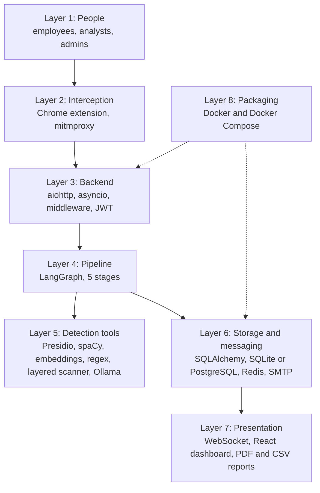
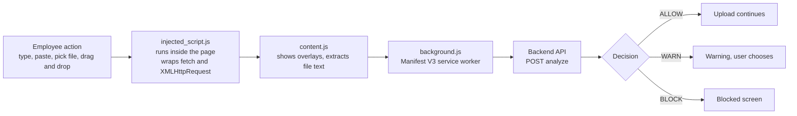
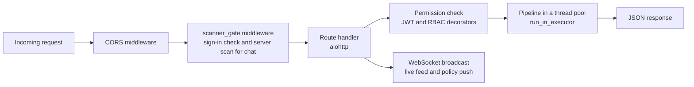
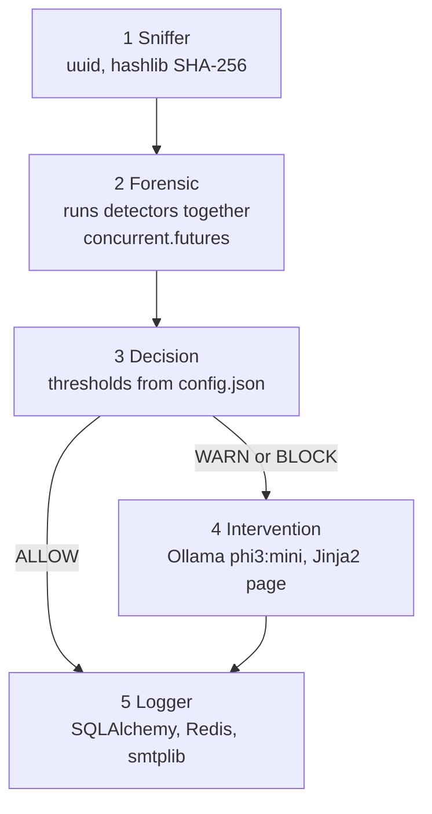
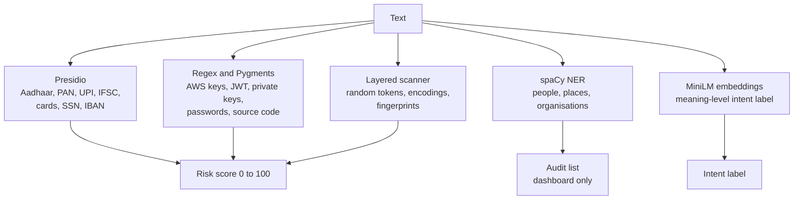
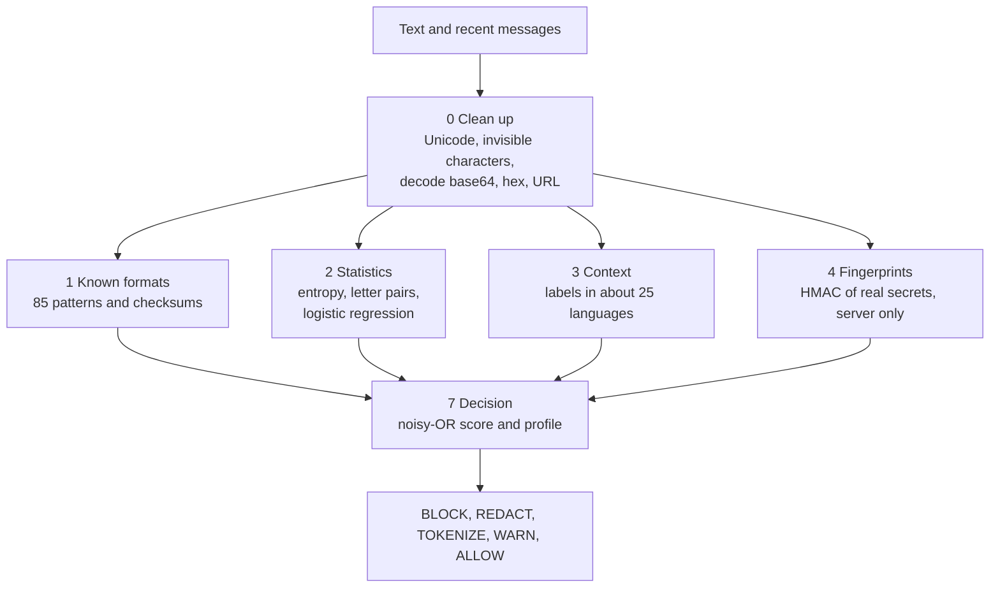
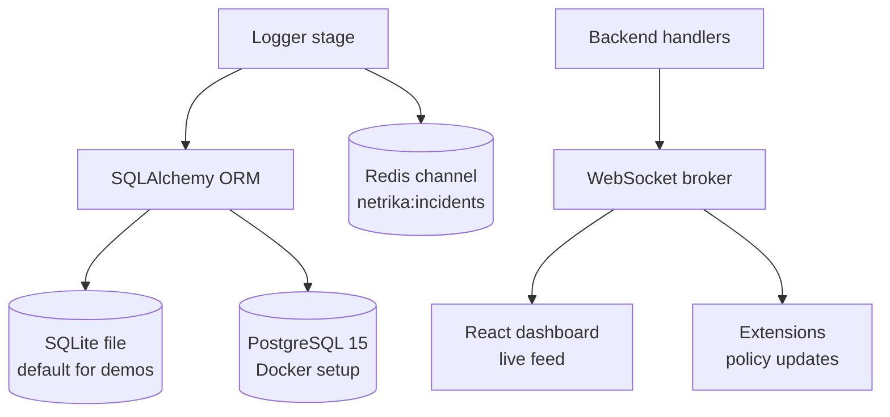
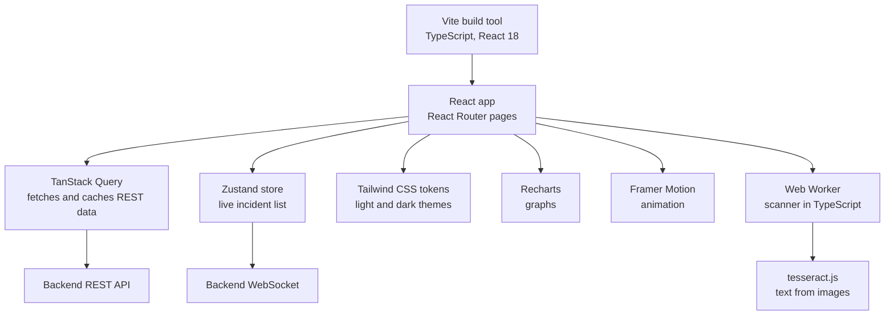
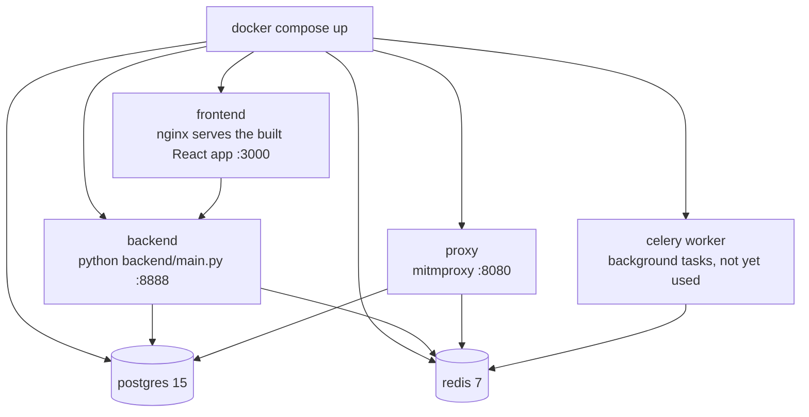

# Part 1: The Architecture at a Glance

## 1.1 In one paragraph

Kavach checks what employees are about to send to AI tools. Two **interceptors** catch the text: a **Chrome extension** inside the browser and a **proxy** on the network. Both hand the text to a **Python backend**, which runs it through a **five-stage pipeline**. The pipeline uses several **detector libraries** to look for personal data, secrets, code and suspicious random strings, then gives a score and a decision: allow, warn or block. The result is **saved** in a database (type and count only, never the secret), **announced** live over WebSocket, and shown on a **React dashboard**.

## 1.2 What is in this document

| Part | What you get |
|---|---|
| 1. Architecture at a glance | The master picture of every framework, and the same system as layers |
| 2. The workflow in simple words | The story of one message, the three ways in, the decisions |
| 3. Layer-by-layer diagrams | Interception, backend, pipeline, detectors, scanner, storage, dashboard, Docker |
| 4. Packages and frameworks | What each package is and what it does here, in plain words |
| 5. Quick reference | One line per technology and honest notes |

The diagrams are also saved as PNG files in the `diagrams/` folder (`master_architecture.png` is the big one) so you can paste them into slides.

## 1.3 Master picture: every framework in one view

Read it from top to bottom. Each coloured band is one layer; each box names the tool or framework that does the job. A message travels down through the layers.

**What each layer does**

| Layer | Meaning |
|---|---|
| People | Employees send text; analysts and admins review it |
| Interception | Catches the request before it leaves: browser extension, network proxy, or the demo chat page |
| Backend | The Python API that coordinates: web server, checkpoints, login, live feed, reports |
| Pipeline | The five stages that decide what to do with the text |
| Detection and AI tools | The libraries that look for sensitive data and write the teaching story |
| Storage and messaging | Where records are kept and where news of new events travels |
| Presentation | The React dashboard and its helper libraries, plus the older Streamlit panel |
| Packaging and quality | Docker to run everything the same way, and the test tools |

The dashboard also asks the backend for data over normal REST calls (with a login token) and receives live events over a WebSocket.

## 1.4 The same system as a flow of layers

---

# Part 2: The Workflow in Simple Words

## 2.1 The story of one message

Imagine an employee pastes a customer's Aadhaar number into ChatGPT.

1. **Catch it.** The Chrome extension (or the network proxy) notices the message is about to leave for an AI website.
2. **Pull out the text.** If it was a PDF or Word file, the text is extracted first (pdf.js in the browser, PyPDF2 and python-docx on the server).
3. **Send it to the backend.** The Python backend (aiohttp) receives it. A middleware checks the user is signed in and, for chat messages, runs a second scan on the server so nobody can skip the browser check.
4. **Run the pipeline.** LangGraph runs five stages in order:
   * *Sniffer* gives the request an ID and a SHA-256 fingerprint.
   * *Forensic* runs the detectors at the same time and computes a risk score.
   * *Decision* turns the score into ALLOW, WARN or BLOCK.
   * *Intervention* (only for WARN and BLOCK) asks a local AI to write a short "how an attacker could misuse this" story.
   * *Logger* saves the record and announces it.
5. **Act on the decision.** The extension lets the message go, shows a warning, or shows a blocked screen. The proxy does the equivalent.
6. **Record and announce.** The database gets a row with the type and count (not the number itself). A live message goes to the dashboard through a WebSocket, and an email can be sent.
7. **Review.** A security analyst sees the incident appear, opens it, adds notes and exports a report.

## 2.2 Three ways in

| Path | Used for | How it reaches the pipeline |
|---|---|---|
| Browser extension | Typing, pasting, file uploads on AI websites | Extension, then service worker, then backend API, then pipeline |
| Network proxy | Any app or script sending to an AI host | Proxy addon calls the pipeline directly |
| Chat sandbox (web app) | Demo chat page with a live scanner | React page, then API with the server gate, then pipeline, then a (mock) AI reply |

## 2.3 Decisions in plain words

* **BLOCK:** the message is stopped. Used when an Aadhaar, PAN, UPI ID, bank code, AWS key, private key, database password or similar is found, or when the score reaches 70.
* **WARN:** the user is told and may choose to continue. Score 40 or more.
* **ALLOW:** nothing sensitive found.
* The scanner can also **REDACT** (hide the value) or **TOKENIZE** (swap it for a placeholder such as `[SECRET_1]` and restore it on the user's screen).

---

# Part 3: Layer-by-Layer Diagrams

## 3.1 Interception: how the text is caught

*In simple words:* three small scripts cooperate. One lives inside the page and sees the action, one draws the overlay, and one (the service worker) is allowed to call the backend. The network proxy does the same job for traffic that never touches a browser.

## 3.2 Backend: the coordinator

*In simple words:* every request passes through two checkpoints before the real work. Heavy analysis runs in a thread pool so one slow scan does not freeze the server.

## 3.3 The pipeline and the tools each stage uses

| Stage | Tools | Work in simple words |
|---|---|---|
| Sniffer | `uuid`, `hashlib` | Gives the request an ID and a fingerprint, trims huge text |
| Forensic | Presidio, spaCy, sentence-transformers, regex, Pygments, layered scanner, `ThreadPoolExecutor` | Runs the detectors, then computes the risk score |
| Decision | `config.json` | Compares the score with limits and applies special rules |
| Intervention | Ollama, Jinja2 | Writes the teaching story and builds the warning page |
| Logger | SQLAlchemy, redis-py, smtplib | Saves the record, announces it, optionally emails |

## 3.4 The detectors inside the Forensic stage

*In simple words:* several different "detectives" read the same text. Presidio, the regex detector and the layered scanner can raise the score. spaCy only adds notes for the dashboard. The embedding model only sets a label such as "PII leak" or "safe".

## 3.5 The layered scanner

*In simple words:* first make hidden text visible, then ask four different questions about each piece (does it look like a known secret, does it look random, is there a label, is it one of our real secrets), then combine the answers.

## 3.6 Storage and live updates

*In simple words:* the database keeps history; Redis and WebSockets carry news of new events. The database stores only what kind of data was found and how many, plus a hash, never the data.

## 3.7 The dashboard (frontend)

*In simple words:* React draws the screens. TanStack Query fetches data, Zustand holds the live feed, Tailwind and Framer Motion handle the look, and a Web Worker runs the scanner so typing never lags.

## 3.8 Deployment with Docker

*In simple words:* one command starts six containers. The Docker image bundles Python, the libraries and the spaCy model, so every machine runs the same setup. Ollama runs on the host machine, outside Docker.

---

# Part 4: Packages and Frameworks in Simple Words

## 4.1 Backend core

| Package | What it is | What it does here, simply |
|---|---|---|
| **Python 3.11** | The programming language | Everything on the server is written in it |
| **asyncio** | Python's built-in tool for doing many things while waiting | Lets one server handle many connections |
| **aiohttp** | An asynchronous web framework | Receives requests, serves the API, keeps WebSocket connections open |
| **python-dotenv** | Reads settings from a `.env` file | Loads configuration such as ports and URLs |
| **concurrent.futures** | Standard library thread pools | Runs the detectors side by side |
| **json, uuid, hashlib, hmac, smtplib** | Standard library | Data format, unique IDs, hashing, keyed hashing, sending email |

## 4.2 Pipeline and AI tools

| Package | What it is | What it does here, simply |
|---|---|---|
| **LangGraph** and **langchain-core** | A library for flowcharts of steps sharing one state | Runs the five stages in order, with one branch |
| **Presidio** (analyzer, anonymizer) | Microsoft's personal-data finder | Finds cards, SSNs, IBANs and, with custom rules, Aadhaar, PAN, UPI IDs and IFSC codes |
| **spaCy** (`en_core_web_sm`) | A language-processing library | Spots names, places and organisations for the dashboard |
| **sentence-transformers** (MiniLM) | Turns sentences into number lists that capture meaning | Compares the message with "dangerous" and "safe" examples to label its intent |
| **PyTorch** and **transformers** | The deep-learning engine and model library underneath | Needed to run the MiniLM model |
| **Pygments** | A syntax-highlighting library | A second opinion on whether the text is source code |
| **Regular expressions** (`re`) | Pattern matching built into Python | Finds secrets with a fixed shape, such as AWS keys |
| **Ollama** (Python client) with **phi3:mini** | Runs a small language model on your own computer | Writes the teaching story without sending data to the cloud |
| **Jinja2** | A templating engine | Fills the blocked-page and warning-banner HTML |
| **PyPDF2** and **python-docx** | Read PDF and Word files | Extract text from uploaded documents on the server |

## 4.3 The layered scanner's own building blocks

| Idea | In simple words |
|---|---|
| Unicode normalisation | Turns look-alike and invisible characters into plain ones so tricks stop working |
| Decoding views | Opens base64, hex and URL-encoded text to see what is inside |
| Checksums (Luhn, Verhoeff, IBAN) | Maths checks that tell a real card or Aadhaar number from random digits |
| Entropy and a letter-pair model | Measure how random a string looks compared with real words |
| Logistic regression | A tiny model that turns those measurements into a probability |
| HMAC fingerprints | Secret-key hashes of the company's real secrets, so they can be recognised without being stored |
| Noisy-OR | A way to combine several pieces of evidence into one score |

## 4.4 Interception

| Package | What it is | What it does here, simply |
|---|---|---|
| **mitmproxy** | A scriptable proxy that can read HTTPS | Sits on the network, watches traffic to AI hosts and calls the pipeline |
| **Chrome Manifest V3** | Chrome's extension platform | Hosts the scripts that watch the browser |
| **pdf.js** (`lib/pdf.min.mjs`) | Mozilla's PDF reader in JavaScript | Reads text out of PDFs in the browser before upload |

## 4.5 Data and messaging

| Package | What it is | What it does here, simply |
|---|---|---|
| **SQLAlchemy 2** | Python library that maps database tables to classes | Saves and reads incidents, users, devices and policies |
| **SQLite** | A database in one file | Default storage, needs no setup |
| **PostgreSQL 15** | A full database server | Storage in the Docker setup |
| **psycopg** | PostgreSQL driver for Python | Lets SQLAlchemy talk to PostgreSQL |
| **Redis 7** and **redis-py** | A very fast in-memory store with messaging | Carries "new incident" messages |
| **Celery** | A background task queue | Two tasks are defined (PDF, webhook) but not called yet |

## 4.6 Security

| Package | What it is | What it does here, simply |
|---|---|---|
| **PBKDF2-HMAC-SHA256** (from `hashlib`) | Slow, salted password hashing | Stores passwords safely |
| **JWT** (hand-written with `hmac`) | A signed login token | Proves who you are on each request |
| **RBAC** (own code) | Permissions by role | SUPER_ADMIN, ORG_ADMIN, ANALYST, EMPLOYEE |
| **SHA-256** | A one-way fingerprint | Fingerprints each payload without storing it |

## 4.7 Reports, alerts and the legacy panel

| Package | What it is | What it does here, simply |
|---|---|---|
| **ReportLab** | A PDF generator for Python | Builds incident and compliance PDFs |
| **csv** | Standard library | Exports incidents as CSV |
| **smtplib** | Standard library email sender | Sends alert emails when SMTP is configured |
| **Streamlit**, **Plotly**, **pandas** | Quick dashboards, charts, tables | The older admin panel on port 8501 |

## 4.8 Frontend

| Package | What it is | What it does here, simply |
|---|---|---|
| **React 18** and **react-dom** | UI library | Builds the screens from components |
| **TypeScript** | JavaScript with types | Catches data mistakes before running |
| **Vite** | Build tool and dev server | Fast development and the production build |
| **React Router** | Page navigation | Dashboard, incidents, devices, detection, reports, chat |
| **TanStack Query** | Data fetching and caching | Loads REST data with loading and error states |
| **Zustand** | A very small state store | Keeps the live incident list |
| **Tailwind CSS** (with PostCSS and Autoprefixer) | Utility-class styling | One colour and spacing system, light and dark themes |
| **Framer Motion** | Animation library | Screen transitions and the animated characters |
| **Recharts** | Chart library | Dashboard graphs |
| **lucide-react** | Icon set | Line icons everywhere |
| **canvas-confetti** | Confetti effect | Small celebration moments |
| **tesseract.js** | OCR in the browser | Reads text from images, locally |
| **Web Worker** | Browser background thread | Runs the scanner without freezing typing |
| **vitest**, **ESLint** | Test runner, code linter | Checks the TypeScript code |

## 4.9 Packaging and testing

| Tool | What it is | What it does here, simply |
|---|---|---|
| **Docker** | Packages an app and its dependencies | Same environment everywhere |
| **Docker Compose** | Starts several containers together | Runs database, Redis, backend, proxy, worker, frontend |
| **nginx** | A fast web server | Serves the built React app in Docker |
| **pytest**, **pytest-asyncio** | Python test tools | Test detectors, API, scanner and safety rules |

## 4.10 Listed in `requirements.txt` but not imported by the code

These are installed but the code does not import them directly, so do not claim they are used.

| Package | Note |
|---|---|
| google-generativeai | The chat reply is a mock, so Gemini is never called |
| PyJWT, passlib, bcrypt | Authentication uses hand-written code (hashlib, hmac) instead |
| pydantic | Request data is checked by hand |
| aiosqlite | The database layer is synchronous SQLAlchemy |

`psycopg` and `torch` are used indirectly (SQLAlchemy loads the PostgreSQL driver by URL; sentence-transformers uses PyTorch).

---

# Part 5: Quick Reference

## 5.1 One line per technology

| Job | Technology |
|---|---|
| Catch text in the browser | Chrome extension (Manifest V3, JavaScript) |
| Catch text on the network | mitmproxy |
| Serve the API and WebSockets | Python, aiohttp, asyncio |
| Run the stages | LangGraph |
| Find personal data | Presidio |
| Find names and places | spaCy |
| Judge meaning | sentence-transformers (MiniLM, PyTorch) |
| Find secrets and code | Regex, Pygments |
| Find random passwords and disguised secrets | The layered scanner |
| Write the teaching story | Ollama, phi3:mini |
| Store records | SQLAlchemy with SQLite or PostgreSQL |
| Announce events | Redis pub/sub, WebSocket |
| Log in and permissions | JWT, PBKDF2, RBAC |
| Reports and alerts | ReportLab, csv, smtplib |
| Dashboard | React, TypeScript, Vite, Tailwind |
| Package and run | Docker, Docker Compose, nginx |
| Test | pytest, vitest |

## 5.2 Honest notes to keep in mind

* The chat sandbox reply is a **mock**; the scanning around it is real.
* The semantic model only sets a label; it does not change the score with the shipped settings.
* The Celery worker and the Slack and Teams alerts exist in code but are not called yet.
* The ports are 8888 (backend), 8080 (proxy), 3000 (frontend in Docker), 8501 (legacy Streamlit panel), 5432 (PostgreSQL), 6379 (Redis).
