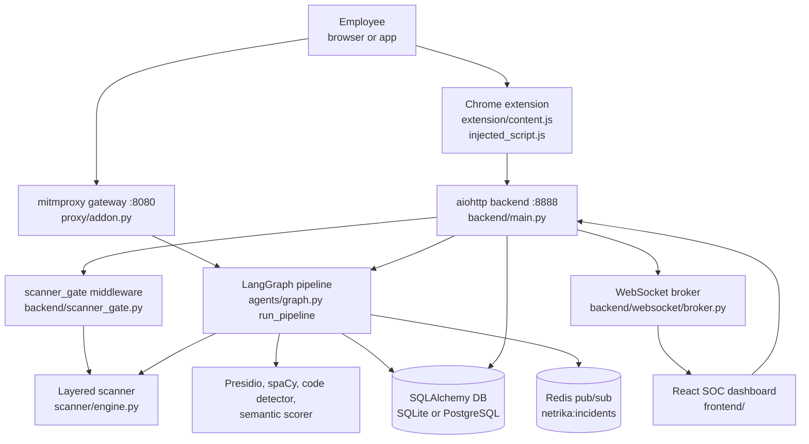
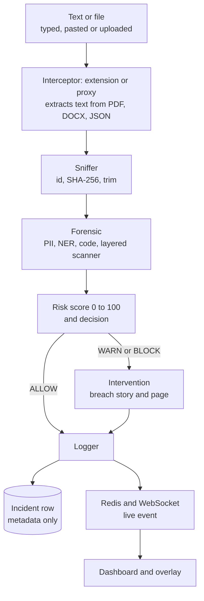
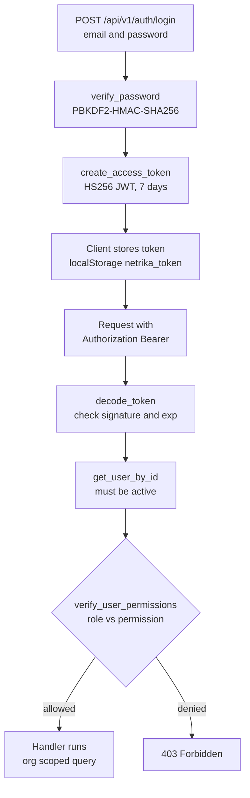
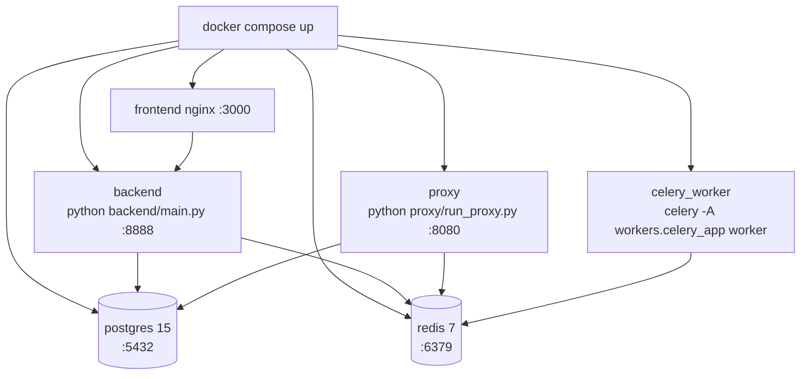

# Part 2: System Architecture

## 2.1 The big picture

Kavach has four cooperating parts: **interceptors** (proxy and browser extension), a **backend** (aiohttp API plus the LangGraph pipeline), **storage** (SQLAlchemy database, Redis), and **user interfaces** (React dashboard, chat sandbox, legacy Streamlit panel).



**How to read it.** The employee's request goes through one of two doors. At the browser door the extension asks the backend `POST /api/v1/analyze`. At the network door the proxy calls the same pipeline function in-process. Chat messages from the built-in sandbox additionally pass through a middleware (the *gate*) that scans on the server so nobody can skip the browser-side scanner by calling the API directly. The pipeline writes the incident, and the backend pushes a live event to the dashboard over a WebSocket.

### Component responsibilities

| Component | Responsibility | Key files |
|---|---|---|
| Browser extension | Hooks `fetch`, `XMLHttpRequest`, file inputs, drag and drop, paste; shows overlays; relays text to the backend through its service worker | `extension/injected_script.js`, `content.js`, `background.js`, `paste_guard.js` |
| Proxy gateway | Intercepts POSTs to the configured AI hostnames, extracts prompt text, runs the pipeline, redirects on BLOCK, injects a banner on WARN, masks sensitive data in the model's reply | `proxy/addon.py`, `ai_endpoints.py`, `run_proxy.py` |
| Backend API | Authentication, incidents, analytics, policy, scanner settings, analyze gateway, chat sandbox, WebSockets, static frontend | `backend/main.py`, `backend/api/*.py` |
| Pipeline | Sniff, analyse, decide, (explain), log | `agents/graph.py` and the five node files |
| Detectors | PII, NER, semantic, code and secrets | `pii/`, `agents/code_detector.py` |
| Layered scanner | Normalise, decode, validate formats, statistics for bare tokens, context, fingerprints, business rules, decision | `scanner/` |
| Persistence | Organisations, users, devices, incidents, entity detections, policies, audit log, evaluations | `database/models.py`, `crud.py`, `session.py` |
| Live events | Redis publish from the logger node; WebSocket push to dashboards and extensions | `agents/logger_node.py`, `backend/websocket/broker.py` |
| Dashboard | Overview, incidents, devices, detection settings, reports, chat sandbox | `frontend/src/` |

## 2.2 Folder map

```
netrika-trace/
  agents/        LangGraph nodes, graph, state, code detector, mock chat service
  backend/       aiohttp app (main.py), api/ routes, auth/ (JWT, RBAC), websocket/, services/, scanner_gate.py
  server/        legacy intervention server (still supplies the chat and upload handlers)
  proxy/         mitmproxy addon, AI endpoint registry, launcher
  pii/           Presidio wrapper, spaCy NER, semantic scorer, risk calculator
  scanner/       layered scanner (Python), rule pack, trained model, evaluation harness
  database/      SQLAlchemy models, CRUD, session factory   (db/ re-exports it for old imports)
  simulation/    Jinja2 page builder and breach simulator, HTML templates
  reports/       ReportLab PDF builders (git-ignored, see 7.3)
  workers/       Celery app and two tasks (not called by the app)
  utils/         SMTP mailer
  dashboard/     legacy Streamlit admin panel
  extension/     Chrome MV3 extension
  frontend/      React + Vite + TypeScript app (src/, public/, scripts/)
  tests/         pytest suites and sample payloads
  docs/          openapi.yaml, brand docs
  config.json    thresholds and weights read by the pipeline
  docker-compose.yml, Dockerfile, setup.sh, demo.sh
```

**Two servers, one product.** `backend/main.py` is the primary server (it is what `docker-compose.yml` runs as `backend`). `server/intervention_server.py` is the older server. It has its own `create_app()` and routes (including `/api/analyze/file`, `/api/analyze/file/fast` and `/incident/{id}`), but `backend/main.py` imports its chat and upload handlers and registers them itself. The routes that exist only in the legacy server are not served by `backend/main.py` (see 5.2).

## 2.3 Request and response flows

### Flow A: browser extension (typed text, paste, files)

1. `injected_script.js` runs in the page's own JavaScript world (`"world": "MAIN"` in the manifest) at `document_start`, so it can wrap `window.fetch` and `XMLHttpRequest` before the page uses them. It also watches file inputs, drag and drop and paste.
2. It asks `content.js` (isolated world) to analyse the text or file by `postMessage`. `pdf_extract.js` extracts text from PDFs with pdf.js.
3. `content.js` sends the text to `background.js` (the service worker), which calls `POST http://localhost:8888/api/v1/analyze` with the device and organisation headers.
4. The backend runs `run_pipeline`, applies a block policy for extension traffic, broadcasts a live event, and returns `{decision, risk_score, entities_found, block_reason, ...}`.
5. The extension shows a scanning overlay, then a block or warn dialog, or lets the request continue.
6. `paste_guard.js` and `kavach-scanner.js` additionally scan pasted text locally with the TypeScript engine and replace or block it before it enters the page.

### Flow B: network proxy

1. The browser or system is configured to use `127.0.0.1:8080`; mitmproxy terminates TLS with its own certificate authority (stored in the `mitmproxy-ca` Docker volume).
2. `NetrikaTraceAddon.request()` checks the host against `AIEndpointRegistry`, which loads the `ai_endpoints` list from `config.json` and falls back to built-in defaults (its docstring mentions the database, but `_load_endpoints` never reads the `ai_endpoints` table). Only POST requests with at least 10 characters of text are analysed.
3. `_extract_payload` pulls prompt text out of JSON (keys such as `content`, `text`, `prompt`, `messages`, to depth 10), form data or raw text.
4. `run_pipeline` runs in a thread executor so the event loop is not blocked.
5. **BLOCK:** the addon answers `302` with `Location: http://netrika-trace.internal/incident/<id>`. **WARN:** metadata is stored and the response handler injects a banner after `<body>` in HTML responses. **ALLOW:** the request passes through.
6. `response()` also scans the AI service's complete (non-streamed) JSON or text reply and masks flagged items.

### Flow C: chat sandbox with the server gate

1. The React chat page scans as you type in a Web Worker (TypeScript engine) and shows findings.
2. On send, `POST /api/chat` reaches the middleware `scanner_gate` first. It requires a valid sign-in, reads up to the last 6 user messages of the session, and scans the message on the server.
3. **BLOCK:** it writes an incident (hash and metadata only), broadcasts it, and answers HTTP 422 `blocked_by_policy`. The handler is never called.
4. **REDACT or TOKENIZE:** the message is rewritten and stored in `request["scan_message"]`.
5. `api_chat` runs the full pipeline, then calls `chat_with_llm` (a mock, 3.10), and scans the reply before returning it.

## 2.4 End-to-end data flow



What changes along the way: the raw text exists only in memory inside the pipeline. After the forensic node it is reduced to entity *types and counts*; the logger writes a hash, a size and counts. The dashboard never receives the text.

## 2.5 Authentication and authorization flow



| Role | Permissions (from `ROLE_PERMISSIONS`) |
|---|---|
| SUPER_ADMIN | everything; sees all organisations |
| ORG_ADMIN | view_incidents, edit_policies, manage_users, manage_devices, view_analytics, export_reports |
| ANALYST | view_incidents, review_incidents, view_analytics, export_reports |
| EMPLOYEE | use_extension, register_device |

Multi-tenancy is by `org_id`: list and detail handlers pass the caller's `org_id` to the query unless the role is SUPER_ADMIN.

## 2.6 Background processing and events

* **Redis publish.** `logger_node._broadcast_event` publishes a small JSON event to the channel `netrika:incidents` with a 0.2 second timeout. If Redis is down it logs a warning and continues.
* **Redis subscribe.** `server/intervention_server.py` has `redis_listener`, which subscribes and forwards events to WebSocket clients. It is started by the legacy server's startup hook. `backend/main.py` does not start it, so in the primary server the live feed comes from direct calls to `broadcast_incident_event` made inside the request handlers.
* **WebSockets.** `/ws/alerts` and `/ws/live-feed` (dashboard) and `/ws/policy-sync` (extensions). Clients are kept in in-memory sets; there is no replay of missed events.
* **Celery.** `workers/celery_app.py` configures Celery with Redis as broker and result backend, and `workers/tasks.py` defines `generate_incident_pdf_task` and `dispatch_webhook_alert_task`. No code calls them, so background jobs are **[Defined, not wired]**.
* **Thread pools.** The forensic node runs PII, NER and code detection in a `ThreadPoolExecutor(max_workers=3)`; the API runs the whole pipeline with `loop.run_in_executor`.

## 2.7 Deployment architecture and configuration



| Service | Image or build | Port | Notes |
|---|---|---|---|
| postgres | `postgres:15-alpine` | 5432 | Health-checked; volume `postgres-data` |
| redis | `redis:7-alpine` | 6379 | Health-checked |
| backend | `Dockerfile` (python:3.11-slim) | 8888 | Depends on healthy postgres and redis; reaches Ollama on the host via `host.docker.internal:11434` |
| proxy | same image | 8080 | Volume `mitmproxy-ca` keeps the generated CA |
| celery_worker | same image | none | Runs the (unused) tasks |
| frontend | `frontend/Dockerfile` (nginx) | 3000 to 80 | Serves the built React app |

Configuration inputs (names only): `DATABASE_URL`, `REDIS_URL`, `JWT_SECRET`, `OLLAMA_HOST`, `OLLAMA_MODEL`, `SBERT_MODEL`, `SPACY_MODEL`, `INTERVENTION_PORT`, `PROXY_PORT`, `PROXY_FAIL_CLOSED`, `LOG_LEVEL`, SMTP settings (`SMTP_HOST`, `SMTP_PORT`, `SMTP_USER`, `SMTP_PASS`, `SMTP_STARTTLS`, `ADMIN_EMAIL`), `SLACK_WEBHOOK_URL`, `TEAMS_WEBHOOK_URL`, `SCANNER_HMAC_KEY`, `SCANNER_KEY_PATH`. `config.json` holds thresholds, weights and the AI host list. Without `DATABASE_URL` the app uses SQLite at `data/netrika.db`.

**Important:** the sample compose file contains a database password and a JWT secret written in plain text. They are not repeated here. Treat them as development defaults and replace them before any real deployment (7.4).
