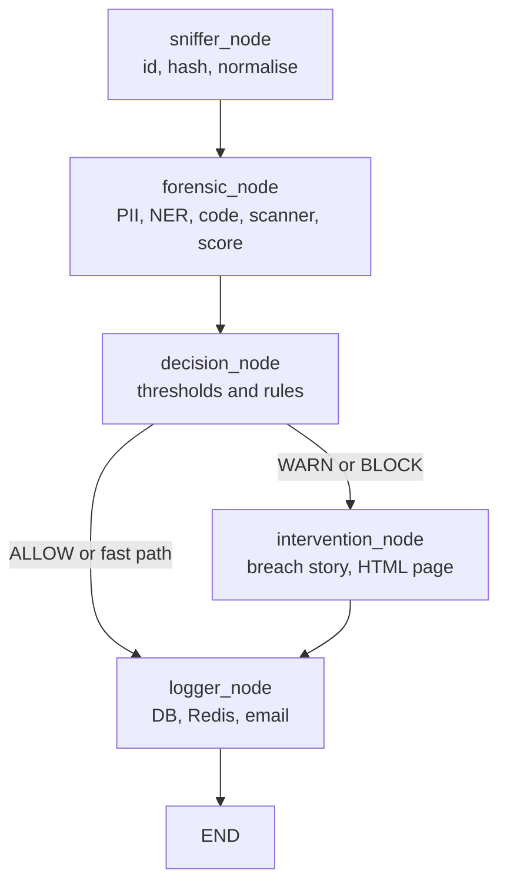
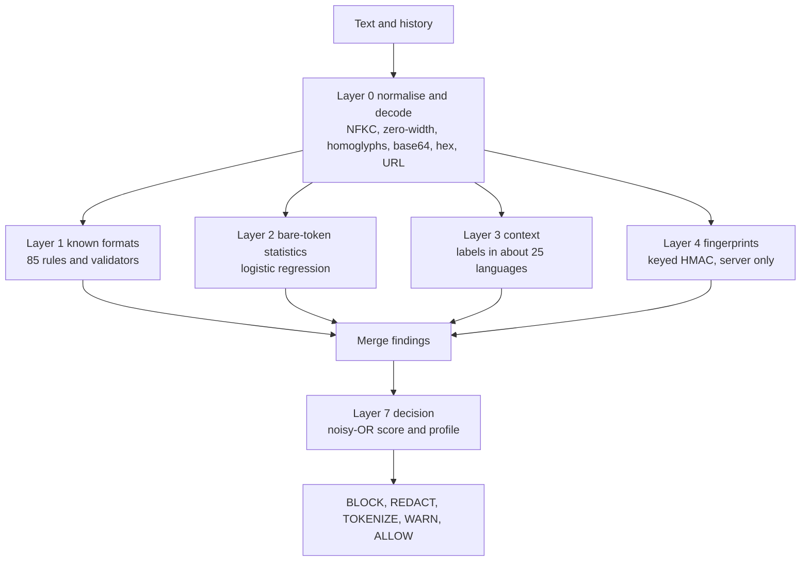

# Part 3: Feature-by-Feature Implementation

Each section answers the same questions: what it does, why it exists, how a user meets it, which files implement it, the internal steps, the data and database involved, rules, error handling, an example, and the limits.

## 3.1 Network proxy gateway

**What and why.** A transparent HTTPS proxy that sees every request an organisation's machines send to AI services, even from apps that are not browsers. It exists because a browser extension cannot see desktop apps or scripts.

**User interaction.** None for the employee beyond a proxy setting; they see a redirect page on BLOCK or a banner on WARN.

**Implementation.** `proxy/run_proxy.py` starts `mitmdump` with `--listen-port` (default 8080) and loads `proxy/addon.py`. `NetrikaTraceAddon` has `request()` and `response()` hooks. `proxy/ai_endpoints.py` holds `AIEndpointRegistry`.

**Internal flow.**
1. `request()`: if the host is not in the registry, return. Mark `flow.metadata["netrika_ai_request"]`.
2. Skip non-POST requests and payloads under 10 characters.
3. `_extract_payload` decodes the body (UTF-8, replacement on errors). For JSON it calls `_extract_text_from_json`, which walks dictionaries and lists up to depth 10 and collects values under keys such as `content`, `text`, `prompt`, `query`, `input`, `message`, `system`, `user`, `assistant`.
4. `run_pipeline(...)` is awaited in an executor.
5. BLOCK builds a `302` response with `X-Netrika-Decision`, `X-Netrika-Incident` and `X-Netrika-Score` headers. WARN stores the incident id, score and entities in `flow.metadata`.
6. `response()`: `_mask_model_output` scans complete, non-streamed JSON, plain-text or Markdown replies up to 2,000,000 bytes and masks flagged items when the scanner setting `scan_output` is on. For WARN, `render_warning_banner` output is inserted after `<body ...>` in HTML responses.

**Data and database.** The pipeline writes the incident. The proxy itself stores nothing.

**Error handling.** If the pipeline raises, the request is allowed through by default (the layered scanner inside the pipeline fails closed on its own). Setting `PROXY_FAIL_CLOSED=1` makes the proxy answer `503` instead.

**Example.** A script POSTs `{"messages":[{"role":"user","content":"my aws key AKIA..."}]}` to `api.openai.com`. The addon extracts the string, the pipeline returns BLOCK, the script receives a 302.

**Limitations.** Streamed (Server-Sent Events) replies are not masked. The redirect target `netrika-trace.internal` must resolve inside the organisation (**[Unverified]**), and the page it points to (`/incident/{id}`) is served by the legacy server only. Real HTTPS interception needs the mitmproxy CA installed on clients (**[Unverified]** here).

## 3.2 Chrome extension (browser interception)

**What and why.** Catches text and files inside the browser before they leave, with instant, friendly overlays. It also sees traffic that is end-to-end inside one web page.

**User interaction.** The employee types, pastes, picks a file or drags one in. A scanning overlay appears ("Netrika is checking your upload"), then either nothing (allowed), a warning with *Proceed anyway* or *Cancel upload*, or a blocked screen.

**Implementation.**

| File | Role |
|---|---|
| `manifest.json` | MV3; three content-script groups; host permission for `http://localhost:8888/*`; service worker `background.js` |
| `injected_script.js` | Runs in the **page's JavaScript world** at `document_start`; wraps `fetch`/`XMLHttpRequest`; hooks paste, drop and file-input `change`; keeps upload "pass" caches |
| `pdf_extract.js` | Extracts text from PDFs with pdf.js (`lib/pdf.min.mjs`) |
| `content.js` | Isolated world; owns the overlays (`showScanning`, `showInterventionDialog`) and talks to `background.js` |
| `background.js` | Registers the device, fetches the policy, keeps a policy WebSocket, relays analysis requests (`ANALYZE_API`) to the backend |
| `kavach-scanner.js`, `paste_guard.js` | Local scan of pasted text using the TypeScript engine bundle (`npm run build:extension`) |
| `popup.html`, `popup.js` | Checks `/health` and shows status |

**Internal flow (file upload).**
1. `injected_script.js` sees a file chosen or dropped, and calls `showScanningUI` (a `postMessage` of type `NETRIKA_SHOW_SCANNING`).
2. `content.js` receives `NETRIKA_SCAN_BUFFER` or the file-scan request, extracts text (PDF through `pdf_extract.js`), and sends `ANALYZE_API` to the service worker.
3. `background.js` posts to `/api/v1/analyze` with `X-Device-ID`, `X-Organization-ID` and the JWT if one is stored.
4. The verdict returns as `NETRIKA_VERDICT`; `injected_script.js` then lets the original request proceed or cancels it.

**Data.** The service worker stores `device_uuid`, `org_id`, `jwt_token`, `active_policy` and an offline queue in `chrome.storage.local`.

**Error handling.** If the backend cannot be reached (`sendResponse(null)`), `content.js` handles the fallback; the file-scan path logs "No files received for scan — blocking (fail-closed)". Offline requests can be queued (`QUEUE_OFFLINE_ANALYZE`).

**Limitations.** The extension targets a configured list of AI sites in `manifest.json`. Verified only through a simulated paste on localhost; behaviour on real AI sites is **[Unverified]**. The extension fetches the policy but the content scripts do not read the threshold or keyword fields (a search for them in `content.js` and `injected_script.js` finds nothing), so policy edits do not change what the extension blocks (3.15).

## 3.3 The LangGraph pipeline (orchestration)

**What and why.** One reusable analysis path for every door (proxy, extension, chat, uploads). LangGraph is used so that the steps are explicit nodes sharing one typed state, with a conditional edge after the decision.

**Implementation.** `agents/state.py` defines `AgentState` (a `TypedDict`). `agents/graph.py::build_graph()` registers five nodes, sets `sniffer_node` as the entry point, adds edges `sniffer → forensic → decision`, then a conditional edge from `decision_node` using `should_intervene`: `intervention_node` for WARN or BLOCK, `logger_node` for ALLOW (and for "fast-path" sources), then `intervention → logger → END`. `run_pipeline(...)` builds the initial state and calls `.invoke`. The compiled graph is a lazy singleton.



**State fields.** `payload`, `user_ip`, `target_host`, `target_url`, `http_method`, `payload_size_bytes`, `risk_score`, `pii_score`, `entity_score`, `semantic_score`, `entities_found`, `intent_label`, `decision`, `code_detected`, `secrets_detected`, `scan_history`, `scanner_action`, `scanner_summary`, `simulation_html`, `incident_id`, `payload_hash`, `payload_preview`.

**Fast path.** When `user_ip` is `chat-upload`, or starts with `extension` or `browser-extension`, the forensic node skips the semantic scorer, the decision node blocks as soon as any policy entity is present, and the router skips the intervention node. This is a latency optimisation, because the Ollama call is slow.

## 3.4 Sniffer node

`agents/sniffer_node.py`. It (1) creates a UUID incident id, (2) computes `SHA-256` of the payload (for de-duplication, not stored as text), (3) strips whitespace and truncates to 50,000 characters, (4) records the byte size, (5) sets `payload_preview` to an **empty string** on purpose (so no sensitive text is retained), and (6) resets the score and result fields. Its logger line contains sizes and addresses, never content.

## 3.5 Forensic node: detectors run in parallel

`agents/forensic_node.py` loads each detector lazily (so import-time model loading does not slow start-up) and runs three of them in a `ThreadPoolExecutor(max_workers=3)`.

### 3.5.1 PII detection (Presidio plus Indian patterns)

`pii/presidio_analyzer.py::PresidioAnalyzerWrapper`.
* Standard entities: `CREDIT_CARD`, `EMAIL_ADDRESS`, `US_SSN`, `CRYPTO`, `IBAN_CODE`, `IP_ADDRESS`.
* Custom Indian recognizers built with `PatternRecognizer`: `AADHAAR` (`[2-9]\d{3}\s?\d{4}\s?\d{4}`), `PAN` (`[A-Z]{5}[0-9]{4}[A-Z]`), `UPI_ID` (name plus a known handle such as `@upi`, `@ybl`, `@paytm`), `IFSC` (`[A-Z]{4}0[A-Z0-9]{6}`), `INDIAN_PHONE`, `INDIAN_PASSPORT`.
* A keyword layer (`SENSITIVE_KEYWORDS`) catches `password=`, `api_key=`, database URLs, private-key headers, AWS keys and `.env`-style lines, and reports them as `SENSITIVE_*` types.
* If Presidio cannot load, `_regex_analyze` runs the same patterns directly (a fallback so the system degrades instead of stopping).
* `compute_pii_score` ignores harmless labels (PERSON, DATE, ORG and so on) and adds, per detected item of a blocking type, `0.85 × 1.25` for high-confidence types (Aadhaar, PAN, UPI, IFSC, credit card, SSN, passport, private key, AWS key, database credential, secret key, password) or 0.5, 0.3 or 0.1 by confidence for others, capped at 1.0.

### 3.5.2 Named entity recognition (spaCy)

`pii/spacy_ner.py` extracts `ORG`, `PERSON`, `GPE`, `NORP`, `FAC`, `PRODUCT`, `MONEY`, `DATE` from the first 10,000 characters using `en_core_web_sm`, with a keyword fallback. Its score function **always returns 0.0** by design: names and places appear in ordinary text, so they are recorded for the dashboard's audit view (`audit_ner_entities`) but never drive a block.

### 3.5.3 Source code and secrets

`agents/code_detector.py::CodeDetector.analyze`.
* **Secrets:** compiled regular expressions for `PRIVATE_KEY`, `AWS_ACCESS_KEY` (`AKIA[0-9A-Z]{16}`), `JWT_TOKEN`, `DATABASE_URL`, `GITHUB_TOKEN`, `SLACK_TOKEN`, `GENERIC_API_KEY`, `BEARER_TOKEN`, `AZURE_CONNECTION`, and more.
* **Code:** patterns such as Python `def`/`class`/`import`, JS functions and arrows, Java classes, SQL statements, `<script>`, Dockerfile commands, YAML and shebangs. Code is "detected" when at least 2 pattern types match or 3 matches in total. If regex says no, Pygments' language guesser gets a second opinion.
* Output: `code_detected`, `secrets_detected`, a list of detections.

### 3.5.4 Semantic similarity

`pii/semantic_scorer.py` embeds the first 2,048 characters with `all-MiniLM-L6-v2` (normalised vectors) and compares them with two template sets, `DANGEROUS_TEMPLATES` and `SAFE_TEMPLATES`, using the maximum cosine similarity: `raw = dangerous / (dangerous + safe)`, then it is rescaled to 0 to 1. `classify_intent` maps the score to `PII_LEAK`, `IP_LEAK`, `SAFE` or `AMBIGUOUS` (≥ 0.7 is risky, ≤ 0.3 is safe). It returns 0.5 if the model is unavailable. In the current configuration its weight is 0 (see 3.7), so it only sets the **intent label** shown to analysts.

### 3.5.5 Entity policy and merging

After the parallel step the node keeps only entity types in `BLOCK_POLICY_TYPES` (Aadhaar, PAN, UPI, IFSC, AWS, private key, database credential, secret key and related), maps duplicates to canonical names (for example `AWS_ACCESS_KEY` to `SENSITIVE_AWS_KEY`, `JWT_TOKEN` to `SENSITIVE_SECRET_KEY`), and de-duplicates by type. NER output is kept separately for audit.

## 3.6 Layered scanner inside the forensic node

After the older detectors, `_run_scanner` calls `scanner.service.scan_text(payload, history=..., deep=False)`. The result adds entities, can set `secrets_detected`, and raises `risk_score` to at least the scanner's score. **If the scanner itself raises, the node returns BLOCK** (`scanner_unavailable`): it fails closed. The scanner is described fully in 3.9.

## 3.7 Risk calculator and decision node

**Risk score** (`pii/risk_calculator.py::RiskCalculator.calculate`):

```python
base  = pii*pii_weight + entity*entity_weight + semantic*semantic_weight
score = int(base * 100)
if code_detected:    score += code_boost      # config: 20
if secrets_detected: score += 30
if pii_score >= 0.9: score += 30
score = min(score, 100)
```

With the shipped `config.json` the weights are `pii_weight = 1.0`, `entity_weight = 0.0`, `semantic_weight = 0.0`, so the score is effectively the PII score plus boosters. The docstrings and the older design notes mention 0.5, 0.2 and 0.3; the code reads `config.json` and the file says otherwise.

**Decision** (`agents/decision_node.py`), in order:
1. **Extension or chat-upload source with any policy entity:** BLOCK, score raised to at least 85.
2. **Scanner action BLOCK:** BLOCK, score at least 85. The scanner has the last word.
3. Otherwise compare the score with thresholds from `config.json`: `score >= block_threshold` (70) is BLOCK; `>= warn_threshold` is WARN; else ALLOW. `config.json` currently has `warn_threshold = 40`; the in-code default is 30.
4. If the result is ALLOW but the scanner said WARN, TOKENIZE or REDACT, upgrade to WARN.

**Worked example (computed from the code).** Text: `My Aadhaar is 2345 6789 0123`. Presidio's Aadhaar pattern matches. Aadhaar is high-confidence, so the pii score is `min(0.85 × 1.25, 1.0) = 1.0`. Risk = `int(1.0 × 100) = 100`, plus 30 for high PII, capped at 100. For an extension source, rule 1 already blocks. For a proxy source, 100 ≥ 70 so it is BLOCK.

## 3.8 Intervention node: the breach story

**What and why.** Instead of a bare "blocked" message, it shows a short, realistic story of how an attacker could abuse *that kind* of data, to teach the employee at the moment of risk.

**Flow** (`agents/intervention_node.py`): build `entity_summary` (for example `2x AADHAAR, 1x SENSITIVE_AWS_KEY`) and a payload summary (for example "A payload containing source code, API keys or credentials"). Build a fixed prompt asking a "cybersecurity educator" for a 3-paragraph story under 200 words. Call `ollama.Client(host=OLLAMA_HOST).chat(model=OLLAMA_MODEL (default phi3:mini), temperature 0.7, num_predict 300)`. On any error use `_fallback_simulation`, a fixed text. Then render the red-screen HTML with `simulation/page_builder.py` (Jinja2 templates `blocked.html` and `warning_banner.html`) and save it as `data/incidents/<incident_id>.html`.

**Privacy rule enforced in code.** The prompt contains only type names and counts, never the payload. `enable_breach_simulation` in `config.json` can turn it off.

**Limitation.** Whether Ollama and `phi3:mini` are installed was not tested here (**[Unverified]**); without them the static fallback is used.

## 3.9 The layered scanner (`scanner/`)

**What and why.** Regular expressions only find *labelled* or *formatted* secrets. A password typed as `xyzwudguwd` has no label and no format. The scanner combines several weak signals into a decision, runs fully offline, and exists twice (Python on the server, TypeScript in the browser) so the user gets instant feedback while the server stays authoritative.



| Layer | File | What it does |
|---|---|---|
| 0 | `normalize.py` | NFKC normalisation; removes zero-width and bidi characters; folds Cyrillic and Greek look-alikes; collapses spaced-out secrets; joins wrapped lines; decodes base64, base64url, hex, URL-encoding, HTML entities and reversed text to depth 3; every decoded view is scanned and mapped back to the original span |
| 1 | `rules/formats_src.py` → `formats.json` (85 rules), `validators.py` | Provider token formats plus checksum validators: Luhn (cards), Verhoeff (Aadhaar), PAN shape, GSTIN, IFSC, IBAN mod-97, SSN and passport shape |
| 2 | `statistical.py`, `rules/model.json`, `lexicon.json` | Per token features: length, Shannon entropy, character mix, vowel and consonant runs, a trigram language model over about 52,000 words, dictionary coverage, "looks like a UUID/hash/CSS class/path/identifier/SVG path"; a small logistic regression returns a probability that the token is an opaque secret |
| 3 | `context.py` | Label words (`password`, `token`, ... in about 25 languages, leetspeak folded), `.env`, YAML, JSON, `export`, curl headers, CLI flags |
| 4 | `fingerprints.py` | Keyed HMAC-SHA256 fingerprints of the organisation's real secrets and canary tripwires; stores hashes only; server only |
| 5 | engine `_business`, `_deep` | Configured internal hostnames, codenames, custom regexes; optional Presidio and spaCy when `deep=true` |
| 7 | `decision.py` | `risk_score` by noisy-OR: `keep *= (1 - w × confidence)`, score `= 100 × (1 − keep)`; per finding action by profile (`strict`, `balanced`, `relaxed`) |

**Actions.** BLOCK, REDACT (mask), TOKENIZE (reversible placeholder, restored on the user's device), WARN, ALLOW. Known-format secrets and fingerprints cannot be "confirmed safe" by the user.

**Settings and operations.** `scanner/settings.py` stores settings, the allow-list and fingerprints in the existing `policy_config` key-value table. `scanner/service.py` is the facade (`scan_text`, `summarize`, `to_entities`, `sanitize`). `scanner/files.py` reads `.txt/.csv/.json/.docx/.pdf/.zip`.

**Measured on the project's own synthetic corpus** (`scanner/eval/REPORT.md`, balanced profile, 4,045 samples): overall recall 98.64 percent, precision 99.02 percent, false-alarm rate on hard negatives 1.00 percent (3.04 percent on real code chunks), latency p50 0.45 ms, p95 20.61 ms. Known formats, PII, evasions, labelled context, fingerprints and adversarial instructions all reached 100 percent; bare random strings 98.17 percent; human-style passwords such as `Summer2024!` only 84.15 percent. **These numbers describe a corpus written by the same authors as the detectors, so they flatter the result** (the report says so too).

**Parity.** `scanner/eval/parity.py` writes expected answers; `frontend/src/scanner/parity.test.ts` checks the TypeScript engine agrees with Python (at least 99 percent action agreement, and never a BLOCK versus non-BLOCK disagreement on known formats, evasions and context).

## 3.10 Server enforcement gate and the chat sandbox

**What and why.** A browser-side scanner can be bypassed by calling the API directly. `backend/scanner_gate.py` is an aiohttp middleware that scans on the server for every `/api/chat*` request.

**Flow.** Described in 2.3 (Flow C). Key checks: sign-in required for all `/api/chat*` paths (401 otherwise); only `POST /api/chat` is scanned; the confirmed-safe list is capped at 100 items; HTTP 422 with `blocked_by_policy` on BLOCK; the rewritten text is passed to the handler.

**Chat handlers** (`server/intervention_server.py`):
* `api_chat` runs the pipeline with the last 6 user messages as history, broadcasts a WebSocket event, replies with a fixed "BLOCKED" text on BLOCK, otherwise calls `chat_with_llm`, then scans and masks the reply.
* `api_chat_upload_scan` (multipart): extracts text (`.txt .csv .pdf .docx` through PyPDF2 and python-docx), runs the pipeline as `chat-upload`, stores the text in an in-memory pending map if not blocked, and returns the verdict before any model is called. `api_chat_upload_respond` then asks for the answer. This split makes the verdict appear fast.
* `api_chat_memory_test` runs a "digital Alzheimer's" demonstration: a fresh session cannot recall earlier data.

**Important: the AI reply is mocked.** `agents/llm_service.py::chat_with_llm` calls `_get_mock_response`, which returns canned text ("This is a mock AI response ... (Gemini API quota exceeded)"). No Gemini call is made even though `google-generativeai` is listed in `requirements.txt` and the UI says "Powered by Gemini". The DLP checking around it is real; the model behind it is not. Say this plainly in a demo.

## 3.11 Incident logging and the privacy design

**Logger node** (`agents/logger_node.py`):
1. `ensure_data_dir()` and `init_database()`.
2. Build an entity summary `{type: count}` only.
3. `create_incident(...)`: hash, size, score, decision, intent, `entities_json`, `code_detected`, `simulation_html`.
4. `create_entity_detection(...)` per policy entity and per NER entity (detector source `NER`).
5. Publish `netrika:incidents` to Redis.
6. If the policy value `enable_email_alerts` is true and the decision is BLOCK or WARN, send an email.

Every step is wrapped in `try/except`; a failure is logged and the response still returns. **What is never stored:** the payload text, entity values, and (because the sniffer empties it) the preview. This is checked by tests in `tests/test_scanner_safety.py`.

## 3.12 Authentication, RBAC and device registration

* `POST /api/v1/auth/login`: looks up the user by email, verifies with `verify_password`, rejects inactive users (403), issues a 7-day access token and a 30-day refresh token, writes an `audit_logs` row.
* `POST /api/v1/auth/refresh`: accepts a token whose `type` is `refresh` and returns a new access token.
* `POST /api/v1/auth/register-device`: stores or updates a device row for the extension (heartbeat via `last_seen`).
* `GET /api/v1/auth/me`, `GET /api/v1/auth/devices` (needs `manage_devices`).
* `backend/auth/security.py` implements PBKDF2-HMAC-SHA256 (100,000 iterations, random 16-byte salt) and a hand-written HS256 JWT with `hmac`. `backend/auth/rbac.py` provides `require_auth` and `require_permission(...)` decorators.
* `seed_enterprise_defaults()` creates a default organisation, a default SUPER_ADMIN account and a default policy at first start. The password is set in the source; change it (7.4).

## 3.13 SOC dashboard (React)

**Routes** (`frontend/src/App.tsx`): `/` landing, `/login`, `/dashboard`, `/incidents`, `/incidents/:id`, `/devices`, `/detection`, `/reports`, `/chat`, `/style-guide`; `/search` and `/compliance` redirect. Pages are lazy loaded.

**Data access.** `src/lib/api.ts` (`apiFetch`) adds the `Authorization` header from `localStorage["netrika_token"]` and turns HTTP errors into messages. TanStack Query hooks in `src/hooks/useIncidents.ts` fetch incidents, stats, compliance and endpoint stats. `useWebSocket.ts` connects to `/ws/alerts` and updates the Zustand `incidentStore` so new incidents appear without refresh.

**Key pages.** Dashboard (stat cards, charts, live feed), Incidents (search, filters, mark reviewed, CSV and PDF), Incident detail (entity detections, notes), Devices, Detection (rules, scanner settings, quality metrics), Reports (DPDP PDF, CSV), Chat (composer with live scanner, findings drawer).

**Design system.** Design tokens in `src/index.css`, Tailwind config reading CSS variables, light and dark themes, characters (Kavi, Sentinel, Vault, Lens), the Kavach logo component.

## 3.14 Reports and analytics

* `GET /api/v1/analytics/stats?window=1h|24h|7d|30d`: totals by decision, average latency, average risk, hourly traffic and top entities (`get_incident_stats`, `get_traffic_breakdown`).
* `GET /api/v1/analytics/search`, `/endpoints-stats`, `/compliance`, `/compliance/pdf`, `/export` (CSV).
* `GET /api/v1/incidents/{id}/pdf`: `reports/pdf_builder.py::IncidentPDFBuilder.build_incident_report`.
* The DPDP text (`reports/dpdp_template.py`, and the matching cards in `frontend/src/pages/Reports.tsx`) explains how the logs help with "Section 8", "Section 9" and "Section 15". **Check these titles against the official Act before you present them:** to the best of this review's knowledge, Section 9 of the DPDP Act 2023 concerns children's data and Significant Data Fiduciaries are in Section 10, so the project's section labels may be mislabelled (see 7.5).
* **Caveat:** `.gitignore` excludes `reports/`, so a fresh clone does not contain these modules and the PDF endpoints would fail (7.3).

## 3.15 Policy management

* `GET/PATCH /api/v1/policies` read and update the `enterprise_policies` row for the caller's organisation (thresholds, blocked keywords, allowed and blocked domains, allowed file types, maximum file size, feature switches). A patch is audited and pushed to connected extensions over `/ws/policy-sync` as a `POLICY_UPDATE` message.
* `GET /api/v1/policies/extension-sync?org_id=...` gives the extension a light copy.
* **Gap:** the pipeline reads thresholds and weights from `config.json`, not from this table, and the extension's interception code does not read the synced fields. So the policy screen stores and distributes settings but does not change what is blocked **[Partial]**. The scanner's own settings (profile, tokenize, scan output, hosts, codenames, custom patterns) are the part that does change behaviour, through `/api/v1/scanner/settings`.

## 3.16 Alerts and background jobs

* **Email:** `utils/mailer.py::EmailService.send_incident_alert` uses `smtplib` with optional STARTTLS and login from `SMTP_*` variables; skipped with a warning if `SMTP_HOST` is missing. Triggered from the logger node when `enable_email_alerts` is true.
* **Slack and Teams:** `backend/services/notifier.py` posts JSON to webhook URLs from environment variables. Nothing calls `send_all_alerts`, so it is **[Defined, not wired]**.
* **Celery tasks:** PDF generation and a Slack-style webhook alert; **[Defined, not wired]**.

## 3.17 Model evaluation endpoint

`POST /api/v1/eval/evaluate` validates `model_version`, `dataset_name` and equal-length 0/1 arrays (maximum 100,000), computes TP, FP, TN, FN, precision, recall and F1, stores a `model_evaluations` row and returns it. `GET /api/v1/eval/latest` lists the last 10 for the organisation. `backend/services/evaluator.py` also has a function with ROC points that nothing calls. This lets an analyst record the quality of any detector; it does not itself test the pipeline.
