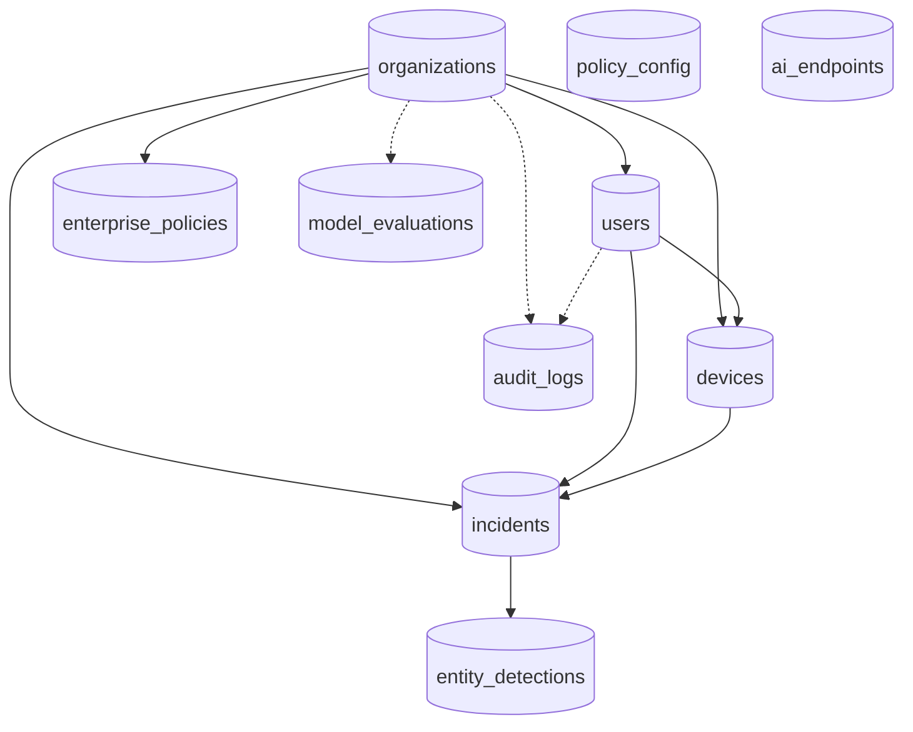

# Part 5: Database and API Documentation

## 5.1 Database schema

The schema is defined in `database/models.py` (SQLAlchemy 2 declarative models). There are ten tables. Primary keys are 36-character UUID strings except `entity_detections`, `policy_config` and `ai_endpoints` (auto-increment integers). Tables are created by `Base.metadata.create_all` (no migrations).

Solid arrows are foreign keys from the parent to the child table. Dotted arrows are nullable foreign keys. `policy_config` and `ai_endpoints` are standalone.

### organizations

| Column | Type | Notes |
|---|---|---|
| id | String(36) PK | UUID |
| name | String(255) | required |
| domain | String(255) | unique, required |
| license_tier | String(50) | default `ENTERPRISE` |
| created_at | DateTime(tz) | UTC |

### users

| Column | Type | Notes |
|---|---|---|
| id | String(36) PK | |
| org_id | FK `organizations.id` | required |
| email | String(255) | unique, indexed |
| password_hash | String(255) | `salt_hex$key_hex` (PBKDF2) |
| full_name | String(255) | |
| role | String(50) | `SUPER_ADMIN`, `ORG_ADMIN`, `ANALYST`, `EMPLOYEE`; default `EMPLOYEE` |
| is_active | Boolean | default true |
| created_at | DateTime(tz) | |

### devices

| Column | Type | Notes |
|---|---|---|
| id | String(36) PK | |
| device_uuid | String(100) | unique, indexed (generated by the extension) |
| user_id | FK `users.id` | required |
| org_id | FK `organizations.id` | required |
| os, browser, ext_version | String | optional |
| last_seen, created_at | DateTime(tz) | `last_seen` is the heartbeat |

### enterprise_policies

| Column | Type | Notes |
|---|---|---|
| id | String(36) PK | |
| org_id | FK `organizations.id` | |
| name | String(255) | default "Default Security Policy" |
| warn_threshold, block_threshold | Integer | defaults 30 and 67 |
| blocked_keywords_json, allowed_domains_json, blocked_domains_json, allowed_file_types_json | Text (JSON) | lists |
| max_file_size_mb | Integer | default 10 |
| enable_semantic, enable_code, enable_secrets, enable_pii, enable_local_llm, is_active | Boolean | default true |
| updated_at | DateTime(tz) | |

### incidents

| Column | Type | Notes |
|---|---|---|
| id | String(36) PK | the pipeline's `incident_id` |
| org_id, user_id, device_id | FK, nullable, indexed | tenant, user and device |
| timestamp | DateTime(tz) | indexed |
| user_ip | String(45) | also used as a **source tag**: `browser-extension`, `chat-upload`, `chat-ui` |
| target_host, target_url, http_method | String | destination |
| payload_hash | String(64) | SHA-256 hex |
| payload_preview | String(200) | always stored as `""` |
| payload_size_bytes | Integer | |
| risk_score | Integer | 0 to 100 |
| decision | String(10) | ALLOW, WARN, BLOCK |
| intent_label | String(20) | PII_LEAK, IP_LEAK, SAFE, AMBIGUOUS, SECRET_LEAK |
| entities_json | Text | JSON `{type: count}` |
| code_detected | Boolean | |
| simulation_html | Text | breach story text |
| reviewed, reviewed_by, notes | Boolean, String, Text | analyst review |
| latency_ms | Integer | default 0 |

### entity_detections

`id` (auto PK), `incident_id` (FK, required), `entity_type`, `entity_count`, `confidence_score` (nullable float), `detector_source` (`PII`, `REGEX`, `NER`, ...).

### audit_logs

`id`, `org_id`, `user_id` (nullable FKs, indexed), `action` (for example `LOGIN`, `UPDATE_POLICY`, `REVIEW_INCIDENT`), `resource`, `ip_address`, `details_json`, `timestamp` (indexed).

### model_evaluations

`id`, `org_id`, `model_version`, `dataset_name`, `precision`, `recall`, `f1_score`, `confusion_matrix_json`, `timestamp`.

### policy_config (key-value)

`id`, `key` (unique), `value` (Text), `updated_at`. Holds legacy switches such as `enable_email_alerts` and, for the scanner, settings, the allow-list and the fingerprints.

### ai_endpoints

`id`, `hostname` (unique), `display_name`, `is_active`, `added_at`. Seeded by `seed_default_endpoints()`; used by endpoint statistics. The proxy's registry reads `config.json` instead (2.3).

### Relationships (ORM)

`Organization` has many `User`, `Device`, `EnterprisePolicy`, `Incident` (cascade delete-orphan). `User` has many `Device` and `Incident`. `Device` has many `Incident`. `Incident` has many `EntityDetection` (cascade). Constraints are enforced as unique columns and foreign keys; **SQLite does not enforce foreign keys unless asked**, and nothing in `session.py` enables it.

### Significant queries and data processing (in `database/crud.py`)

| Function | What it does |
|---|---|
| `create_incident` | Inserts the incident (forces `payload_preview` to `""`) |
| `get_recent_incidents`, `search_incidents` | Filter by `org_id`, decision, minimum risk, substring over id, host, intent or IP; order by timestamp descending; limit |
| `get_incident_stats(window)` | Counts total, BLOCK, WARN, ALLOW since `now - window`; averages latency and risk |
| `get_traffic_breakdown`, `get_hourly_breakdown` | Time-bucketed counts for charts |
| `get_entity_type_breakdown` | Sums entity counts by type |
| `get_weekly_compliance_stats` | Counts used by the compliance report |
| `get_endpoint_incident_stats` | Incident counts per destination host |
| `mark_incident_reviewed` | Sets `reviewed`, `reviewed_by`, `notes` |
| `seed_enterprise_defaults`, `seed_default_endpoints` | First-run data |
| `get/set_policy_value`, `get_all_policy_config` | Key-value policy |

**Tenant-scoping gap.** The logger node does not pass `org_id`, `user_id` or `device_id` to `create_incident`, so incidents created by the pipeline have `NULL` tenant columns. List and detail queries filter `Incident.org_id == <caller's org>` for every role except SUPER_ADMIN, so ORG_ADMIN and ANALYST accounts would **not** see pipeline-created incidents; only the chat gate's blocked-message incidents carry `org_id`. This was found by reading the code and has not been reproduced in a running system (**[Unverified]**); see 7.2.

## 5.2 API reference

All paths are served by `backend/main.py` on port 8888 unless marked *legacy only*. JSON errors use `{"error": "..."}`. "Auth" says what the code enforces; "perm" is the RBAC permission.

### Public and authentication

| Method | Route | Purpose | Input | Success response | Auth |
|---|---|---|---|---|---|
| GET | `/health` | Liveness | none | `{"status":"ok"}` | none |
| POST | `/api/v1/auth/login` | Sign in | `{email, password}` | `{access_token, refresh_token, token_type, user{id,email,full_name,role,org_id,organization_name}}` | none. Errors: 400 missing fields, 401 bad credentials, 403 disabled |
| POST | `/api/v1/auth/refresh` | New access token | `{refresh_token}` | `{access_token, token_type}` | none. 401 if not a valid refresh token |
| POST | `/api/v1/auth/register-device` | Register or heartbeat a device | `{device_uuid, user_id?, org_id?, os?, browser?, ext_version?}` | `{status, device_id, device_uuid, last_seen}` | optional JWT. 400 if no `device_uuid` |
| GET | `/api/v1/auth/me` | Current user and organisation | none | `{user, organization}` | any signed-in user |
| GET | `/api/v1/auth/devices` | Devices of the organisation | none | list of devices | perm `manage_devices` |

### Analysis gateway

| Method | Route | Purpose | Input | Response | Auth |
|---|---|---|---|---|---|
| POST | `/api/v1/analyze`, `/api/analyze` | Run the pipeline on text | `{payload, user_ip?, target_host?, target_url?, http_method?, org_id?, user_id?, device_id?}` plus headers `X-Organization-ID`, `X-User-ID`, `X-Device-ID` | `{incident_id, decision, risk_score, intent_label, entities_found, code_detected, secrets_detected, block_reason, latency_ms}` | **none enforced** (the extension sends its JWT but the handler does not check it). 400 if payload under 2 characters; 500 on errors |

For `user_ip` values that start with `browser-extension` or `extension`, or equal `chat-upload`, `_apply_block_policy` runs after the pipeline: if any entity of a blocking type remains the decision is BLOCK and the score is at least 85; otherwise the decision is forced to ALLOW (so ordinary NER or intent noise cannot block extension traffic).

### Incidents

| Method | Route | Purpose | Auth |
|---|---|---|---|
| GET | `/api/v1/incidents?limit=1..100&q=&decision=` | List or search | `view_incidents`; 400 on bad `limit` or `decision` |
| GET | `/api/v1/incidents/{incident_id}` | Detail with `entity_detections` and simulation text | `view_incidents`; 404 if absent or other tenant |
| PATCH | `/api/v1/incidents/{incident_id}` | Mark reviewed; body `{notes}` (max 4000 chars) | `review_incidents`; writes an audit row |
| GET | `/api/v1/incidents/{incident_id}/pdf` | Download PDF | `view_incidents`; needs `reports/pdf_builder.py` |

### Analytics and reports

| Method | Route | Purpose | Auth |
|---|---|---|---|
| GET | `/api/v1/analytics/stats?window=1h\|24h\|7d\|30d` | `{stats, hourly, entity_breakdown, window}` | `view_analytics`; 400 on bad window |
| GET | `/api/v1/analytics/endpoints-stats` | Counts by destination | `view_analytics` |
| GET | `/api/v1/analytics/search?q&decision&risk_min&limit` | Search rows | `view_analytics` |
| GET | `/api/v1/analytics/compliance` | Compliance counters | `view_analytics` |
| GET | `/api/v1/analytics/compliance/pdf` | DPDP PDF | `export_reports` |
| GET | `/api/v1/analytics/export` | CSV (`Incident ID, Timestamp, User IP, Target Host, Risk Score, Decision, Intent, Code Detected`) | `export_reports` |

### Policy and evaluation

| Method | Route | Purpose | Auth |
|---|---|---|---|
| GET | `/api/v1/policies` | Active policy (auto-creates one) | **none enforced**; unauthenticated callers get the `default-org` policy |
| PATCH | `/api/v1/policies` | Update fields; audited; pushed to extensions by WebSocket | `edit_policies` |
| GET | `/api/v1/policies/extension-sync?org_id=` | Light policy for the extension | none |
| POST | `/api/v1/eval/evaluate` | Compute and store precision, recall, F1 from `y_true`/`y_pred` | `view_analytics`; 400 on invalid arrays |
| GET | `/api/v1/eval/latest` | Last 10 evaluations | `view_analytics` |

### Layered scanner

| Method | Route | Purpose | Auth |
|---|---|---|---|
| POST | `/api/v1/scanner/scan` | `{text, history?, policy?, confirmed?, deep?}` returns masked findings, score and action | signed in; 400 for non-string or too long text |
| GET / PATCH | `/api/v1/scanner/settings` | Read or change profile, tokenize, scan_output, hosts, codenames, custom patterns | GET signed in; PATCH `edit_policies`; 400 on an invalid regex |
| POST | `/api/v1/scanner/allow` | Allow-list one token by 32-character fingerprint | signed in |
| DELETE | `/api/v1/scanner/allow/{fp}` | Remove an allow-list entry | `edit_policies` |
| POST | `/api/v1/scanner/fingerprints/ingest` | Fingerprint secrets from `.env` or JSON files inside the project root only | `edit_policies` |
| POST | `/api/v1/scanner/canaries` | Plant a tripwire; the generated value is returned once | `edit_policies` |

### Chat sandbox (all require sign-in through the gate; 401 otherwise)

| Method | Route | Purpose |
|---|---|---|
| POST | `/api/chat` | `{message, session_id?, confirmed_safe?}`; response `{session_id, message, response, dlp{...}}`; HTTP 422 `blocked_by_policy` with `scan` details on BLOCK |
| POST | `/api/chat/upload/scan` | Multipart `file`, `session_id`; extracts text, runs DLP, returns `{filename, extracted_text_preview, dlp, blocked}` |
| POST | `/api/chat/upload/respond` | `{session_id}`; returns the model reply for the previously scanned file (400 if none pending) |
| POST | `/api/chat/upload` | One-call upload plus reply |
| POST | `/api/chat/memory-test` | Demonstrates that a new session has no memory |
| GET | `/api/chat/sessions` | Lists in-memory sessions |

### Legacy aliases and WebSockets

`/api/stats`, `/api/compliance`, `/api/compliance/pdf`, `/api/incidents` (+ `{id}`, PATCH, `/pdf`), `/api/policy` (GET, PATCH) map to the same handlers. WebSockets: `/ws/alerts`, `/ws/live-feed` (dashboard events, JSON text frames) and `/ws/policy-sync` (`{"type":"POLICY_UPDATE","org_id":...,"policy":{...}}`). **None of the WebSocket endpoints check a token.** Single-page-app routes (`/`, `/dashboard`, `/login`, ... and a catch-all) return the built `frontend/dist/index.html` when it exists.

**Legacy only (not registered by `backend/main.py`):** `/api/analyze/file`, `/api/analyze/file/fast`, `/incident/{id}` (the red page the proxy redirects to), `/api/endpoints` (list, add, toggle, delete, stats). The older design notes mention the file endpoints; the current extension uses only `/api/v1/analyze`. `docs/openapi.yaml` exists but was not compared line by line with the code.
