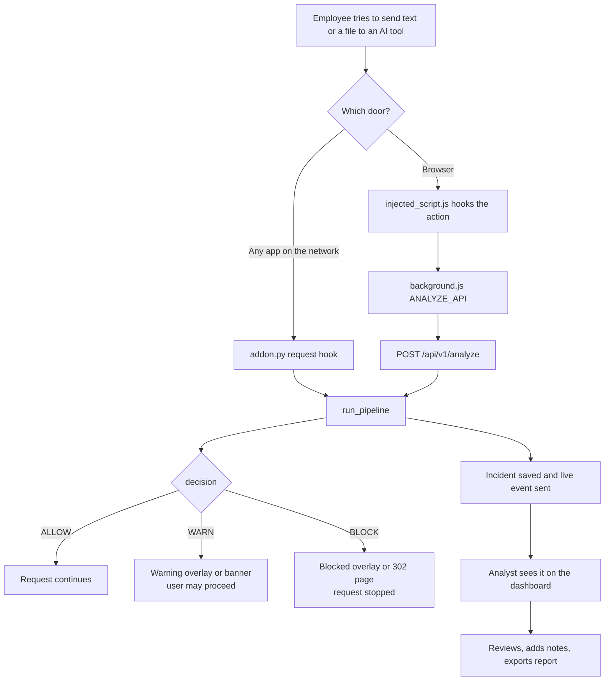
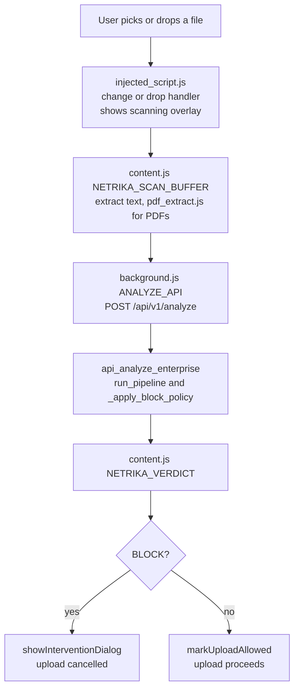
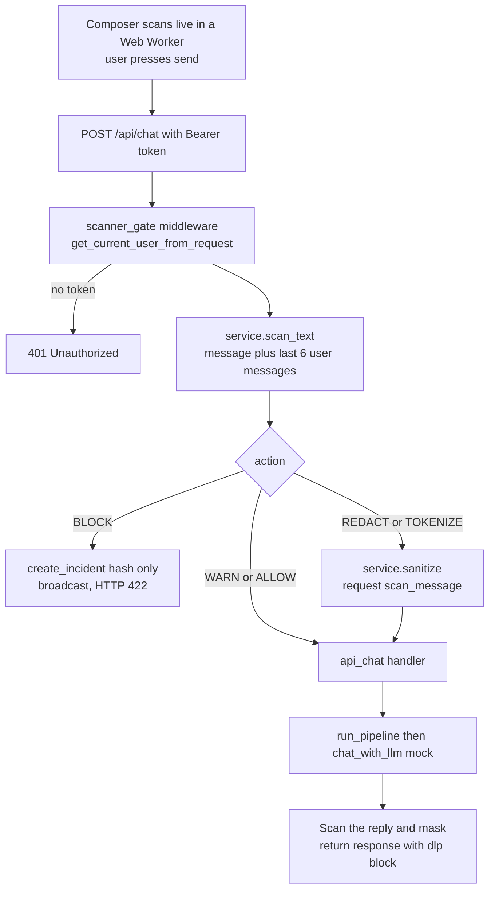
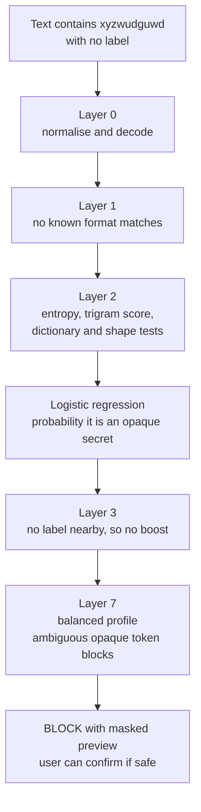
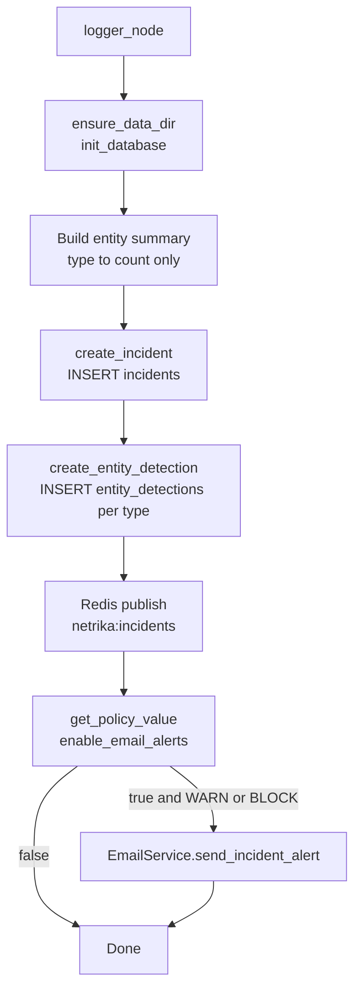
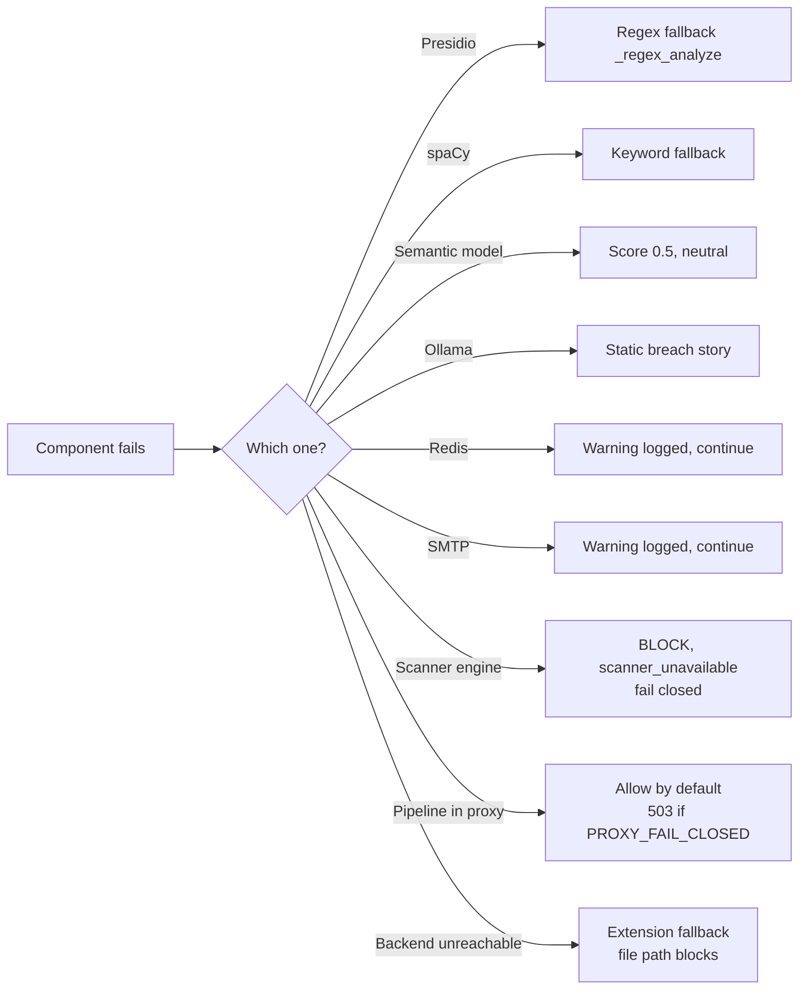
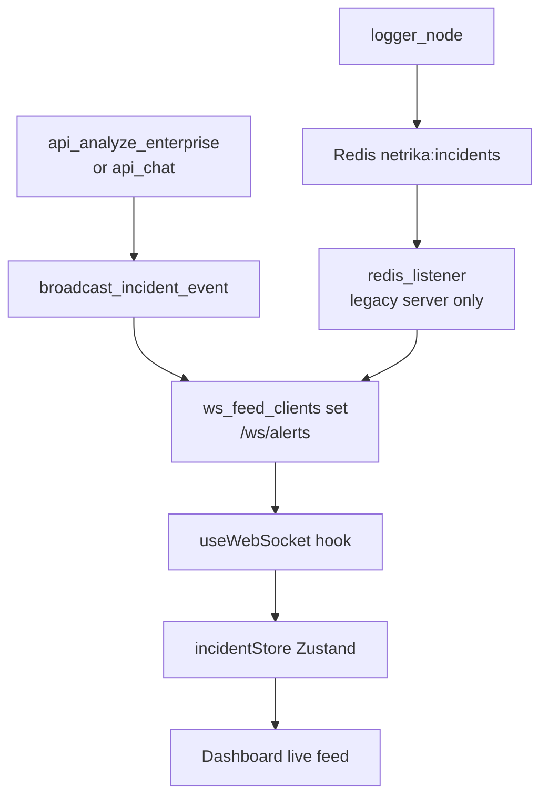
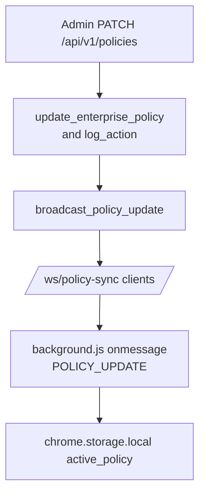

# Part 6: Important Workflows and Diagrams

The diagrams use the real file, class and function names. Each is followed by a plain-English explanation. (Parts 2 and 3 already contain the architecture, authentication, pipeline, scanner-layer and deployment diagrams.)

## 6.1 Overall application workflow

**In words.** Two doors lead to one pipeline. The pipeline decides, the interceptor enforces the decision, and the logger records it, so the analyst's dashboard reflects what employees experienced.

## 6.2 Browser file upload (a major feature, step by step)

**In words.** The page script catches the file before the browser sends it, a scanning overlay appears, the text is extracted (PDF text needs pdf.js), the backend decides, and the page script either cancels the upload or marks it allowed for a short window (about 30 seconds) so the real network call is not scanned twice. If the backend is unreachable the handler's fallback applies (the file-scan path blocks, "fail-closed").

## 6.3 Chat message through the server gate

**In words.** The middleware sits in front of the handler, so no client can reach the model without being scanned. The reply is scanned too, in case the model echoes or invents data that must not leave.

## 6.4 Scanner reasoning on a bare token

**In words.** There is no keyword and no format, so the decision rests on statistics: the token looks nothing like words, names or identifiers. The default profile prefers to interrupt and ask. In the project's synthetic evaluation this kind of case was caught 98.17 percent of the time; a person's own memorable password is caught far less often (84.15 percent).

## 6.5 Database interaction when an incident is logged

**In words.** Two inserts record the event; each step is individually guarded, so a Redis or email failure never loses the database record, and a database failure never stops the user's decision from being returned.

## 6.6 Error handling and recovery

**In words.** The design principle is "degrade, do not crash" for optional features and "fail closed" for the safety-critical scanner. The proxy is the exception: by default it lets traffic through if the whole pipeline crashes, which is a deliberate availability choice that the `PROXY_FAIL_CLOSED` switch can reverse.

## 6.7 Live updates to the dashboard

**In words.** The primary server pushes the event itself. The Redis route exists for the legacy server and for sharing events between processes, but the primary server does not subscribe to it.

## 6.8 Policy change reaching the extension

**In words.** The update is stored, audited and pushed. The extension keeps it in local storage; as noted in 3.15, the interception scripts do not currently read it.
