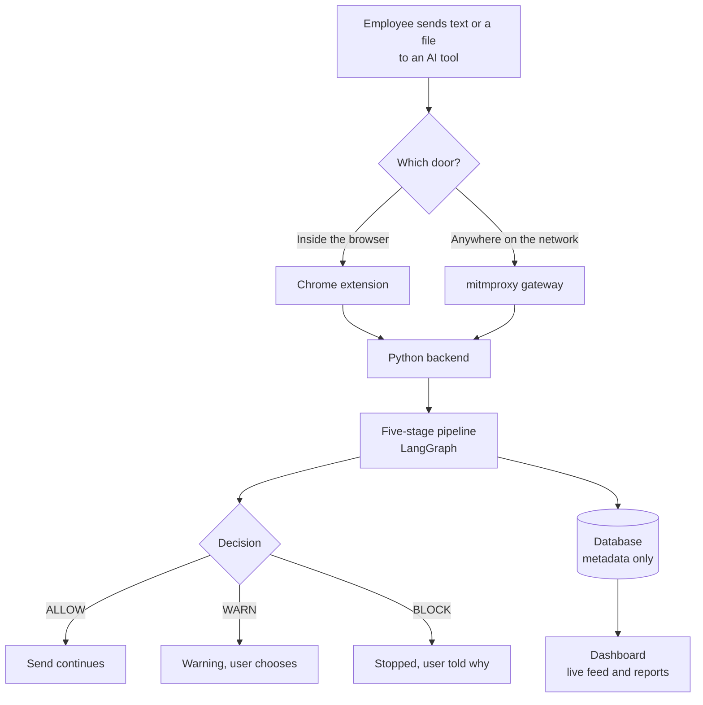
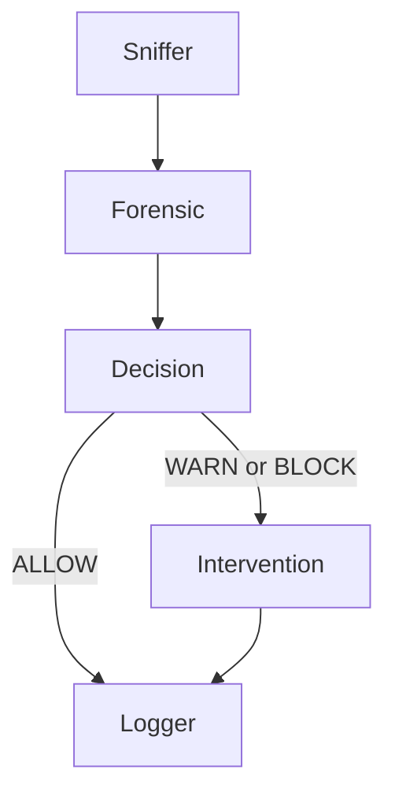

# Kavach (Netrika-Trace)

## Study Guide: How It Works and the Tools Behind It

**Learning guide for understanding the project and preparing for interviews**

Prepared 29 October 2026.

> A learning guide, not a code audit. For routes, schema and known issues see `PROJECT_DOCUMENTATION.pdf`.

---

# Table of Contents

- [Part 1: The Project in Plain Language](#part-1-the-project-in-plain-language)
    - [1.1 What the project is](#11-what-the-project-is)
    - [1.2 Why it exists](#12-why-it-exists)
    - [1.3 An everyday analogy](#13-an-everyday-analogy)
    - [1.4 How it works, step by step](#14-how-it-works-step-by-step)
    - [1.5 The five-stage pipeline](#15-the-five-stage-pipeline)
    - [1.6 What the detectors look for](#16-what-the-detectors-look-for)
    - [1.7 The layered scanner in one page](#17-the-layered-scanner-in-one-page)
    - [1.8 The privacy promise](#18-the-privacy-promise)
    - [1.9 Who uses it](#19-who-uses-it)
    - [1.10 What to be honest about](#110-what-to-be-honest-about)
    - [1.11 The tech stack at a glance](#111-the-tech-stack-at-a-glance)
- [Part 2: The Tools and Frameworks](#part-2-the-tools-and-frameworks)
    - [2.1 Python and asynchronous programming (asyncio, aiohttp)](#21-python-and-asynchronous-programming-asyncio-aiohttp)
    - [2.2 REST, JSON and WebSockets](#22-rest-json-and-websockets)
    - [2.3 LangGraph (the pipeline)](#23-langgraph-the-pipeline)
    - [2.4 Regular expressions (regex)](#24-regular-expressions-regex)
    - [2.5 Microsoft Presidio (PII detection)](#25-microsoft-presidio-pii-detection)
    - [2.6 spaCy and Named Entity Recognition (NER)](#26-spacy-and-named-entity-recognition-ner)
    - [2.7 Embeddings, cosine similarity and sentence-transformers](#27-embeddings-cosine-similarity-and-sentence-transformers)
    - [2.8 Machine-learning ideas used by the scanner](#28-machine-learning-ideas-used-by-the-scanner)
    - [2.9 Local LLMs with Ollama](#29-local-llms-with-ollama)
    - [2.10 Proxies, TLS and mitmproxy](#210-proxies-tls-and-mitmproxy)
    - [2.11 Chrome extensions (Manifest V3)](#211-chrome-extensions-manifest-v3)
    - [2.12 Databases: SQL, SQLAlchemy, SQLite and PostgreSQL](#212-databases-sql-sqlalchemy-sqlite-and-postgresql)
    - [2.13 Redis and publish/subscribe](#213-redis-and-publishsubscribe)
    - [2.14 Celery and background jobs](#214-celery-and-background-jobs)
    - [2.15 Authentication, hashing and roles](#215-authentication-hashing-and-roles)
    - [2.16 The frontend: React, TypeScript, Vite, Tailwind and friends](#216-the-frontend-react-typescript-vite-tailwind-and-friends)
    - [2.17 Docker and Docker Compose](#217-docker-and-docker-compose)
    - [2.18 Testing: pytest and vitest](#218-testing-pytest-and-vitest)
- [Part 3: Interview Practice on the Project](#part-3-interview-practice-on-the-project)
    - [3.1 Explaining the project](#31-explaining-the-project)
    - [3.2 Design decisions](#32-design-decisions)
    - [3.3 Challenges and how to talk about them](#33-challenges-and-how-to-talk-about-them)
    - [3.4 Limitations and next steps (say these proudly)](#34-limitations-and-next-steps-say-these-proudly)
    - [3.5 Concept questions that often follow](#35-concept-questions-that-often-follow)
    - [3.6 Your own contribution](#36-your-own-contribution)
- [Part 4: Revision Sheets](#part-4-revision-sheets)
    - [4.1 One-page cheat sheet](#41-one-page-cheat-sheet)
    - [4.2 Glossary](#42-glossary)

---

# Part 1: The Project in Plain Language

## 1.1 What the project is

**Kavach** (the code is named *Netrika-Trace*) is a security guard for AI chatbots.

When an employee types or pastes something into ChatGPT, Gemini or Claude, Kavach reads it first. If it contains something that must not leave the company, such as an Aadhaar number, a password, an AWS key or private source code, Kavach stops it, warns the user, or hides the sensitive part. It also writes a record for the security team, but the record never contains the secret itself, only what *kind* of secret it was.

**The one-sentence version for an interview:**

"Kavach is a data-loss-prevention gateway for generative AI: a Chrome extension and a network proxy send text to a Python pipeline that detects sensitive data and decides allow, warn or block, and a React dashboard shows what happened."

## 1.2 Why it exists

* People paste confidential material into AI tools because it is fast. Once sent, it cannot be taken back.
* A firewall can only block a whole website. It cannot read the message.
* Old-style security tools look for keywords, so they miss a password with no label.
* In India, the Digital Personal Data Protection (DPDP) Act 2023 expects organisations to protect personal data, so leaking Aadhaar or PAN numbers has legal weight.

## 1.3 An everyday analogy

Think of an airport security check, but for text.

| Airport | Kavach |
|---|---|
| Two entrances: staff gate and passenger gate | Two doors: the browser extension and the network proxy |
| X-ray machine | The detectors (patterns, language models, statistics) |
| Officer decides: let through, extra check, stop | ALLOW, WARN, BLOCK |
| Log of incidents without keeping your luggage | Audit log with types and counts, never the secret |
| Control room screens | The React dashboard with a live feed |

## 1.4 How it works, step by step

1. **Interception.** The employee sends something to an AI site. Either the Chrome extension catches it inside the browser, or the proxy catches it on the network.
2. **Extraction.** The text is pulled out of the request, or out of a PDF or Word file.
3. **Pipeline.** The text goes through five stages (below).
4. **Decision.** The result is ALLOW, WARN or BLOCK.
5. **Enforcement.** The extension or proxy acts: let it go, show a warning, or stop it.
6. **Record.** An incident is stored and a live update reaches the dashboard.



## 1.5 The five-stage pipeline

The pipeline is built with **LangGraph**. Each stage is a function that receives a shared "state" (a dictionary) and returns it with more information added.

| Stage | What it does, simply |
|---|---|
| **Sniffer** | Gives the request an ID, makes a fingerprint (SHA-256 hash) of the text, trims it |
| **Forensic** | The detectives: look for personal data, names, code, secrets and odd random strings, then compute a risk score from 0 to 100 |
| **Decision** | Compare the score with limits: 70 or more is BLOCK, 40 or more is WARN, below is ALLOW (limits come from `config.json`) |
| **Intervention** | For WARN and BLOCK, ask a local AI to write a short "how an attacker could misuse this" story so the user learns |
| **Logger** | Save the incident, send a live update, optionally email |



## 1.6 What the detectors look for

* **Personal data** with Microsoft Presidio plus custom patterns for Indian IDs: Aadhaar (12 digits), PAN (5 letters, 4 digits, 1 letter), UPI IDs, IFSC bank codes.
* **Secrets and code** with regular expressions: AWS keys (`AKIA...`), private-key headers, JWT tokens, database URLs, passwords, source-code shapes.
* **Names, places, organisations** with spaCy. These are only recorded for the dashboard, never used to block (normal text is full of names).
* **Meaning** with a sentence-embedding model. It is computed, but with the shipped settings it does not change the score.
* **A layered scanner** (written for this project) for the hard cases: a random password with no label, text hidden with base64 or look-alike letters, and fingerprints of the company's real secrets.

## 1.7 The layered scanner in one page

Regular expressions only catch secrets that *look like something known*. A password like `xyzwudguwd` looks like nothing. The scanner decides in layers:

| Layer | Idea |
|---|---|
| 0. Clean up | Normalise odd characters, remove invisible characters, decode base64, hex and URL-encoding so hidden text becomes visible |
| 1. Known formats | 85 patterns for real services, plus maths checks such as Luhn for cards and Verhoeff for Aadhaar |
| 2. Statistics | Does this token look like a word or like random noise? Uses entropy, letter-pair probabilities and a small logistic-regression model |
| 3. Context | Is there a label nearby like `password=` or `token:`, in about 25 languages? |
| 4. Fingerprints | Compare against hashes of the company's real secrets (server only) |
| 7. Decision | Combine the evidence into a score and pick BLOCK, REDACT, TOKENIZE, WARN or ALLOW |

Two names to remember: **REDACT** hides the value; **TOKENIZE** swaps it for a placeholder like `[SECRET_1]` and restores it on the user's screen afterwards.

The scanner exists twice, in Python (the boss, on the server) and in TypeScript (instant feedback in the browser). A test checks that both give the same answers.

## 1.8 The privacy promise

* The log stores the type and count (for example "1 AWS key"), a SHA-256 hash, the size and the score. **Never the secret.**
* The local AI that writes the breach story is given only type names, never the text.
* Tests check that raw secrets do not reach logs or the live feed.

## 1.9 Who uses it

| Person | Sees |
|---|---|
| Employee | Overlays in the browser: scanning, warning, blocked |
| SOC analyst | Live feed, incident list, can mark incidents as reviewed |
| Admin | Settings, devices, reports |

## 1.10 What to be honest about

Interviewers like candidates who know the limits of their own project.

* It is a **working prototype**, not a hardened product.
* The chat sandbox is a **simulator**: the DLP checks are real, but the AI reply is a canned mock.
* The scanner's accuracy numbers come from a **synthetic test set**, not real company data.
* No scanner is perfect. A person can paraphrase a secret or retype it from memory.
* Some features exist in code but are not fully connected (for example, the policy screen and background jobs).

The full list is in `PROJECT_DOCUMENTATION.pdf`, section 7.

## 1.11 The tech stack at a glance

| Job | Tool |
|---|---|
| Backend language and server | Python, aiohttp |
| Pipeline | LangGraph |
| Personal data | Microsoft Presidio |
| Names and places | spaCy |
| Meaning | sentence-transformers (MiniLM) |
| Local AI story | Ollama with phi3:mini |
| Network interception | mitmproxy |
| Browser interception | Chrome extension (Manifest V3) |
| Storage | SQLAlchemy with SQLite or PostgreSQL |
| Live events | Redis pub/sub, WebSockets |
| Login | JWT tokens, PBKDF2 password hashing, roles |
| Dashboard | React, TypeScript, Vite, Tailwind |
| Packaging | Docker and Docker Compose |
| Tests | pytest, vitest |

Part 2 teaches each of these.

# Part 2: The Tools and Frameworks

Every chapter follows the same order so you can revise quickly: **What it is**, **Why the project uses it**, **How it works (concepts to know)**, **Alternatives**, **Interview questions**.

---

## 2.1 Python and asynchronous programming (asyncio, aiohttp)

**What it is.** Python is the language of the whole backend. `asyncio` is Python's built-in way to do many things "at the same time" on one thread. `aiohttp` is a web framework built on it.

**Why here.** The server has many short requests and long-lived WebSocket connections. Most of the time a request is *waiting* (for the network, a database). Async lets one thread serve other requests during those waits. The detection libraries (spaCy, transformers) are also Python, so no language bridge is needed.

**How it works.**
* A function declared `async def` can `await` something slow. While it waits, the **event loop** runs other work.
* Async helps with *waiting*, not with heavy *computing*. A big spaCy scan would still block the loop, so the project runs the pipeline in a thread pool with `run_in_executor`.
* **Middleware** is code that runs before or after every request. The project uses it for CORS headers and for the security gate that scans chat messages.
* **The GIL** (Global Interpreter Lock) lets only one thread run Python code at a time, so threads help with waiting and with libraries that release the lock, not with pure Python number crunching.

**Alternatives.** Flask (simple, synchronous), FastAPI (async with automatic validation and docs; a popular modern choice), Django (full-featured, heavier).

**Interview questions**
* **What is the difference between concurrency and parallelism?** Concurrency is handling many tasks by switching between them; parallelism is running them literally at the same time on several cores.
* **Why not just use threads?** Threads cost memory and switching overhead per connection; async scales better for many idle connections.
* **What does `await` do?** It pauses this function until the result is ready and lets the event loop run other tasks meanwhile.
* **Why `run_in_executor`?** To stop CPU-heavy code from freezing the event loop.

---

## 2.2 REST, JSON and WebSockets

**What they are.** *REST* is a style of web API: the client sends an HTTP request (GET to read, POST to create, PATCH to update, DELETE to remove) and the server replies, usually in *JSON* (a text format for structured data). A *WebSocket* is a connection that stays open so the server can push messages whenever it wants.

**Why here.** The dashboard asks for lists and reports with REST. New incidents appear instantly through a WebSocket, so nobody has to refresh.

**Concepts.**
* HTTP status codes: 200 OK, 400 bad input, 401 not signed in, 403 not allowed, 404 not found, 422 request understood but refused, 500 server error. (Kavach answers 422 when it blocks a chat message.)
* REST is *request then response*; WebSocket is *two-way and persistent*.
* Alternatives for live updates: polling (ask every few seconds), Server-Sent Events (one-way push).

**Interview questions**
* **REST versus WebSocket?** REST for client-initiated requests; WebSocket for server pushes and real-time feeds.
* **What happens if the WebSocket drops?** The live feed stops until it reconnects; stored data is safe in the database.
* **What is idempotent?** An operation that has the same effect if repeated; GET and PUT are idempotent, POST usually is not.
* **Why validate input on the server?** The client can be bypassed; the server must never trust it.

---

## 2.3 LangGraph (the pipeline)

**What it is.** A library for building a **graph of steps** that share one state. Each *node* is a function that takes the state and returns an updated state. *Edges* connect nodes; a *conditional edge* chooses the next node using a function.

**Why here.** The detection flow is a small flowchart with one branch (intervene or not). A graph makes each stage separate, testable and easy to draw.

**How it works.**
```python
graph = StateGraph(AgentState)          # state is a typed dictionary
graph.add_node("sniffer_node", sniffer_node)
graph.add_edge("sniffer_node", "forensic_node")
graph.add_conditional_edges("decision_node", should_intervene, {...})
pipeline = graph.compile()
result = pipeline.invoke(initial_state)
```

**Be honest about it.** The nodes are normal Python functions, not autonomous AI agents. "Agentic" here means a staged, orchestrated pipeline. LangGraph also supports loops, parallel branches and LLM-driven agents, which this project does not use.

**Alternatives.** Plain function calls in order; task orchestrators such as Prefect or Airflow (heavier, for batch jobs).

**Interview questions**
* **What is a state machine?** A system that is always in one state and moves to another by defined rules.
* **Why a shared state object?** Every stage can read earlier results and add its own without passing many arguments.
* **Do you need LangGraph for this?** Not strictly; it adds structure and room to grow.

---

## 2.4 Regular expressions (regex)

**What it is.** A mini-language for describing text patterns. `[A-Z]{5}[0-9]{4}[A-Z]` means "five capital letters, four digits, one capital letter", which is the shape of an Indian PAN number.

**Why here.** Many secrets have a fixed shape: AWS keys start with `AKIA` and have 16 more characters; Aadhaar is 12 digits; private keys start with `-----BEGIN ... PRIVATE KEY-----`.

**Concepts to know.**
* `\d` digit, `\w` word character, `\s` space, `.` any character, `*` zero or more, `+` one or more, `{n}` exactly n, `[...]` a set, `(...)` a group, `|` or, `^` and `$` start and end, `\b` word boundary.
* **Checksums complement regex.** A regex can match any 12 digits; the Verhoeff checksum checks whether they could really be an Aadhaar number.
* **Catastrophic backtracking.** Some patterns take exponential time on crafted input, which is a denial-of-service risk. The project rewrote two such patterns and added a test.
* Regex is brittle against disguise (spacing, encoding), which is why the scanner first normalises text.

**Interview questions**
* **Write a regex for an Indian PAN.** `\b[A-Z]{5}[0-9]{4}[A-Z]\b`.
* **What are the limits of regex for security?** Easy to evade, no understanding of meaning, false positives.
* **What is a false positive and a false negative?** Flagging something harmless; missing something harmful.

---

## 2.5 Microsoft Presidio (PII detection)

**What it is.** An open-source library that finds personal data in text. Its `AnalyzerEngine` runs many *recognizers* (patterns, checksums, NLP) and returns each match with a type, position and confidence score.

**Why here.** It already knows credit cards, SSNs, emails and IBANs. The project adds *custom recognizers* for Aadhaar, PAN, UPI IDs and IFSC codes using `PatternRecognizer` (a regex plus a score).

**How it works here.** The wrapper runs Presidio, ignores harmless types such as names and dates when scoring, and gives high-confidence types (Aadhaar, PAN, keys, credentials) a heavy weight. If Presidio fails to load, a regex fallback runs so detection degrades instead of stopping.

**Alternatives.** Cloud DLP services (they would receive the data, defeating the purpose), training your own PII model (needs labelled data), pure regex.

**Interview questions**
* **What is PII?** Personally Identifiable Information: data that can identify a person.
* **How do you add a new entity type?** Create a `PatternRecognizer` with a regex and a score and register it with the analyzer.
* **Why is confidence score useful?** It lets you set thresholds to balance missed detections against false alarms.

---

## 2.6 spaCy and Named Entity Recognition (NER)

**What it is.** spaCy is an NLP library. *NER* tags words that are names of people, organisations, places, dates and money. The project uses the small English model `en_core_web_sm`.

**Why here.** To give analysts context ("which organisations appear in this message"). It is not used to block, because names appear in ordinary text.

**Concepts.** *Tokenisation* splits text into words; a *pipeline* applies tagger, parser and NER; models are *pre-trained* on large labelled text; small models are fast but less accurate than large ones.

**Interview questions**
* **What is NER?** Finding and labelling named things in text.
* **Why does your NER score not affect blocking?** Because it would flag nearly every message.
* **Small versus large model?** Small is faster and lighter; large is more accurate.

---

## 2.7 Embeddings, cosine similarity and sentence-transformers

**What they are.** An *embedding* turns text into a list of numbers (a vector) so that similar meanings are close together. `all-MiniLM-L6-v2` is a small model that produces 384 numbers per sentence. *Cosine similarity* measures how close two vectors are by the angle between them, from -1 to 1.

**Why here.** To judge the *meaning* of a message even when no pattern matches: compare it with example "dangerous" and "safe" prompts and see which it resembles more.

**How it works here.** Embed the text, take the highest similarity to the dangerous examples and to the safe examples, and turn the ratio into a 0 to 1 score. It then labels the intent (PII leak, IP leak, safe, ambiguous). With the shipped configuration its weight is 0, so it only sets the label.

**Formula to remember:** `cosine(a, b) = (a · b) / (|a| |b|)`.

**Interview questions**
* **What is an embedding?** A numeric vector representing meaning.
* **Why cosine and not Euclidean distance?** It compares direction, not length, which suits text vectors.
* **Downsides?** Needs a model download and CPU time; quality depends on the example sentences.

---

## 2.8 Machine-learning ideas used by the scanner

You do not need deep ML for this project, but you should explain these four ideas.

**Entropy.** A measure of unpredictability: `H = -Σ p(c) log2 p(c)`. Random keys have high entropy; English words have low entropy.

**Language model (trigram).** Learns which three-letter sequences are common in real words. `xyzwudguwd` has very unlikely sequences, so it looks random.

**Logistic regression.** A simple classifier. It multiplies each feature by a weight, adds them, and squashes the result to a probability between 0 and 1: `p = 1 / (1 + e^-(w·x + b))`. It is fast, small and explainable. The project trained it on synthetic examples, not real leaked data.

**Evaluation.**
* Precision = TP / (TP + FP): of the alerts raised, how many were right.
* Recall = TP / (TP + FN): of the real problems, how many were caught.
* F1 is the harmonic mean of the two.
* TP, FP, TN and FN are true and false positives and negatives.

The scanner's own report (synthetic data): recall 98.6 percent, precision 99.0 percent, about 1 percent false alarms. Human-style passwords like `Summer2024!` were caught only about 84 percent of the time.

**Other terms.** Noisy-OR (combine independent evidence: `1 - Π(1 - p)`), train/test split, overfitting, synthetic data, parity test (two implementations must agree).

**Interview questions**
* **Precision versus recall, which matters here?** Both: a missed secret is costly, but too many false alarms make users ignore the tool.
* **Why logistic regression and not a neural network?** Small data, need for speed and explainability, runs in the browser.
* **What is overfitting?** Learning the training data too closely so it fails on new data.

---

## 2.9 Local LLMs with Ollama

**What it is.** Ollama runs large language models on your own machine. `phi3:mini` is a small model (about 3.8 billion parameters).

**Why here.** For each WARN or BLOCK, it writes a three-paragraph story of how an attacker could misuse that kind of data. Running it locally means no data goes to a cloud service, and the prompt contains only type names and counts.

**Concepts.** *Prompt* (the instruction), *temperature* (randomness; the project uses 0.7), *tokens* (pieces of text; limit 300 here), *hallucination* (confident but wrong output), *fallback* (if Ollama is missing, a fixed text is used).

**Interview questions**
* **Why local and not the OpenAI API?** Sending data to a cloud LLM would be the leak you are preventing.
* **Can the LLM change the decision?** No, it only writes educational text after the decision.
* **What are the limits of small LLMs?** Less accurate, slower on CPU, can hallucinate.

---

## 2.10 Proxies, TLS and mitmproxy

**What they are.** A *proxy* is a middleman that forwards your traffic. *TLS* (the "S" in HTTPS) encrypts traffic between browser and website. *mitmproxy* is a scriptable proxy that can read HTTPS by acting as a "man in the middle".

**Why here.** The browser extension cannot see desktop apps or scripts. A proxy on port 8080 sees everything that is sent through it, so it covers those gaps.

**How it works.**
1. The client trusts mitmproxy's own **certificate authority (CA)**.
2. For each HTTPS site, mitmproxy presents a certificate signed by that CA, decrypts the request, lets the addon inspect it, then re-encrypts it to the real server.
3. The project's addon checks the hostname against a list of AI services, extracts the prompt text from the JSON body, runs the pipeline, and either redirects (BLOCK), injects a banner (WARN) or does nothing (ALLOW).

**Concepts.** Certificate, CA, handshake, transparent versus explicit proxy, why TLS interception needs consent and company-managed devices.

**Alternatives.** A commercial secure web gateway; DNS or SNI filtering (can block domains but cannot read content); an endpoint agent.

**Interview questions**
* **How can a proxy read HTTPS?** By terminating TLS with its own CA that the client trusts, then opening a second TLS connection to the real server.
* **Is that ethical or safe?** Only on managed devices with a clear policy; it can read sensitive traffic, so protect the CA key.
* **What is a fail-open versus fail-closed design?** Fail-open allows traffic if the checker breaks; fail-closed blocks it. Kavach's scanner fails closed; the proxy fails open unless `PROXY_FAIL_CLOSED=1`.

---

## 2.11 Chrome extensions (Manifest V3)

**What it is.** A small program that runs inside Chrome. *Manifest V3* is the current extension platform.

**Why here.** The extension sees text and files inside the page *before* they are encrypted and sent, and can show friendly overlays.

**The parts to know.**

| Part | Role |
|---|---|
| `manifest.json` | Declares permissions, scripts and where they run |
| **Content script** | JavaScript injected into web pages |
| **Isolated world vs MAIN world** | By default a content script sees the page's DOM but not the page's JavaScript variables. A script declared with `"world": "MAIN"` runs inside the page's own context, so it can wrap `window.fetch` before the site does |
| **Service worker** (`background.js`) | Event-driven background script; holds settings and makes the call to the backend |
| `postMessage` / `chrome.runtime.sendMessage` | How these pieces talk to each other |

**How Kavach uses it.** A MAIN-world script wraps `fetch`, `XMLHttpRequest`, file inputs, drag and drop and paste. It asks the content script to scan; the content script asks the service worker; the service worker calls the backend; the answer decides whether the upload continues.

**Limits.** MV3 restricts the old network-blocking API, so patching in the page is the practical route; a determined user can disable the extension, which is why the proxy is a second layer. Real-site behaviour was not tested in this project review.

**Interview questions**
* **What changed in Manifest V3?** Service workers replace persistent background pages; remote code is not allowed; network request blocking is limited.
* **Why a MAIN-world script?** To intercept the page's own `fetch` calls.
* **Why call the backend from the service worker?** It has host permission, which avoids page CSP and CORS limits.

---

## 2.12 Databases: SQL, SQLAlchemy, SQLite and PostgreSQL

**What they are.** A *relational database* stores data in tables with rows and columns, linked by keys. *SQL* is the language to query it. *SQLAlchemy* is a Python library (an *ORM*, object-relational mapper) that lets you work with tables as Python classes. SQLite is a database in a single file; PostgreSQL is a full database server.

**Why here.** Incidents, users, organisations and devices are related records. The project defaults to SQLite (no setup, good for demos) and uses PostgreSQL in Docker (many users at once, robust).

**Concepts to know.**
* **Primary key:** uniquely identifies a row. **Foreign key:** points to a row in another table, such as an incident's `org_id`.
* **Index:** speeds up lookups at the cost of extra storage and slower writes.
* **JOIN:** combines rows from two tables. **GROUP BY:** groups rows to count or sum.
* **ORM trade-off:** less SQL to write, but you must watch the queries it generates.
* **Migrations** (for example Alembic) change the schema safely over time. This project does not use them; it creates tables with `create_all`.
* **Multi-tenancy:** several organisations in one database, separated by an `org_id` column.

**The main tables in plain words.** Organisations own users and devices. Every blocked or warned attempt becomes an **incident**; each incident can have several **entity detections** (what kinds of sensitive data were found). An **audit log** records actions like logins.

**A query to be able to write.**
```sql
SELECT decision, COUNT(*) AS total
FROM incidents
WHERE timestamp >= NOW() - INTERVAL '24 hours'
GROUP BY decision;
```

**Alternatives.** MongoDB (flexible documents; poor fit for related data), raw SQL (more control, more code).

**Interview questions**
* **SQL versus NoSQL?** SQL for structured, related data with constraints; NoSQL for flexible or massive unstructured data.
* **What is an index and when would you not add one?** A lookup structure; skip it on columns rarely queried or tables with heavy writes.
* **What is an ORM?** A layer that maps tables to classes so you write Python instead of SQL.
* **What is ACID?** Atomicity, Consistency, Isolation, Durability: guarantees that transactions are reliable.

---

## 2.13 Redis and publish/subscribe

**What it is.** Redis is an in-memory data store: very fast because it keeps data in RAM. *Pub/sub* lets a program publish a message to a named channel and any subscriber receives it instantly. Redis pub/sub does not store messages, so a subscriber that is offline misses them.

**Why here.** After saving an incident, the logger publishes a small event to the channel `netrika:incidents`, so other parts (such as the WebSocket server) can react without the logger knowing about them. That is **loose coupling**: the sender does not depend on who listens.

**Other uses to know.** Caching, rate limiting, expiring keys with a TTL (time to live), job queues.

**Alternatives.** Kafka (durable event log, for huge volumes), RabbitMQ (message broker with delivery guarantees).

**Interview questions**
* **What is pub/sub?** A messaging pattern where publishers and subscribers communicate through channels.
* **Redis versus a database?** Redis is fast and temporary; a database is durable and queryable.
* **Does Redis pub/sub guarantee delivery?** No.

---

## 2.14 Celery and background jobs

**What it is.** Celery runs tasks in separate worker processes, taking them from a queue (here, Redis). A *scheduler* decides when a task runs; a *worker* executes it.

**Why it matters.** Slow work such as generating PDFs or sending webhooks should not make the user wait.

**Be honest.** The project defines two Celery tasks (PDF generation, webhook alert) but the application does not currently call them. You can explain the concept and say it is prepared, not active.

**Interview questions**
* **Why use a queue?** To separate producing work from doing it, smooth spikes and retry failures.
* **How do you scale workers?** Run more worker processes or containers reading the same queue.

---

## 2.15 Authentication, hashing and roles

**Key ideas.**
* **Hashing** turns data into a fixed-size fingerprint; it is one-way. **SHA-256** is a standard hash; the project uses it to fingerprint payloads so it never stores them.
* **Password hashing** must be slow and salted. The project uses **PBKDF2-HMAC-SHA256** with a random salt and 100,000 rounds. Stronger choices today are bcrypt, scrypt or argon2.
* **HMAC** is a hash that uses a secret key. The scanner uses HMAC to fingerprint real company secrets so a stolen database cannot be brute-forced offline.
* **JWT (JSON Web Token):** a signed token with three parts, header, claims and signature. After login the server returns one; the client sends it in the `Authorization: Bearer ...` header; the server verifies the signature and expiry.
* **RBAC (role-based access control):** permissions belong to roles. Kavach has SUPER_ADMIN, ORG_ADMIN, ANALYST and EMPLOYEE.
* **Authentication** proves who you are; **authorization** decides what you may do.

**Be honest about gaps (good interview material).** The JWT code is hand-written rather than using a library, there is a fallback default secret, and several endpoints are open. Say you know these should be hardened.

**Interview questions**
* **Hash versus encryption?** Hashing is one-way; encryption is reversible with a key.
* **Why salt passwords?** So identical passwords give different hashes and rainbow tables fail.
* **Where should a JWT be stored in a browser?** `localStorage` is simple but readable by injected scripts; an httpOnly cookie is safer against XSS.
* **What is CORS?** A browser rule about which websites may call an API; wide-open CORS is a risk.

---

## 2.16 The frontend: React, TypeScript, Vite, Tailwind and friends

| Tool | What it is | Why here |
|---|---|---|
| **React** | A JavaScript *library* for building UIs from reusable components | The dashboard has many live-updating parts |
| **TypeScript** | JavaScript with types | Catches wrong data shapes at build time |
| **Vite** | A fast build tool and dev server | Quick rebuilds, simple setup |
| **Tailwind CSS** | Utility classes for styling | One set of design tokens (colours, radii) in CSS variables, with light and dark themes |
| **React Router** | Client-side page routing | Dashboard, incidents, devices, reports, chat |
| **TanStack Query** | Fetching and caching server data | Loading and error states for free |
| **Zustand** | A tiny state store | Holds the live incident list |
| **Framer Motion** | Animation | The animated characters and transitions |
| **Recharts** | Charts | Dashboard graphs |
| **Web Worker** | Runs JavaScript on a background thread | The scanner runs without freezing typing |
| **tesseract.js** | OCR in the browser | Reads text from images |

**React concepts to know.**
* **Component:** a reusable piece of UI. **Props:** data passed from parent to child (read-only). **State:** data a component owns that can change; changing it re-renders the UI.
* **Hooks:** `useState`, `useEffect` (side effects such as fetching), custom hooks like `useWebSocket`.
* **Virtual DOM:** React compares a lightweight copy of the page to update only what changed.
* React is a *library*; routing, data fetching and state come from other libraries.

**Interview questions**
* **State versus props?** State is owned and mutable inside a component; props are inputs from the parent.
* **Why TypeScript?** Static types prevent a class of bugs and document data shapes.
* **How does the frontend talk to the backend?** REST requests with a bearer token, plus a WebSocket for live events.
* **Why a Web Worker?** To keep heavy work off the UI thread.

---

## 2.17 Docker and Docker Compose

**What they are.** *Docker* packages an application and everything it needs into an **image**; a running copy is a **container**. A *Dockerfile* lists the build steps. *Docker Compose* describes several containers together in one file.

**Why here.** The project needs PostgreSQL, Redis, the backend, the proxy, a worker and the frontend. Compose starts them all with one command and gives everyone the same environment.

**Concepts.** Image versus container, volume (data that survives a restart), port mapping (`8888:8888`), environment variables for configuration, health checks, `depends_on`. A container shares the host's kernel, which makes it lighter than a virtual machine. Horizontal scaling means running more containers; vertical scaling means a bigger machine.

**Interview questions**
* **Docker versus virtual machine?** A VM virtualises a whole OS; a container isolates a process and shares the host kernel.
* **Why environment variables for secrets?** They keep secrets out of source code, but a proper secrets manager is better in production.
* **What is a volume?** Storage that outlives a container.

---

## 2.18 Testing: pytest and vitest

* **pytest** (Python) and **vitest** (TypeScript) run automated tests.
* **Unit test:** one function. **Integration test:** several parts together. **Fixture / mock:** a prepared environment or a fake dependency.
* The project's interesting tests are about *properties*: a secret never reaches the model through the raw API, logs never contain the payload, the pipeline blocks if the scanner breaks, and the TypeScript scanner agrees with the Python one.
* Say what you know: most tests ran, a couple fail or are timing-sensitive, and real-world conditions (real AI sites, Docker, TLS interception) were not covered by automated tests.

**Interview questions**
* **What makes a good test?** Fast, repeatable, independent, and checks behaviour not implementation.
* **What is test coverage and its limit?** The share of code run by tests; high coverage does not prove correctness.

# Part 3: Interview Practice on the Project

Short answers you can say aloud. Keep them natural; do not memorise word for word.

## 3.1 Explaining the project

**Tell me about your project.**

"Kavach is a data-loss-prevention gateway for generative AI. A Chrome extension and a network proxy intercept what employees send to tools like ChatGPT and pass it to a Python pipeline built with LangGraph. The pipeline detects personal data like Aadhaar and PAN, secrets, source code and even unlabelled random passwords, scores the risk and decides allow, warn or block. It stores only metadata, never the secret, and a React dashboard shows incidents live."

**What problem does it solve?**

"Employees paste confidential data into AI tools and it cannot be taken back. Firewalls cannot read content and keyword tools miss unlabelled secrets. We check the content at the moment of sending."

**Why both a proxy and an extension?**

"The extension sees text and files inside the browser and gives instant feedback. The proxy covers desktop apps and scripts. Each covers the other's blind spot."

**What happens when I paste an Aadhaar number?**

"The extension catches the paste or send, the text goes to the backend, the forensic stage matches the Aadhaar pattern, the risk score reaches 100, the decision stage blocks, the logger saves an incident with the type and count only, and the extension shows a blocked screen."

**What is the privacy design?**

"We never store the raw text. The log holds a SHA-256 hash, types, counts and scores. The local LLM only receives type names. Tests check that secrets do not reach logs."

## 3.2 Design decisions

**Why Python?** "The NLP and ML libraries are Python, and aiohttp gives async handling for WebSockets and many requests."

**Why LangGraph?** "It gives explicit stages that share a typed state and a conditional branch. Honestly, the stages are plain functions, so it adds structure rather than intelligence."

**Why a local LLM?** "A cloud LLM would receive the data we are trying to protect."

**Why SQLite and PostgreSQL?** "SQLite for zero-setup demos, PostgreSQL in Docker for concurrency. The data is relational."

**Why Redis pub/sub?** "To announce new incidents without the logger knowing who listens, which keeps components loosely coupled."

**Why React and TypeScript?** "A dashboard with live-updating parts suits components and state; TypeScript catches data-shape mistakes early."

**Why write the scanner in both Python and TypeScript?** "The browser needs instant feedback without sending text to a server; the server must enforce because a browser cannot be trusted. A parity test keeps both consistent."

**Why do NER entities not block?** "Names and places are in almost every message, so blocking on them would make the tool unusable. They are kept for the dashboard only."

**Why a risk score plus rules, not only ML?** "Rules are fast, explainable and predictable. Strong signals like an Aadhaar match must block regardless of the score."

## 3.3 Challenges and how to talk about them

**Detecting secrets with no label.** "A regex cannot find a random string. We used statistics: entropy, how unlike English the letter patterns are, dictionary coverage, and shape checks that exclude UUIDs and hashes, combined by a small logistic regression."

**Too many false alarms on real code.** "Early versions flagged many harmless identifiers. We added code-aware context rules and benign-shape checks and brought the false-alarm rate on real code down to about 3 percent on our test set."

**Slow or hanging regexes.** "Two patterns caused catastrophic backtracking. We rewrote them and added an adversarial test."

**Latency.** "The scanner takes under a millisecond typically, but spaCy and the embedding model are slower, so uploads use a fast path that skips the slow stages."

**Hidden or encoded secrets.** "We normalise text first: Unicode folding, removing invisible characters, collapsing spaced letters and decoding base64, hex and URL-encoding to a limited depth."

*(Only use a challenge in an interview if you can explain the details. If something was built with AI assistance, say how you reviewed and tested it.)*

## 3.4 Limitations and next steps (say these proudly)

**What are the limits?**

"It is a prototype. The chat sandbox uses a mock reply, accuracy was measured on a synthetic test set, the policy screen is not fully connected to the decisions, and some authentication hardening is still needed. No scanner can stop a determined person who paraphrases a secret."

**What would you improve?**

"Connect policy settings to the decision logic, replace the hand-written JWT with a maintained library and add rate limiting, add database migrations, connect a real LLM, run background jobs with Celery, and measure accuracy on real consented data."

**Is it production ready?** "No. It demonstrates the design well, but it needs hardening, load testing and real-world evaluation first."

## 3.5 Concept questions that often follow

| Question | Short answer |
|---|---|
| What is DLP? | Technology that stops sensitive data leaving an organisation |
| What is Shadow AI? | Use of AI tools the organisation does not know about or control |
| What is PII? | Personally identifiable information |
| What is a false positive? | Raising an alert for something harmless |
| What is fail-closed? | If the check cannot run, refuse rather than allow |
| What is loose coupling? | Components communicate without depending on each other's internals |
| What is a hash? | A one-way fixed-size fingerprint of data |
| HMAC vs hash? | HMAC uses a secret key, so outsiders cannot recompute it |
| What is a JWT? | A signed token carrying identity claims |
| What is RBAC? | Permissions assigned by role |
| What is middleware? | Code that runs on every request before the handler |
| REST vs WebSocket? | Request and response vs a persistent two-way connection |
| Image vs container? | Blueprint vs a running instance |
| What is an embedding? | A vector that represents meaning |
| Precision vs recall? | Right alerts among alerts vs real cases caught |

## 3.6 Your own contribution

Prepare a truthful answer to "what did you personally do?". A good structure:

1. The part you built or understand best and can explain line by line.
2. The parts you integrated, tested or reviewed, and how.
3. What you learned and what you would do differently.

If an AI assistant helped with parts of the project, say so plainly and describe how you verified the result. Interviewers value honesty and understanding more than a claim of doing everything alone.

---

# Part 4: Revision Sheets

## 4.1 One-page cheat sheet

**Flow:** extension or proxy, then backend, then Sniffer, Forensic, Decision, (Intervention), Logger, then dashboard.

**Decision:** score 70 or more BLOCK, 40 or more WARN, else ALLOW; extension or upload with a sensitive entity blocks at once; the scanner's BLOCK is final.

**Score:** weighted PII score times 100, plus 20 for code, plus 30 for secrets, plus 30 if PII is certain, capped at 100.

**Detectors:** Presidio (plus Aadhaar, PAN, UPI, IFSC), regex secrets and code, spaCy NER (audit only), MiniLM semantic (label only), layered scanner.

**Scanner layers:** 0 clean and decode, 1 known formats and checksums, 2 statistics for random tokens, 3 context labels, 4 fingerprints of real secrets, 7 decision (noisy-OR, profiles strict, balanced, relaxed).

**Actions:** ALLOW, WARN, REDACT (mask), TOKENIZE (placeholder), BLOCK.

**Privacy:** hash, type and count only; never the secret; local LLM sees only type names.

**Stack:** Python, aiohttp, LangGraph, Presidio, spaCy, sentence-transformers, Ollama, mitmproxy, Chrome MV3, SQLAlchemy (SQLite or PostgreSQL), Redis, Celery, JWT, React, TypeScript, Vite, Tailwind, Docker, pytest, vitest.

**Ports:** backend 8888, proxy 8080, frontend 3000 (Docker).

**Honest limits:** mock chat reply, synthetic accuracy numbers, partly connected policy, auth to harden.

## 4.2 Glossary

| Term | Meaning |
|---|---|
| Async / event loop | Doing other work while waiting; the loop schedules the tasks |
| Middleware | Code that wraps every request |
| LangGraph | Library for graphs of steps sharing state |
| Node, edge | A step, the link to the next step |
| Regex | Pattern language for text |
| Presidio | Microsoft's PII detection library |
| NER | Tagging names, places, organisations |
| Embedding | Numbers representing meaning |
| Cosine similarity | Closeness of two embeddings |
| Entropy | Randomness measure |
| Logistic regression | Simple probability classifier |
| Noisy-OR | Combining independent evidence |
| Precision, recall, F1 | Alert accuracy, catch rate, their balance |
| Ollama, phi3:mini | Local LLM runner and a small model |
| Proxy, mitmproxy | Middleman for traffic; scriptable HTTPS proxy |
| TLS, CA | HTTPS encryption; the authority that signs certificates |
| Manifest V3 | Chrome's current extension platform |
| Content script, service worker | Page-level script; background script of an extension |
| ORM, SQLAlchemy | Tables as Python classes |
| Primary key, foreign key | Unique row id, link to another table |
| Index | Structure that speeds up lookups |
| Redis, pub/sub | In-memory store; publish and subscribe messaging |
| Celery | Task queue with workers |
| Hash, SHA-256, HMAC | One-way fingerprint, a standard hash, keyed hash |
| PBKDF2 | Slow salted password hashing |
| JWT | Signed login token |
| RBAC | Role-based access control |
| CORS | Browser rule on cross-site API calls |
| React, props, state | UI library; inputs from parent; data a component owns |
| Vite, Tailwind | Build tool, utility CSS |
| Web Worker | Background thread in the browser |
| Docker, image, container, volume | Packaging tool, blueprint, running copy, persistent storage |
| Fail-closed | Refuse when the check cannot run |
| Parity test | Test that two implementations agree |
| REDACT, TOKENIZE | Mask a value, swap for a reversible placeholder |
| DPDP Act | India's data protection law (2023) |
