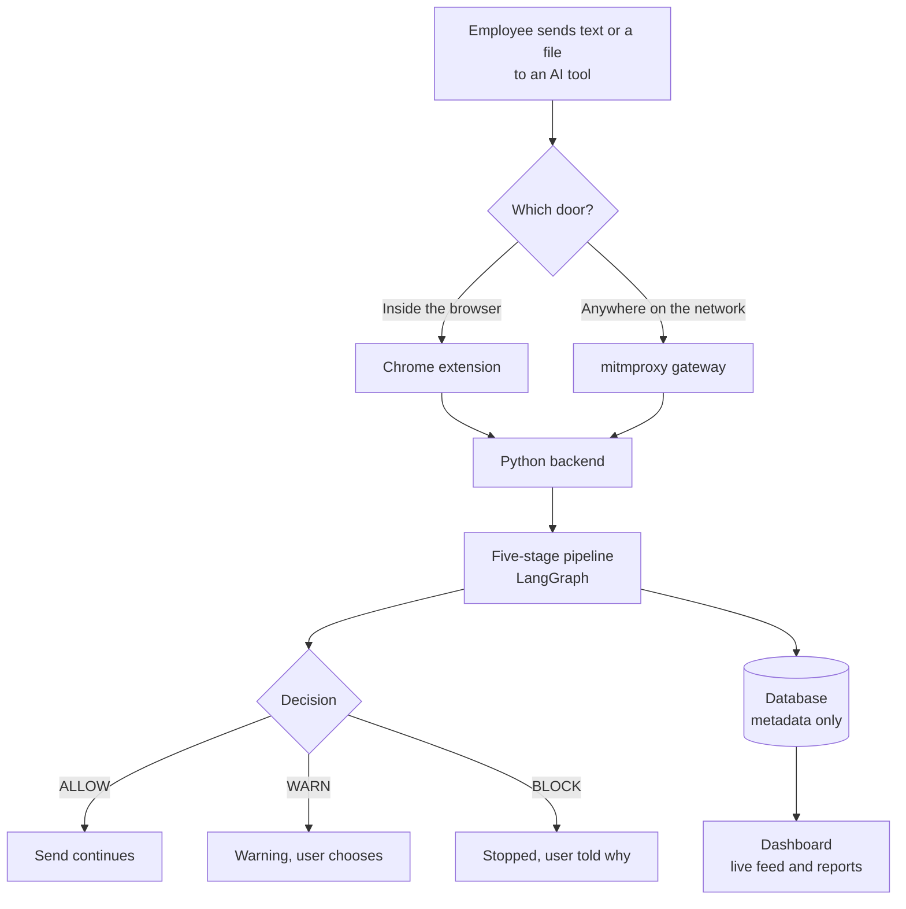
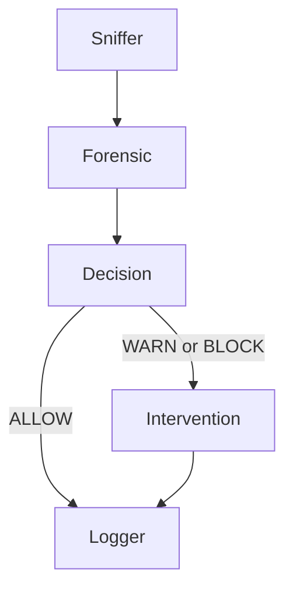

# Part 1: The Project in Plain Language

## 1.1 What the project is

**Kavach** (the code is named *Netrika-Trace*) is a security guard for AI chatbots.

When an employee types or pastes something into ChatGPT, Gemini or Claude, Kavach reads it first. If it contains something that must not leave the company, such as an Aadhaar number, a password, an AWS key or private source code, Kavach stops it, warns the user, or hides the sensitive part. It also writes a record for the security team, but the record never contains the secret itself, only what *kind* of secret it was.

**The one-sentence version for an interview:**
"Kavach is a data-loss-prevention gateway for generative AI: a Chrome extension and a network proxy send text to a Python pipeline that detects sensitive data and decides allow, warn or block, and a React dashboard shows what happened."

## 1.2 Why it exists

* People paste confidential material into AI tools because it is fast. Once sent, it cannot be taken back.
* A firewall can only block a whole website. It cannot read the message.
* Old-style security tools look for keywords, so they miss a password with no label.
* In India, the Digital Personal Data Protection (DPDP) Act 2023 expects organisations to protect personal data, so leaking Aadhaar or PAN numbers has legal weight.

## 1.3 An everyday analogy

Think of an airport security check, but for text.

| Airport | Kavach |
|---|---|
| Two entrances: staff gate and passenger gate | Two doors: the browser extension and the network proxy |
| X-ray machine | The detectors (patterns, language models, statistics) |
| Officer decides: let through, extra check, stop | ALLOW, WARN, BLOCK |
| Log of incidents without keeping your luggage | Audit log with types and counts, never the secret |
| Control room screens | The React dashboard with a live feed |

## 1.4 How it works, step by step

1. **Interception.** The employee sends something to an AI site. Either the Chrome extension catches it inside the browser, or the proxy catches it on the network.
2. **Extraction.** The text is pulled out of the request, or out of a PDF or Word file.
3. **Pipeline.** The text goes through five stages (below).
4. **Decision.** The result is ALLOW, WARN or BLOCK.
5. **Enforcement.** The extension or proxy acts: let it go, show a warning, or stop it.
6. **Record.** An incident is stored and a live update reaches the dashboard.

## 1.5 The five-stage pipeline

The pipeline is built with **LangGraph**. Each stage is a function that receives a shared "state" (a dictionary) and returns it with more information added.

| Stage | What it does, simply |
|---|---|
| **Sniffer** | Gives the request an ID, makes a fingerprint (SHA-256 hash) of the text, trims it |
| **Forensic** | The detectives: look for personal data, names, code, secrets and odd random strings, then compute a risk score from 0 to 100 |
| **Decision** | Compare the score with limits: 70 or more is BLOCK, 40 or more is WARN, below is ALLOW (limits come from `config.json`) |
| **Intervention** | For WARN and BLOCK, ask a local AI to write a short "how an attacker could misuse this" story so the user learns |
| **Logger** | Save the incident, send a live update, optionally email |

## 1.6 What the detectors look for

* **Personal data** with Microsoft Presidio plus custom patterns for Indian IDs: Aadhaar (12 digits), PAN (5 letters, 4 digits, 1 letter), UPI IDs, IFSC bank codes.
* **Secrets and code** with regular expressions: AWS keys (`AKIA...`), private-key headers, JWT tokens, database URLs, passwords, source-code shapes.
* **Names, places, organisations** with spaCy. These are only recorded for the dashboard, never used to block (normal text is full of names).
* **Meaning** with a sentence-embedding model. It is computed, but with the shipped settings it does not change the score.
* **A layered scanner** (written for this project) for the hard cases: a random password with no label, text hidden with base64 or look-alike letters, and fingerprints of the company's real secrets.

## 1.7 The layered scanner in one page

Regular expressions only catch secrets that *look like something known*. A password like `xyzwudguwd` looks like nothing. The scanner decides in layers:

| Layer | Idea |
|---|---|
| 0. Clean up | Normalise odd characters, remove invisible characters, decode base64, hex and URL-encoding so hidden text becomes visible |
| 1. Known formats | 85 patterns for real services, plus maths checks such as Luhn for cards and Verhoeff for Aadhaar |
| 2. Statistics | Does this token look like a word or like random noise? Uses entropy, letter-pair probabilities and a small logistic-regression model |
| 3. Context | Is there a label nearby like `password=` or `token:`, in about 25 languages? |
| 4. Fingerprints | Compare against hashes of the company's real secrets (server only) |
| 7. Decision | Combine the evidence into a score and pick BLOCK, REDACT, TOKENIZE, WARN or ALLOW |

Two names to remember: **REDACT** hides the value; **TOKENIZE** swaps it for a placeholder like `[SECRET_1]` and restores it on the user's screen afterwards.

The scanner exists twice, in Python (the boss, on the server) and in TypeScript (instant feedback in the browser). A test checks that both give the same answers.

## 1.8 The privacy promise

* The log stores the type and count (for example "1 AWS key"), a SHA-256 hash, the size and the score. **Never the secret.**
* The local AI that writes the breach story is given only type names, never the text.
* Tests check that raw secrets do not reach logs or the live feed.

## 1.9 Who uses it

| Person | Sees |
|---|---|
| Employee | Overlays in the browser: scanning, warning, blocked |
| SOC analyst | Live feed, incident list, can mark incidents as reviewed |
| Admin | Settings, devices, reports |

## 1.10 What to be honest about

Interviewers like candidates who know the limits of their own project.

* It is a **working prototype**, not a hardened product.
* The chat sandbox is a **simulator**: the DLP checks are real, but the AI reply is a canned mock.
* The scanner's accuracy numbers come from a **synthetic test set**, not real company data.
* No scanner is perfect. A person can paraphrase a secret or retype it from memory.
* Some features exist in code but are not fully connected (for example, the policy screen and background jobs).

The full list is in `PROJECT_DOCUMENTATION.pdf`, section 7.

## 1.11 The tech stack at a glance

| Job | Tool |
|---|---|
| Backend language and server | Python, aiohttp |
| Pipeline | LangGraph |
| Personal data | Microsoft Presidio |
| Names and places | spaCy |
| Meaning | sentence-transformers (MiniLM) |
| Local AI story | Ollama with phi3:mini |
| Network interception | mitmproxy |
| Browser interception | Chrome extension (Manifest V3) |
| Storage | SQLAlchemy with SQLite or PostgreSQL |
| Live events | Redis pub/sub, WebSockets |
| Login | JWT tokens, PBKDF2 password hashing, roles |
| Dashboard | React, TypeScript, Vite, Tailwind |
| Packaging | Docker and Docker Compose |
| Tests | pytest, vitest |

Part 2 teaches each of these.
